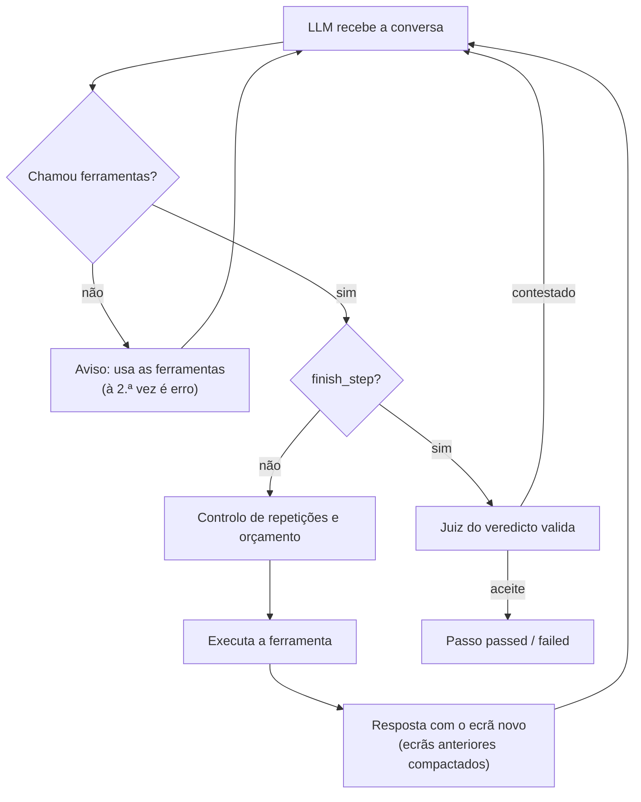

# Como funciona o agente

Este documento explica como o QAgent executa um passo de teste escrito em linguagem natural: o que o LLM recebe, que ferramentas pode usar, como é decidido se o passo passou e que limites existem. Para a visão geral do sistema, ver [ARQUITETURA.md](ARQUITETURA.md).

## 1. Onde entra o LLM

Quase tudo no QAgent é determinístico, incluindo a sessão Appium, a ordem dos passos, as evidências, a limpeza e o script gerado. O LLM só entra em dois sítios:

| Onde | Quando | Chamadas |
|---|---|---|
| Normalizador (`normalizer.py`) | O caso de teste chega em texto livre | 1 por execução |
| Executor LLM (`ai_executor.py` + `agent/`) | Cada passo do tipo `ai` | Várias por passo (uma por decisão) |

Passos estruturados (`tap`, `type`, `assert_text`…) e passos `manual` não usam o LLM.

## 2. Do caso de teste aos passos

O caso pode chegar em três formatos:

- **Texto livre** (`testExecution`). O normalizador pede ao LLM uma lista de passos Gherkin, com saída estruturada (máximo 15 passos). As regras estão no prompt `n2`:
  - um passo por objetivo ou mudança de ecrã, não por micro-ação;
  - cada resultado esperado vira um passo THEN;
  - nunca inventar valores esperados;
  - escrever os placeholders de `testData` tal como estão.
- **Gherkin** (`scenario`). É convertido diretamente, sem LLM.
- **Passos estruturados** (`steps`). Correm tal como vêm; só os do tipo `ai` passam pelo agente.

Cada passo leva o tipo no texto, por exemplo `[WHEN] Inicia sessão com o utilizador de teste`. `AND` e `BUT` herdam o tipo do passo anterior. O tipo importa porque as regras do veredicto são diferentes para ações (WHEN) e verificações (THEN).

## 3. O ciclo de um passo

Para cada passo `ai`, o executor (`AiStepExecutor.run_instruction`) monta uma conversa nova com o LLM:

1. **Mensagem de sistema:** o prompt do executor (`e3` por omissão), com o idioma pedido para os relatórios.
2. **Mensagem do passo:**
   - os passos anteriores do teste, um por linha, com o estado e o motivo;
   - o passo atual;
   - os placeholders de `testData` disponíveis;
   - a descrição do ecrã atual.

A partir daí o ciclo repete:



O histórico da conversa recomeça em cada passo. Do passo anterior só passa o resumo de uma linha na lista "passos anteriores".

## 4. O que o LLM vê

O LLM não recebe o XML do ecrã nem screenshots por omissão. Recebe uma descrição em texto construída por `screen.py`, com uma linha por elemento. Exemplo:

```
Screen 1080x2400, app package(s): com.exemplo.app
- e1 TextView "Iniciar sessão" @top-center
- e2 EditText "Utilizador" id=username [editable, clickable] @middle-center
- e3 EditText "Palavra-passe" id=password [editable, password, clickable] @middle-center
- e4 ImageButton (no label) id=show_password [clickable] @middle-right
- e5 Button "Entrar" id=login_btn [clickable] @bottom-center
```

Cada linha tem:

| Campo | Exemplo | Significado |
|---|---|---|
| ref | `e5` | Identificador do elemento neste ecrã; muda a cada leitura |
| classe | `Button` | Classe Android, sem o pacote |
| texto | `"Entrar"` | Texto visível (cortado a 60 caracteres) |
| `desc=` | `desc="Fechar"` | Descrição de acessibilidade, se for diferente do texto |
| `(no label)` | — | Controlo só com ícone, sem texto nem descrição |
| `id=` | `id=login_btn` | Nome do resource-id, útil como pista nos ícones sem rótulo |
| flags | `[editable, password]` | Estado: editável, clicável, marcado, selecionado, desativado… |
| região | `@bottom-center` | Zona do ecrã (terço vertical e horizontal) |

Regras do modelo do ecrã:

- **Elementos incluídos:** todos os elementos interativos, incluindo ícones sem rótulo. Os textos estáticos também entram.
- **Limite:** no máximo 70 elementos. Se houver mais, a descrição diz quantos ficaram de fora e o LLM pode usar `get_screen` com um filtro.
- **Contentores sem rótulo** (por exemplo, um item de lista) herdam o texto dos filhos.
- **Avisos no topo da descrição:**
  - um diálogo de erro do Android à frente ("a app não responde" / "a app parou");
  - uma sobreposição do sistema;
  - um ecrã vazio, caso em que se sugere `look_at_screen`.

**O LLM nunca escreve locators.** Refere os elementos pela `ref`, e o QAgent converte-a no locator mais estável que existir, por esta ordem:

1. accessibility id;
2. id (resource-id único);
3. texto, via UiAutomator;
4. resource-id + índice (frágil);
5. coordenadas (frágil).

Textos com dígitos (contadores, preços, horas) e textos de campos editáveis são considerados instáveis.

**Imagens** só quando o LLM chama `look_at_screen`. O screenshot (máximo de 400 px de largura) vai na mensagem seguinte. Serve para interfaces desenhadas que não aparecem na descrição, como canvas, gráficos ou conteúdo web embutido.

## 5. Ferramentas

O LLM tem 20 ferramentas (`agent/tools.py`). Depois de cada ação que muda o ecrã, a resposta da ferramenta traz o ecrã novo. O QAgent relê o ecrã até estabilizar, durante no máximo ~2,5 s.

| Ferramenta | Para quê |
|---|---|
| `tap`, `long_press` | Tocar ou manter premido um elemento (por ref) |
| `type_text` | Substituir o texto de um campo; `submit=true` carrega em Enter |
| `read_text` | Ler o texto e o estado atual de um elemento |
| `scroll`, `swipe` | Deslizar o ecrã ou um contentor |
| `scroll_to_text` | Deslizar até aparecer um texto ou descrição |
| `press_key` | Teclas: back, home, enter, delete, tab, search, escape, space, esconder teclado |
| `wait` | Esperar um tempo fixo |
| `wait_for_text` | Esperar até um texto aparecer ou desaparecer; serve para verificar |
| `look_at_screen` | Pedir um screenshot |
| `tap_point`, `long_press_point` | Tocar numa posição do screenshot (só para o que não está na descrição) |
| `drag` | Arrastar entre elementos ou posições (reordenar, sliders, desenhar) |
| `list_apps` | Listar as apps instaladas, filtrando pelo nome do package |
| `open_app` | Abrir ou voltar a uma app |
| `close_apps` | Fechar apps e voltar ao ecrã inicial |
| `get_screen` | Descrever o ecrã outra vez, opcionalmente filtrado |
| `request_human` | Pedir ao QA que faça algo no dispositivo |
| `finish_step` | Terminar o passo com o veredicto |

Comportamentos que vale a pena conhecer:

- **Elemento tapado:** se o centro de um elemento estiver tapado por outro (por exemplo, um botão flutuante por cima de uma lista), o toque é feito num ponto livre do próprio elemento.
- **Fim do conteúdo:** se um `scroll` não mudar nada, a ferramenta responde que se chegou ao fim. Assim o modelo não fica a deslizar sem fim.
- **Pontos no screenshot:** são convertidos para coordenadas reais do ecrã. Se o ponto cair dentro de um controlo que já está na descrição, a ferramenta recusa e manda usar a ref.
- **Erros das ferramentas:** voltam ao LLM como texto ("ERROR…" ou "FAILED…") com o ecrã atual, e o ciclo continua. Não fazem falhar o passo.

## 6. Veredicto

O passo termina quando o LLM chama `finish_step` com:

- `status`: `passed` ou `failed`;
- `reason`;
- nos THEN, `assertion`: a verificação feita pela máquina;
- nos WHEN, `how`: como a ação foi feita.

O veredicto não é aceite às cegas. O `VerdictJudge` (`agent/verdict.py`) aplica regras no código:

**Passos THEN (verificação)**

- Um `passed` tem de trazer uma `assertion`, de um destes tipos:
  - `visible` / `absent`: um elemento ou texto está ou não está no ecrã;
  - `text_equals` / `text_contains`: o texto de um elemento;
  - `count`: o número de elementos iguais.
- A asserção é verificada outra vez num ecrã acabado de ler. Se não se confirmar, o veredicto é recusado.
- Num `failed` sem asserção, o juiz pede uma vez a asserção do que era esperado.
- Se essa asserção afinal se verificar no ecrã, o veredicto contradiz o ecrã e é contestado uma vez.
- A asserção fica registada e passa a ser um `assert` no script gerado.

**Passos WHEN (ação)**

| `how` | Aceite quando |
|---|---|
| `performed` | Pelo menos uma ação do passo correu bem |
| `done_by_tester` | O QA fez a ação neste passo, depois de um `request_human` |
| `already_done_by_step` | Um passo anterior deste teste, que passou, fez exatamente isto |
| `already_true_before_test` | O resultado já existia antes do teste. É contestado uma vez; se o LLM insistir, o passo termina em erro de ambiente |

- **Falhar um WHEN cujas ações correram todas bem** é contestado uma vez. Um WHEN avalia só se a ação foi possível; o resultado é verificado pelo THEN seguinte.

**Passos sem tipo:** só passam se o agente tiver feito ou observado alguma coisa.

Cada contestação acontece no máximo uma vez. Se o LLM insistir, o veredicto é aceite. Isto evita ciclos sem fim e ainda assim apanha os erros mais comuns do modelo.

## 7. Limites e proteções

| Proteção | Como funciona |
|---|---|
| Orçamento de ações | `maxActionsPerStep` (omissão 8). `get_screen`, `read_text`, `look_at_screen`, `list_apps` e `request_human` não contam. Esgotado o orçamento, o LLM só pode chamar `finish_step` e deve falhar com o que observou |
| Limite de iterações | `maxActionsPerStep + 8` chamadas ao LLM por passo; acima disso o passo termina em erro |
| Repetições | A mesma chamada com os mesmos argumentos é recusada à terceira vez. `wait`, `scroll`, `swipe` e `drag` podem repetir-se |
| Sem ferramentas | Se o LLM responder sem chamar ferramentas, recebe um aviso; à segunda vez é erro |
| Timeout do passo | `timeoutPerStepSec`, com mínimo de 180 s nos passos `ai` |
| Custo em tokens | Os ecrãs antigos da conversa são trocados por um marcador (só o mais recente interessa, porque as refs mudam). A saída de cada ferramenta é cortada a 6 000 caracteres |
| Mudança de app inesperada | Se a app à frente mudar sem o agente pedir (alarme, chamada, outra app), a ferramenta avisa que a ação pode não ter tido efeito |
| Diálogo de erro do Android | Detetado depois de cada passo; o passo fica em erro com categoria `app` |

## 8. Várias apps no mesmo teste

O agente não conhece as apps de antemão. Quando um passo fala de uma app pelo nome:

1. O LLM chama `list_apps` com uma palavra do nome. Só aparecem apps com ícone no launcher, para não listar centenas de packages internos.
2. Abre a app com `open_app`. Se o nome do package não tiver nada a ver com o nome no passo, a ferramenta avisa, mas não recusa.
3. Se nenhum package corresponder, pode ir ao ecrã inicial (`press_key home`) e procurar a app pelo nome visível.

**Arranque das apps:** na primeira abertura dentro de um teste, a app é sempre fechada e arrancada de novo, porque muitas apps reabrem no último ecrã e isso tornaria o teste imprevisível. Nas aberturas seguintes ("volta à app X"), mantém o estado.

**Registo para o script:** as mudanças de app ficam registadas, para que o script gerado saiba que app deve estar à frente em cada momento.

## 9. Intervenção do QA

Há passos que o agente não deve fazer sozinho: autenticação com credenciais que não estão nos dados de teste, códigos, biometria, ou passos que dizem explicitamente que o QA atua manualmente. Nesses casos:

1. O LLM chama `request_human` com uma instrução curta, ou o passo é do tipo `manual`.
2. A execução fica em `waiting_for_user` e a interface mostra a instrução.
3. O QA faz a ação no dispositivo e carrega em Continuar (`POST …/resume`).
4. O passo é repetido a partir do ecrã atual, com uma nota a dizer o que o QA fez. O agente pode então declarar `how=done_by_tester`.

As credenciais nunca passam pelo QAgent nem pelo LLM.

**Limites:**

- **Intervenções por passo:** até 3.
- **Tempo de espera:** se o QA não responder em `humanTimeoutSec` (omissão 600 s), o passo termina em erro de ambiente.

## 10. Dados de teste e segredos

- **O que o LLM vê:** só placeholders, como `{{testData.utilizador}}`. Para valores normais, vê também o valor. Para segredos, vê só "(secret, value hidden)".
- **Substituição:** o valor real é posto pelo QAgent no momento de escrever no campo.
- **Registo:** guarda o texto como template, nunca o valor de um segredo.
- **Segredos:** declaram-se com `{{secret:nome}}` e o valor vem da variável de ambiente `QAGENT_SECRET_NOME`. São mascarados nos logs, nos motivos, no XML de evidência e no script gerado.

## 11. Resultado de cada passo

| Campo | Conteúdo |
|---|---|
| `status` | `passed`, `failed` (a app não fez o esperado), `error` (não se conseguiu concluir) ou `skipped` |
| `reason` | Motivo escrito pelo LLM, no idioma pedido; em falhas, inclui os textos visíveis no ecrã |
| `outcome` | Força da evidência (ver abaixo) |
| `actions` | Cada ação feita, com locator e resultado; é a base do script gerado |
| `locators` | Locators usados, marcados como frágeis quando é o caso |
| `evidence` | Screenshot e, em passos não passados, o XML do ecrã |
| `tokens` | Tokens de entrada e saída gastos no passo |

O `outcome` indica quanto se pode confiar no veredicto:

| Valor | Quando |
|---|---|
| `verified` | Houve uma verificação feita pela máquina num ecrã relido: asserção confirmada, `wait_for_text`, ou um passo `assert_*` |
| `executed` | A ação foi feita, mas o resultado não foi verificado neste passo (fica para o THEN seguinte) |
| `inconclusive` | O veredicto assenta só no juízo do LLM, ou o passo terminou em erro |

## 12. Do registo ao script gerado

O script Python + Appium (`GET …/script`) é gerado sem LLM, a partir das ações que correram bem:

- **Locators:** cada ação é traduzida com o mesmo locator que funcionou na execução.
- **Asserções:** as asserções aceites pelo juiz viram `assert`.
- **Toques por coordenadas:** o script confirma primeiro que o mesmo elemento está naquele ponto. Se não estiver, falha em vez de tocar às cegas.
- **Interrupções:** as recuperações que o agente fez (por exemplo, voltar à app depois de um alarme) não são copiadas. O script tem a sua própria função para garantir que a app certa está à frente.

## 13. Prompts

Os prompts estão em `prompts.py`, com versões:

| Versão | Uso |
|---|---|
| `e3` | Executor, por omissão. Só conceitos de interface Android, sem vocabulário de nenhum tipo de app |
| `e1`, `e2` | Versões anteriores do executor, mantidas para comparação e para repetir execuções antigas |
| `n2` | Normalizador, por omissão. Acrescenta a regra de nunca inventar valores esperados |
| `n1` | Versão anterior do normalizador |

- **Escolher a versão:** cada pedido pode escolher a versão do executor com `options.promptVersion`.
- **Registo:** o resultado guarda as versões usadas em `promptVersions`.
- **Teste de agnosticismo:** `tests/test_prompts_app_agnostic.py` falha se um prompt, uma descrição de ferramenta ou uma mensagem enviada ao LLM tiver nomes das apps usadas no desenvolvimento ou vocabulário de domínio. O agente tem de servir qualquer app.

## 14. Onde está o código

| Ficheiro | Conteúdo |
|---|---|
| `ai_executor.py` | Ciclo ReAct de um passo |
| `agent/tools.py` | As 20 ferramentas |
| `agent/schemas.py` | Argumentos das ferramentas e do veredicto (as descrições vão para o LLM) |
| `agent/verdict.py` | Regras do veredicto e asserções |
| `agent/device.py` | Ecrã atual, refs, gestos e teclas |
| `agent/navigation.py` | Apps instaladas, abrir e fechar apps |
| `agent/recording.py` | Registo de ações e locators; máscara de segredos |
| `agent/transcript.py` | Mensagens para o LLM e compactação de ecrãs |
| `agent/state.py` | Contadores e contestações do passo |
| `screen.py` | Modelo do ecrã, locators e asserções |
| `normalizer.py` | Texto livre e Gherkin → passos |
| `prompts.py` | Prompts versionadas |
