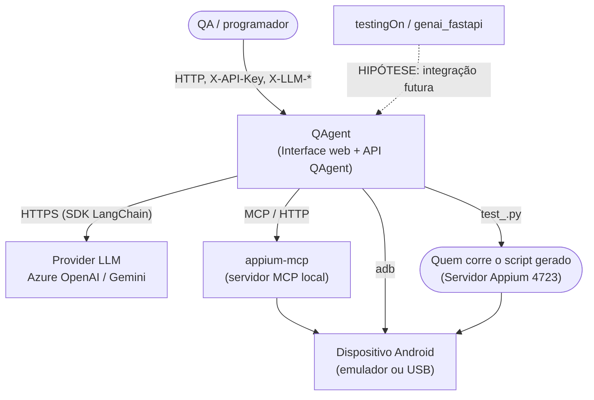
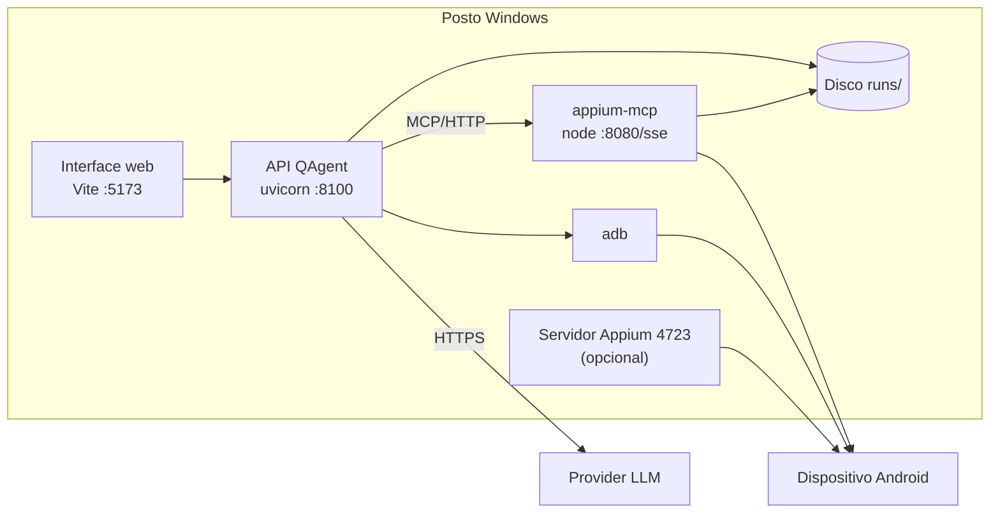
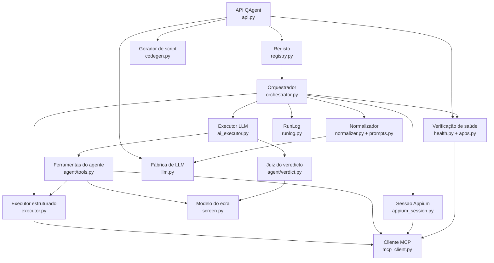
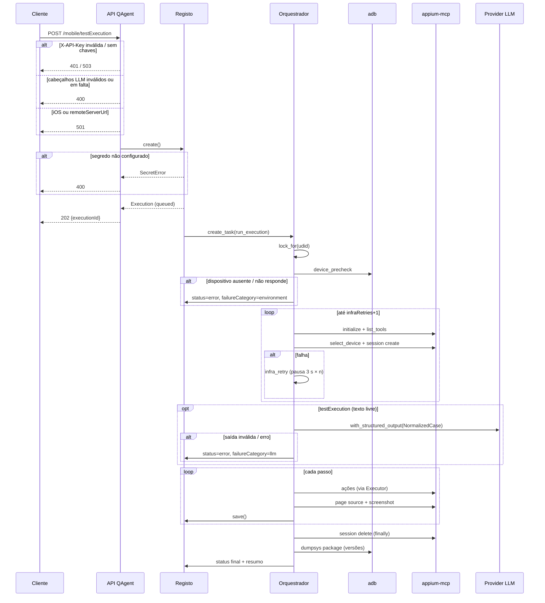
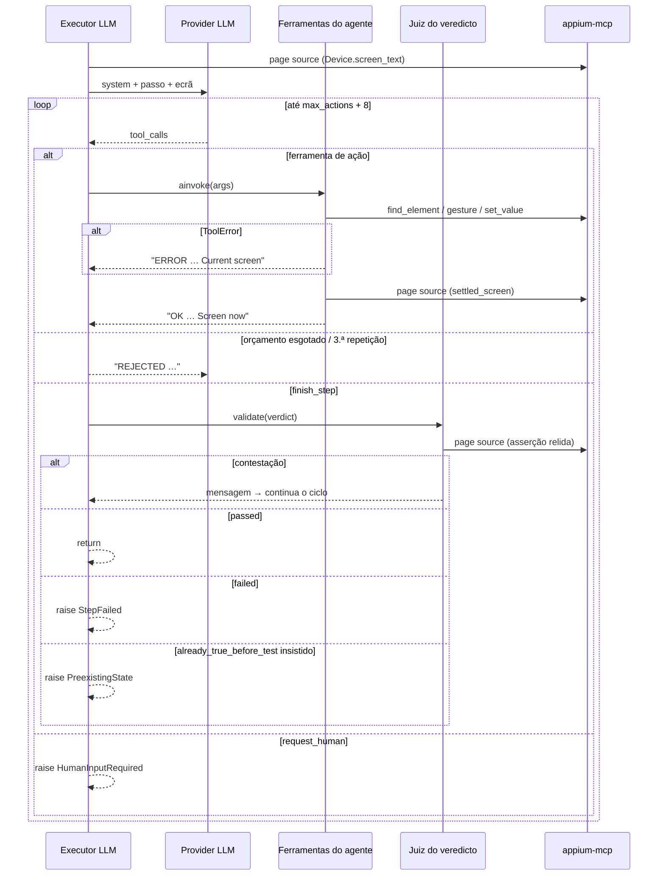
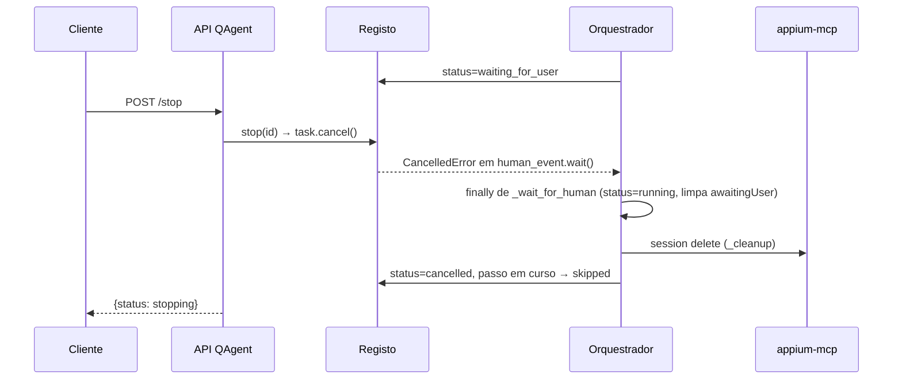
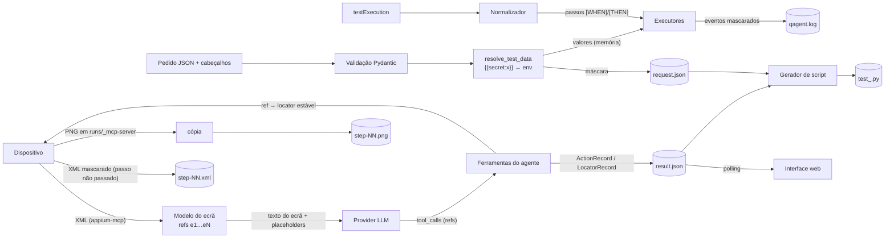
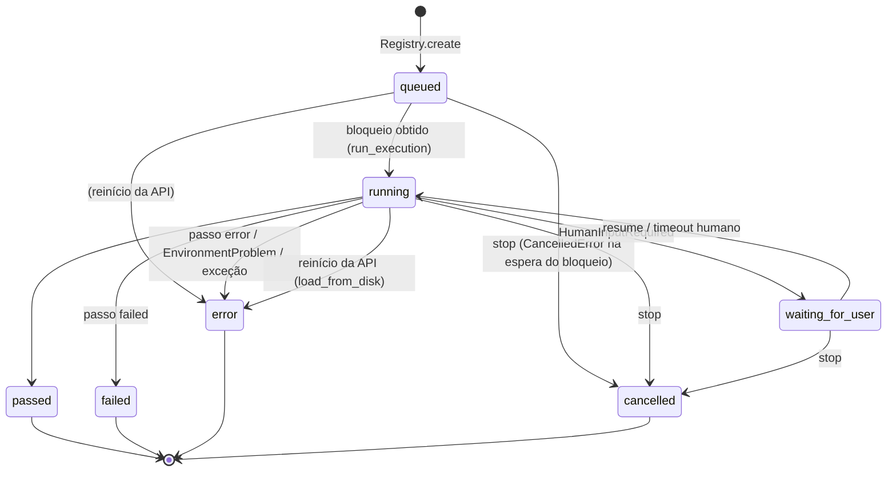

# QAgent — Arquitetura reconstruída a partir do código

> Engenharia reversa da arquitetura do repositório `QAgent` (ramo `main`, commit `676078b`, 2026-11-13), feita a 2026-11-16.
> Descreve o sistema tal como existe. Não é uma auditoria e não propõe correções.
> As linhas citadas referem-se a esse commit.

**Etiquetas de evidência**

| Etiqueta | Significado |
|---|---|
| **CONFIRMADO** | Evidência direta (ficheiro e função/linha indicados) |
| **⚠ INFERIDO** | Dedução a partir de evidência indireta (a origem é indicada) |
| **DESCONHECIDO** | O artefacto existe, mas não há evidência do seu papel |
| **HIPÓTESE** | Direção futura ou intenção dos autores |

**Nomes canónicos** (usados em todas as vistas):
- Elementos internos: **Interface web**, **API QAgent**, **Registo**, **Orquestrador**, **Normalizador**, **Executor estruturado**, **Executor LLM**, **Ferramentas do agente**, **Juiz do veredicto**, **Modelo do ecrã**, **Cliente MCP**, **Sessão Appium**, **Verificação de saúde**, **Fábrica de LLM**, **Gerador de script**, **RunLog**, **Disco `runs/`**.
- Elementos externos: **appium-mcp**, **Dispositivo Android**, **adb**, **Provider LLM**, **Servidor Appium 4723**.

---

## 1. Resumo executivo

O QAgent é um serviço local em Python que executa sozinho casos de teste em **apps Android nativas**. O caso pode vir em linguagem natural, em Gherkin ou como passos estruturados.

Funciona assim:
- Um **Orquestrador** determinístico prepara o dispositivo e a sessão Appium e percorre os passos.
- Em cada passo em linguagem natural, um **Provider LLM** (Azure OpenAI ou Gemini, escolhido por cabeçalhos HTTP em cada pedido) decide as ações. Usa ferramentas próprias que falam com o **appium-mcp** (servidor MCP, Node) por HTTP.

O resultado de cada execução tem três partes:
- um relatório JSON por passo, com evidências (screenshots e XML) em disco;
- um log com segredos mascarados;
- a pedido, um script Python + Appium gerado sem LLM.

Os utilizadores são QA e programadores, através de uma **Interface web** React ou de pedidos HTTP diretos. O sistema é um protótipo para avaliar o appium-mcp antes de uma integração no testingOn / genai_fastapi.
- **⚠ INFERIDO**, com base em `docs/CPS-QAgent.md` §1 e §3.6 e em comentários do código que citam o "CPS".
- **CONFIRMADO** que nenhuma integração com o testingOn existe no código: não há qualquer chamada a esses sistemas em `src/`.

## 2. Âmbito e método

**Analisado:**
- `src/qagent/` (todos os módulos);
- `frontend/src/`, `scripts/`, `tests/`, `config/`, `examples/`;
- `pyproject.toml`, `frontend/package.json`, `tools/appium-mcp/package.json`;
- `.env.example`, `.mcp.json`, `.claude/settings.json`, `.gitignore`, `README.md` e `docs/*.md`.

**Ignorado:**
- `.venv/`, `node_modules/`, `frontend/dist/`, `__pycache__/` e `.git/`;
- o conteúdo de `runs/`: 135 pastas de execução geradas, fora do Git (`.gitignore`);
- `apps/*.apk`, binários fora do Git.

**Método:**
1. Inventário.
2. Leitura de cada ponto de entrada até às folhas.
3. Grafo de importações gerado por script, que não encontrou ciclos.
4. Pesquisa de usos de cada símbolo suspeito de estar inativo.
5. Execução da suite de testes: 95 passam.

**Documentação como afirmação a verificar:** o README e `docs/` foram comparados com o código. As contradições estão registadas nas secções A.16 e A.18.

## 3. Stack tecnológica

| Tecnologia | Versão | Onde é usada | Evidência |
|---|---|---|---|
| Python | `>=3.11,<3.12` | Todo o backend | `pyproject.toml` `requires-python` — CONFIRMADO |
| FastAPI + Uvicorn | `>=0.115,<0.116` / `>=0.30` | API QAgent | `pyproject.toml`; `api.py:30 create_app()` — CONFIRMADO |
| Pydantic / pydantic-settings | `>=2.11,<3` / `>=2.6,<3` | Contrato (`models.py`), configuração (`config.py`) | `pyproject.toml` — CONFIRMADO |
| LangGraph | `>=0.5,<0.6` | Grafo de passos | `orchestrator.py:386 build_graph()` — CONFIRMADO |
| langchain-core | `0.3.46` | Mensagens, ferramentas, modelos | `ai_executor.py`, `agent/tools.py` — CONFIRMADO |
| langchain-openai | `0.3.1` | `AzureChatOpenAI` | `llm.py:56 build_llm()` — CONFIRMADO |
| langchain-google-genai | `2.1.0` | `ChatGoogleGenerativeAI` | `llm.py:56` — CONFIRMADO |
| langchain-mcp-adapters | `0.1.14` | `load_mcp_tools` em `McpConnection.langchain_tools()` | `mcp_client.py:155`; só chamado por `scripts/f1_lifecycle.py` — CONFIRMADO |
| mcp (SDK Python) | `>=1.30,<2` | Cliente MCP (HTTP *streamable* e stdio) | `mcp_client.py:80` — CONFIRMADO |
| python-dotenv | `>=1.0` | Carrega `.env` | `config.py:14` — CONFIRMADO |
| appium-mcp (Node) | `^1.99.3` no `package.json`; `1.99.3` esperado | Servidor MCP externo | `tools/appium-mcp/package.json`; `config.py appium_mcp_version`; `health.py` `versionMatches` — CONFIRMADO |
| Appium 3 + UiAutomator2 | dentro do appium-mcp | Automação Android; servidor 4723 para os scripts | `scripts/start-appium-server.ps1` — CONFIRMADO |
| React / MUI / Vite / TypeScript | 19.3.1 / 9.5.0 / 8.3.8 / 7.0.2 | Interface web | `frontend/package.json` — CONFIRMADO |
| pytest, httpx, Appium-Python-Client | dev | Testes; scripts gerados | `pyproject.toml [dependency-groups]` — CONFIRMADO |
| uv | — | Gestão do ambiente Python | `uv.lock`; README — CONFIRMADO |
| hatchling | — | *Build backend* declarado | `pyproject.toml [build-system]`; nenhum script o usa — CONFIRMADO; finalidade DESCONHECIDO |

Não há evidências de bases de dados, filas, Docker, cloud nem CI.

## 4. Estrutura do repositório

```
QAgent/
├── src/qagent/                 backend (pacote Python)
│   ├── api.py                  API QAgent (FastAPI) — ponto de entrada HTTP
│   ├── registry.py             Registo de execuções (memória + disco), bloqueios por dispositivo
│   ├── orchestrator.py         Orquestrador: preparação, grafo LangGraph, evidências, limpeza
│   ├── normalizer.py           Normalizador: texto livre (LLM) / Gherkin → passos
│   ├── prompts.py              prompts versionadas (e1, e2, e3, n1, n2)
│   ├── executor.py             Executor estruturado (sem LLM)
│   ├── ai_executor.py          Executor LLM: ciclo ReAct de um passo
│   ├── agent/                  partes do Executor LLM
│   │   ├── tools.py            Ferramentas do agente (20, LangChain StructuredTool)
│   │   ├── verdict.py          Juiz do veredicto
│   │   ├── device.py           vista do dispositivo (ecrã atual, refs, gestos)
│   │   ├── navigation.py       apps instaladas, abrir/fechar apps
│   │   ├── recording.py        registo de ações/locators, máscara de segredos
│   │   ├── transcript.py       mensagens para o LLM, compactação de ecrãs
│   │   ├── schemas.py          argumentos das ferramentas e do veredicto
│   │   ├── state.py, errors.py estado por passo; exceções
│   ├── screen.py               Modelo do ecrã (XML → elementos com ref e locator)
│   ├── mcp_client.py           Cliente MCP (uma ligação por execução)
│   ├── appium_session.py       Sessão Appium (create/delete/screenshot/page source)
│   ├── health.py, apps.py      Verificação de saúde; adb; catálogo de apps
│   ├── codegen.py              Gerador de script Python + Appium
│   ├── llm.py                  Fábrica de LLM
│   ├── models.py               contrato de entrada/saída (Pydantic)
│   ├── runlog.py               RunLog (JSON lines com máscara)
│   └── config.py               Settings (QAGENT_*, .env)
├── frontend/                   Interface web (React + MUI + Vite)
├── config/capabilities.json    capabilities Appium base (partilhadas com o appium-mcp)
├── scripts/                    arranque (.ps1) e utilitários de fase (f1, f2, f5, run_case)
├── tests/                      pytest (9 ficheiros, 95 testes) + XML de ecrãs
├── examples/                   pedidos JSON (regressão) e examples/blind/ (às cegas)
├── tools/appium-mcp/           instalação local do appium-mcp (npm)
├── docs/                       CPS, registos de fase, docs2/
├── apps/                       APK de exemplo (fora do Git)
├── runs/                       execuções geradas (fora do Git)
├── .mcp.json, .claude/         configuração de um cliente MCP (Claude Code)
└── pyproject.toml, uv.lock, .env.example, README.md
```

## 5. Pontos de entrada e arranque

| Ponto de entrada | Como arranca | Evidência |
|---|---|---|
| API QAgent | `python -m uvicorn qagent.api:app --host 127.0.0.1 --port 8100`. `app = create_app()` é criado na importação | `api.py:189`; README — CONFIRMADO |
| appium-mcp | `scripts/start-appium-mcp.ps1` → `node …/appium-mcp/dist/index.js --httpStream --port=8080`, com `FASTMCP_HOST=127.0.0.1` | script — CONFIRMADO |
| Interface web | `npx vite` em `frontend/` (127.0.0.1:5173, `strictPort`) | `frontend/vite.config.ts` — CONFIRMADO |
| Servidor Appium 4723 | `scripts/start-appium-server.ps1` (só para os scripts gerados) | script — CONFIRMADO |
| Utilitários | `scripts/run_case.py`, `f5_batch.py` (clientes HTTP da API), `f1_lifecycle.py`, `f2_step.py` (usam módulos internos diretamente) | docstrings — CONFIRMADO |
| Testes | `python -m pytest -q` (`pythonpath = ["src"]`) | `pyproject.toml` — CONFIRMADO |

**Sequência de arranque da API** (`api.py:36 lifespan`), CONFIRMADO:
1. Cria `runs_dir`.
2. `Registry.prune_old_runs()`.
3. `Registry.load_from_disk()`.
4. Avisa se `QAGENT_API_KEYS` estiver vazio.
5. No fim: `Registry.shutdown()`.

**Configuração:**
- `config.py:14` chama `load_dotenv(PROJECT_ROOT / ".env")` na importação; `Settings` lê as variáveis `QAGENT_*` (CONFIRMADO).
- `get_settings()` cria uma instância nova em cada chamada, sem *cache*. A API cria-a uma vez em `create_app()` (CONFIRMADO).

| Variável | Omissão (`config.py`) |
|---|---|
| `QAGENT_RUNS_DIR` | `<raiz>/runs` |
| `QAGENT_RUNS_RETENTION_DAYS` | `0` |
| `QAGENT_CAPABILITIES_CONFIG` | `<raiz>/config/capabilities.json` |
| `QAGENT_APPIUM_MCP_VERSION` | `1.99.3` |
| `QAGENT_MCP_TRANSPORT` | `http` (`stdio` alternativo) |
| `QAGENT_MCP_HTTP_URL` | `http://127.0.0.1:8080/sse` |
| `QAGENT_APPIUM_MCP_ENTRY`, `QAGENT_ANDROID_HOME`, `QAGENT_JAVA_HOME` | caminhos locais (só stdio) |
| `QAGENT_API_KEYS` | `""` |
| `QAGENT_CORS_ORIGINS` | localhost/127.0.0.1:5173, localhost:3000 |
| `QAGENT_IOS_REMOTE_SERVER_URL` | `None` |
| `QAGENT_SECRET_<NOME>` | — (lido diretamente de `os.environ`, `orchestrator.py:72`) |

Variáveis do processo appium-mcp, definidas em `start-appium-mcp.ps1` (modo HTTP) ou em `mcp_client.py:108 _stdio_params()` (modo stdio): `NO_UI`, `APPIUM_MCP_ON_CLIENT_DISCONNECT=delete_all`, `APPIUM_MCP_EVIDENCE`, `ALLOW_REMOTE_APP_URLS=false`, `AI_VISION_ENABLED=false`, `CAPABILITIES_CONFIG`, `SCREENSHOTS_DIR` e `PAGE_SOURCES_DIR` (CONFIRMADO).

A Interface web usa `VITE_QAGENT_API_URL` e `VITE_QAGENT_API_KEY` (`frontend/src/api.ts:4-5`; `frontend/.env.example`) — CONFIRMADO.

## 6. Interfaces expostas

### 6.1 HTTP (API QAgent, `api.py`)

| Método | Caminho | Auth | Entrada | Saída | Erros |
|---|---|---|---|---|---|
| GET | `/health` | Não | — | `{status, checks{node, adb, appiumMcp}, cached}` | 503 se `degraded` |
| GET | `/mobile/devices` | `X-API-Key` | — | `{devices[]}` (adb `state=device` + entrada iOS se `ios_remote_server_url`) | 401/503 |
| POST | `/mobile/testExecution` | `X-API-Key` | `TestExecutionInput`; cabeçalhos `X-Provider`, `X-LLM-Model`, `X-LLM-API-Key`, `X-LLM-Endpoint`, `X-LLM-APIVersion`; query `wait`, `waitTimeoutSec` | 202 `ExecutionCreated` + `X-Execution-Id`; com `wait=true` e execução terminada → 200 `ExecutionResult` | 400 (validação, LLM em falta, segredo em falta), 501 (iOS / `remoteServerUrl`) |
| GET | `/mobile/testExecution` | `X-API-Key` | — | `ExecutionListItem[]` (mais recentes primeiro) | — |
| GET | `/mobile/testExecution/{id}` | `X-API-Key` | — | `ExecutionResult` | 404 |
| POST | `/mobile/testExecution/{id}/stop` | `X-API-Key` | — | `{id, status:"stopping"}` | 404, 409 (já terminou) |
| POST | `/mobile/testExecution/{id}/resume` | `X-API-Key` | — | `{id, status:"resuming"}` | 404, 409 (não está à espera) |
| GET | `/mobile/testExecution/{id}/script` | `X-API-Key` | — | `text/x-python` (`test_<id>.py`) | 404, 409 (não terminou / cancelada / sem passos), 500 (contém segredo / erro de sintaxe) |
| GET | `/mobile/testExecution/{id}/artifacts/{name}` | `X-API-Key` | — | ficheiro | 404 |

- Erros de validação → 400 `{"detail": [{loc, msg}]}` (`api.py:56 _validation`) — CONFIRMADO.
- Rotas automáticas do FastAPI (`/docs`, `/openapi.json`) ficam ativas por omissão e sem autenticação. **⚠ INFERIDO**: `FastAPI()` é criado sem `docs_url=None` (`api.py:48`).

### 6.2 Outras interfaces

- **Scripts gerados**: executáveis isolados (`python test_<id>.py`) que usam `APPIUM_SERVER`, `DEVICE_UDID`, `QAGENT_SECRET_*` e `TESTDATA_*` (`codegen.py:287`) — CONFIRMADO.
- Não há CLI própria, eventos nem webhooks.

## 7. Integrações externas

| Integração | Protocolo | Onde | Evidência |
|---|---|---|---|
| **appium-mcp** | MCP sobre HTTP *streamable* (`/sse`) ou stdio (processo filho `node`) | `McpConnection.__aenter__` | `mcp_client.py:80` — CONFIRMADO |
| Ferramentas appium-mcp chamadas | `select_device`, `appium_session_management`, `appium_get_page_source`, `appium_screenshot`, `appium_find_element`, `appium_gesture`, `appium_set_value`, `appium_get_text`, `appium_mobile_keyboard`, `appium_mobile_press_key`, `appium_app_lifecycle`, `appium_drag_and_drop` | `appium_session.py`, `agent/device.py`, `agent/tools.py`, `agent/navigation.py`, `executor.py`, `orchestrator.py` | CONFIRMADO |
| **Provider LLM** | HTTPS via SDK LangChain (Azure OpenAI, Gemini); `temperature=0` exceto modelos de raciocínio; `max_retries=4` | `llm.py:56 build_llm()`, `is_reasoning_model()` | CONFIRMADO |
| **adb** | Subprocesso (`adb devices -l`, `getprop`, `dumpsys package`, `cmd package query-activities/resolve-activity`) | `health.py`, `apps.py` | CONFIRMADO |
| **Dispositivo Android** | Indireto, via appium-mcp (UiAutomator2) e adb | — | CONFIRMADO |
| `node` | `node --version` na Verificação de saúde | `health.py:115` | CONFIRMADO |
| **Servidor Appium 4723** | Usado só pelos scripts gerados, fora do QAgent | `codegen.py` (`webdriver.Remote`) | CONFIRMADO |
| Sistema de ficheiros | `runs/<id>/`; cópia de screenshots da pasta do appium-mcp | `orchestrator.py:510 _evidence()` | CONFIRMADO |

O QAgent **interpreta texto livre** devolvido pelo appium-mcp com expressões regulares:
- `with ID:` para o id da sessão;
- `saved successfully to:` para o caminho do screenshot;
- `elementId '…'` para o id do elemento;
- o XML extraído entre o primeiro `<` e o último `>`.

Evidência: `appium_session.py:16-17,75`; `agent/device.py:16`; `executor.py:18` — CONFIRMADO. O acoplamento ao formato das mensagens da versão 1.99.3 é **⚠ INFERIDO** desses padrões.

## 8. Segurança

| Aspeto | Situação | Evidência |
|---|---|---|
| Autenticação | `X-API-Key` com `secrets.compare_digest`; sem chaves configuradas → 503 em todas as rotas protegidas | `api.py:61 require_key()` — CONFIRMADO |
| Autorização | Não há: qualquer chave válida acede a todas as execuções | — CONFIRMADO (ausência) |
| Rotas públicas | `/health` (por desenho) e `/docs`, `/openapi.json` (omissão do FastAPI) | `api.py:76`; ⚠ INFERIDO para as do FastAPI |
| Chave LLM | Só por cabeçalho; acrescentada ao conjunto a mascarar; `LlmParams.describe()` exclui-a | `registry.py:72-74`; `llm.py:33` — CONFIRMADO |
| Segredos de `testData` | `{{secret:x}}` → `QAGENT_SECRET_X`; chaves com `pass/secret/token/pwd/pin` também mascaradas | `orchestrator.py:72 resolve_test_data()`, `:33` — CONFIRMADO |
| Máscara | `RunLog.mask()` (valores com ≥ 3 caracteres, do mais longo para o mais curto); XML de evidência e motivos mascarados; `request.json` com `***` | `runlog.py:19`; `orchestrator.py:525-530,559` — CONFIRMADO |
| Segredos face ao LLM | O LLM vê `{{testData.k}}` e, para chaves secretas, "(secret, value hidden)" | `agent/transcript.py:12` — CONFIRMADO |
| Script gerado | Recusado se contiver um segredo conhecido da execução | `api.py:167` — CONFIRMADO |
| Artefactos | Só nomes da lista da execução, sem `/`, `\` ou `..`, resolvidos dentro de `run_dir` | `registry.py:133 artifact_path()` — CONFIRMADO |
| CORS | Origens de `QAGENT_CORS_ORIGINS`; métodos GET/POST; todos os cabeçalhos | `api.py:51` — CONFIRMADO |
| TLS | Não há (HTTP simples em 127.0.0.1) | README, scripts — CONFIRMADO |
| Exposição de rede | appium-mcp em `FASTMCP_HOST=127.0.0.1`; Appium 4723 em `--address 127.0.0.1`; Vite em 127.0.0.1. A porta de bind da API depende da linha de comandos | scripts `.ps1`; `vite.config.ts` — CONFIRMADO |
| Chave da API no browser | `VITE_QAGENT_API_KEY` é embutida no código do browser | `frontend/src/api.ts:5` — CONFIRMADO |
| Configuração do LLM no browser | Guardada em `localStorage` (`qagent.genaiServer`) **sem** a chave | `App.tsx:43-56` — CONFIRMADO |
| appium-mcp | Sem autenticação própria (documentado) | `start-appium-mcp.ps1` cabeçalho — CONFIRMADO |

## 9. Tratamento de erros e observabilidade

**Classificação de erros** (CONFIRMADO):
- `classify_exception()` (`orchestrator.py:59`) devolve `environment`, `llm` ou `appium_mcp`.
- `execute_step` (`:409`) mapeia:
  - `StepFailed` → `failed`/`app`;
  - `TimeoutError` → `error`/`environment`;
  - `ToolError` → classificado;
  - `PreexistingState`/`HumanTimeout` → `environment`;
  - outras exceções → `llm` (passo `ai`) ou classificado.
- Exceções genéricas sem pista caem em `environment` (`:68`).

**Proteção da evidência:** erros ao recolher screenshot ou XML só são registados (`evidence_error`) e não mudam o resultado do passo (`orchestrator.py:533,542`) — CONFIRMADO.

**Novas tentativas** (CONFIRMADO):
- Só na ligação MCP + criação da sessão, até `infraRetries` vezes, com pausa de 3 s × tentativa (`orchestrator.py:291`).
- Os SDK LLM fazem `max_retries=4` (`llm.py`).
- Os passos nunca são repetidos.

**Logging** (CONFIRMADO):
- `RunLog` grava `runs/<id>/qagent.log` em JSON lines (`runlog.py:30`).
- Eventos principais: `execution_started`, `mcp_connected`, `appium_session_created`, `app_reset`, `llm_configured`, `normalized`, `step_finished`, `waiting_for_user`, `user_resumed`, `infra_retry`, `appium_session_deleted`, `execution_finished`, `execution_error`.
- O logger Python `qagent` só regista mensagens do arranque.
- `mcp.client.streamable_http` está silenciado até ERROR (`api.py:26`).

**Métricas:**
- `ExecutionResult.metrics` (chamadas LLM, tokens, chamadas de ferramentas, novas tentativas) e `steps[].tokens/durationMs` — CONFIRMADO.
- Não há exportação de métricas: não existe Prometheus nem OpenTelemetry no código.

**Health check** (`health.py:98 HealthChecker`, *cache* 30 s):

| Verifica | Não verifica |
|---|---|
| `node --version` devolve 0 (sem exigir versão mínima) | Versão mínima do Node |
| `adb` existe no PATH (`health.py:132`) | **Que haja algum dispositivo:** com zero dispositivos, `adb.ok` continua `true` (CONFIRMADO) |
| Ligação MCP + `list_tools`; ferramentas de `LLM_TOOL_ALLOWLIST ∪ {select_device, appium_session_management, appium_get_page_source}` presentes | `appium_mobile_press_key`, usado em `agent/device.py:119`, não está no conjunto verificado (CONFIRMADO) |
| Versão do servidor = `appium_mcp_version` | Acesso ao Provider LLM |
| — | Dispositivo desbloqueado ou que responde (só feito por execução em `device_precheck`) |
| — | Escrita em `runs_dir`; `capabilities.json` legível |
| — | Que a criação de uma sessão Appium funciona |

## 10. Fluxos de negócio

1. **Executar um caso de teste.** O cliente envia o caso e a app, e recebe um `executionId`.
   - Em segundo plano, o Orquestrador espera pelo dispositivo, verifica-o, liga-se ao appium-mcp e cria a sessão Appium.
   - Limpa as apps pedidas e normaliza o texto (se for texto livre).
   - Executa cada passo, com o Executor estruturado ou com o Executor LLM, e recolhe evidências.
   - No fim, apaga a sessão e calcula o estado final e o resumo.
   - O cliente acompanha por *polling* (CONFIRMADO, `registry.py:70`, `orchestrator.py:174`).
2. **Intervenção do QA.** Um passo `manual`, ou a ferramenta `request_human`, põe a execução em `waiting_for_user`. O QA atua no dispositivo e chama `/resume`, e o passo é repetido a partir do ecrã atual (CONFIRMADO, `orchestrator.py:483`).
3. **Cancelar.** `/stop` cancela a tarefa asyncio. A limpeza apaga a sessão Appium e os passos pendentes ficam `skipped` (CONFIRMADO, `registry.py:110`, `orchestrator.py:233-234,241`).
4. **Gerar o script.** Para uma execução terminada, o Gerador de script traduz as ações registadas e o pedido num script Python + Appium (CONFIRMADO, `api.py:156`, `codegen.py:287`).
5. **Consultar o estado e os dispositivos.** Listagem, detalhe, artefactos, `/mobile/devices`, `/health`.

## 11. Mapa de código

| Módulo | Responsabilidade | Depende de (internos) |
|---|---|---|
| `api.py` | Rotas, auth, validação | codegen, config, health, llm, models, orchestrator, registry |
| `registry.py` | Registo | config, llm, models, normalizer, orchestrator |
| `orchestrator.py` | Orquestrador | ai_executor, appium_session, apps, config, executor, health, llm, mcp_client, models, normalizer, prompts, runlog, screen |
| `normalizer.py` | Normalizador | models, prompts |
| `executor.py` | Executor estruturado | mcp_client, models |
| `ai_executor.py` | Executor LLM | agent.*, appium_session, executor, mcp_client, models, prompts |
| `agent/tools.py` | Ferramentas do agente | agent.(schemas, device, errors, navigation, recording, state), executor, mcp_client, models, screen |
| `agent/verdict.py` | Juiz do veredicto | agent.(device, errors, schemas, state), models, screen |
| `agent/device.py` | Vista do dispositivo | agent.errors, appium_session, mcp_client, screen |
| `agent/navigation.py` | Navegação entre apps | agent.errors, apps, mcp_client |
| `agent/recording.py` | Registo de ações | models, screen |
| `agent/transcript.py`, `schemas.py`, `state.py`, `errors.py` | Mensagens, schemas, estado, exceções | — |
| `screen.py` | Modelo do ecrã | models |
| `mcp_client.py` | Cliente MCP | config |
| `appium_session.py` | Sessão Appium | mcp_client |
| `health.py` | Verificação de saúde, adb | config, mcp_client |
| `apps.py` | Catálogo de apps / launcher | mcp_client |
| `codegen.py` | Gerador de script | models |
| `llm.py`, `prompts.py`, `models.py`, `config.py`, `runlog.py` | Folhas | — (exceto `prompts` ← normalizer/ai_executor) |

**Ciclos:** não há ciclos de importação (CONFIRMADO por análise de `from qagent…` em todos os módulos).

Dependências notáveis entre camadas (CONFIRMADO):
- `agent/tools.py` importa `render` e `StepFailed` de `executor.py`: o Executor LLM reutiliza o Executor estruturado.
- `orchestrator.py` importa funções de `health.py` (`device_precheck`, `first_ready_device`, `device_props`, `app_versions`).
- `api.py` importa `SecretError` de `orchestrator.py`.

## 12. Concorrência e estado

**Modelo:** um único processo Uvicorn com o *event loop* asyncio. Cada execução é uma `asyncio.Task` (`registry.py:91`). Não há threads próprias; o adb corre em subprocessos assíncronos (`health.py:16`) — CONFIRMADO.

**Estado em memória:**

| Estado | Onde | Perde-se ao reiniciar? |
|---|---|---|
| `Registry.items` (id → `Execution`) | `registry.py` | Recarregado de `result.json`; execuções não terminadas passam a `error` (`registry.py:52`) — CONFIRMADO |
| `Execution.task`, `human_event`, `llm`, `llm_params`, `ai_exec`, `secrets`, `test_data` | `orchestrator.py:116` | Sim; execuções recarregadas têm `request=None` e `secrets` vazio — CONFIRMADO |
| `Registry.device_locks` (udid → `asyncio.Lock`) | `registry.py:94` | Sim — CONFIRMADO |
| *Cache* de `/health` (30 s) | `HealthChecker._cache` | Sim — CONFIRMADO |
| Por execução: último ecrã (`Device.screen/xml`), apps instaladas e abertas (`AppNavigator`) | `agent/device.py`, `agent/navigation.py` | Vivem só durante a execução — CONFIRMADO |
| Por passo: `StepState` | `agent/state.py` | Recriado em cada passo — CONFIRMADO |
| Sessões Appium | Globais no appium-mcp (todas as chamadas passam `sessionId`) | Fora do processo — CONFIRMADO (`appium_session.py` docstring) |

**Acesso concorrente:**
- Execuções no mesmo `udid` são serializadas pelo bloqueio por dispositivo (CONFIRMADO).
- Execuções em dispositivos diferentes correm em paralelo, cada uma com a sua ligação MCP ao mesmo servidor appium-mcp. O comportamento do appium-mcp com várias ligações em simultâneo é **DESCONHECIDO**: não há testes nem registos que o mostrem.

## 13. Dados e persistência

| Dado | Onde | Formato | Ciclo de vida | Evidência |
|---|---|---|---|---|
| Pedido | `runs/<id>/request.json` | JSON camelCase; segredos → referência ou `***` | Escrito uma vez na criação | `registry.py:70`; `orchestrator.py:559` — CONFIRMADO |
| Resultado | `runs/<id>/result.json` | `ExecutionResult` JSON; escrita atómica (`.tmp` → `replace`) | Reescrito a cada mudança de progresso/passo | `orchestrator.py:152 save()` — CONFIRMADO |
| Log | `runs/<id>/qagent.log` | JSON lines | *Append* | `runlog.py` — CONFIRMADO |
| Screenshots | `runs/<id>/step-NN.png` (cópia do ficheiro gravado pelo appium-mcp) | PNG, largura máx. 400 | Por passo, conforme `options.screenshots` | `orchestrator.py:535-541`; `appium_session.py:68` — CONFIRMADO |
| Page source | `runs/<id>/step-NN.xml` | XML mascarado | Só em passos não passados | `orchestrator.py:526-532` — CONFIRMADO |
| Script | `runs/<id>/test_<id>.py` | Python | Criado (ou reescrito) em cada `GET …/script` | `api.py:156` — CONFIRMADO |
| Pasta do appium-mcp | `runs/_mcp-server/{screenshots,pagesources}` | PNG/XML | Nunca limpa pelo QAgent | `start-appium-mcp.ps1` — CONFIRMADO; ausência de limpeza ⚠ INFERIDO (não há código que lhe toque) |
| Configuração do LLM (sem chave) | `localStorage` do browser | JSON | Até o utilizador limpar | `App.tsx:43` — CONFIRMADO |

**Limpeza:**
- Com `runs_retention_days > 0`, no arranque, apaga as pastas com nome de 12 hex e `result.json` terminado há mais de N dias. Não toca nas pastas das fases (`f0`, `f5`…), que não têm nomes de 12 hex (`registry.py:30`) — CONFIRMADO.
- Por omissão, nada é apagado.

## 14. Testes e qualidade

- **pytest:** 9 ficheiros e 95 testes. Todos passam (execução de 2026-11-16, ≈ 12 s). Não precisam de dispositivo nem de LLM: usam `FakeConn` e `ScriptedChatModel` (CONFIRMADO, `tests/`, `llm.py:82`).
- **Cobertura temática:**
  - API (auth, validação, segredos, artefactos, script);
  - Orquestrador (limpeza, stop, novas tentativas, bloqueios, `outcome`, classificação, retenção);
  - ciclo do Executor LLM (23 testes de regras do veredicto);
  - asserções, ecrãs genéricos, normalizador, humano no circuito, Gerador de script.
- **Teste de agnosticismo:** `test_prompts_app_agnostic.py` proíbe termos das apps de teste e vocabulário de domínio nas prompts, nas descrições de ferramentas e nas mensagens (CONFIRMADO).
- **Testes ponta a ponta:** manuais, via `scripts/run_case.py`, `scripts/f5_batch.py` e `examples/`. Os resultados estão nos registos de fase em `docs/` (CONFIRMADO).
- **Não aplicável** — não foram encontradas evidências de linting, *type checking* do backend, medição de cobertura ou CI. O frontend tem `npm run typecheck` (`tsc -b`) em `package.json`.
- Não há testes automáticos do frontend nem do transporte stdio (CONFIRMADO, ausência em `tests/`).

## 15. Limitações conhecidas e lacunas de conhecimento

**Limitações implementadas no código** (CONFIRMADO):
- Só Android local: iOS e `remoteServerUrl` → 501 (`api.py:110`).
- Máximo de 15 passos por normalização (`normalizer.py MAX_STEPS`) e 70 elementos por ecrã (`screen.py:31`).
- Máximo de 3 intervenções humanas por passo (`orchestrator.py:440`).

**DESCONHECIDOS relevantes:**
1. Comportamento do appium-mcp com várias ligações MCP simultâneas (execuções paralelas em dispositivos diferentes).
2. Se o transporte **stdio** ainda funciona com o código atual: não há testes; o modo por omissão é HTTP desde a F0.
3. Estabilidade do formato textual das respostas do appium-mcp fora da versão 1.99.3; o `package.json` aceita `^1.99.3`.
4. Papel de `hatchling` / `[tool.hatch.build]`: não há empacotamento nem distribuição evidentes.
5. Papel de `docs/image.png`, `image-1.png` e `image-2.png`: não são referidas em nenhum `.md` analisado.
6. Papel de `.mcp.json` e `.claude/settings.json`. **⚠ INFERIDO**: configuram o Claude Code como cliente MCP do appium-mcp na exploração da F0 (`docs/F0-registo.md`).
7. `apps/mda-2.3.0-27.apk`. **⚠ INFERIDO**: é a APK da Sauce Labs My Demo App (nome do ficheiro + `.gitignore` "APKs de terceiros"). Nenhum código a referencia.
8. Consumidor final e contrato de integração com o testingOn: só existe em documentação (HIPÓTESE).

---

# Anexo A — Vistas de arquitetura

## A.1 Contexto (C4 nível 1)



- O testingOn / genai_fastapi só aparece na documentação: HIPÓTESE.
- Tudo o resto é CONFIRMADO (secções 5 e 7).

## A.2 Containers (C4 nível 2)

| Container | Tecnologia | Processo | Comunica com | Protocolo |
|---|---|---|---|---|
| **Interface web** | React/Vite | Servidor de desenvolvimento Vite (127.0.0.1:5173) + browser | API QAgent | HTTP JSON, *polling* 1,5 s (`App.tsx:19`) |
| **API QAgent** (inclui Registo, Orquestrador, Executores) | Python/FastAPI | `uvicorn` (127.0.0.1:8100) | appium-mcp, Provider LLM, adb, Disco `runs/` | MCP/HTTP; HTTPS; subprocesso; ficheiros |
| **appium-mcp** | Node, appium-mcp 1.99.3 + UiAutomator2 embebido | `node … --httpStream --port=8080` (ou filho stdio) | Dispositivo Android | UiAutomator2 / adb |
| **adb** | Android SDK | Subprocessos curtos | Dispositivo Android | adb |
| **Disco `runs/`** | Sistema de ficheiros | — | API QAgent, appium-mcp (`runs/_mcp-server`) | Ficheiros |
| **Servidor Appium 4723** | Appium 3 (de `tools/appium-mcp`) | `appium.cmd --port 4723` | Dispositivo Android | WebDriver |

Não aplicável — não foram encontradas evidências de bases de dados, filas, *caches* externas ou serviços cloud. O armazenamento é feito apenas em ficheiros locais.



## A.3 Componentes (C4 nível 3) — dentro da API QAgent



## A.4 Detalhe de componentes

| Componente | Responsabilidade | Depende de | É usado por | Estado | Evidência |
|---|---|---|---|---|---|
| API QAgent | Rotas, auth, validação, modo síncrono, script | Registo, Verificação de saúde, Fábrica de LLM, Gerador de script | Interface web, scripts | `app.state.registry/settings` | `api.py:30` |
| Registo | Criar, listar, parar e retomar execuções; bloqueios; recarregar; retenção | Orquestrador, Normalizador | API QAgent | `items`, `device_locks` | `registry.py` |
| Orquestrador | `run_execution`, preparação, grafo, evidências, limpeza, resumo | Cliente MCP, Sessão Appium, Executores, Normalizador, Verificação de saúde, RunLog | Registo | `Execution` (resultado, tarefa, evento humano) | `orchestrator.py:116,174,386` |
| Normalizador | Texto livre → `NormalizedCase` (1 chamada LLM); Gherkin → passos `ai` | Fábrica de LLM (modelo recebido), prompts | Orquestrador, Registo | Nenhum | `normalizer.py:42,55` |
| Executor estruturado | `tap/type/scroll_to/assert_*/back/wait` sem LLM; `render()` de `{{testData.x}}` | Cliente MCP | Orquestrador, Ferramentas do agente | Nenhum | `executor.py:42,100` |
| Executor LLM | Ciclo ReAct de um passo: orçamento, repetições, compactação, imagem | Ferramentas do agente, Juiz do veredicto, `Device`, `AppNavigator` | Orquestrador | Por execução: `Device`, `AppNavigator`, contadores de tokens | `ai_executor.py:41,64` |
| Ferramentas do agente | 20 ferramentas; ref → locator; deteção de mudança de app | `Device`, `AppNavigator`, `Secrets`, Executor estruturado | Executor LLM | `StepState` | `agent/tools.py:45,366` |
| Juiz do veredicto | Regras WHEN/THEN, asserções relidas, contestações únicas | `Device`, Modelo do ecrã | Executor LLM | `StepState` (flags de contestação) | `agent/verdict.py:49,69` |
| Modelo do ecrã | XML → `Screen`/`UiElement` com ref, estado, região e melhor locator; `verify_assertion`, `node_at`, `free_point` | `models.Locator` | `Device`, Juiz do veredicto, Gerador de script (`free_point`) | Nenhum | `screen.py:156,266` |
| Cliente MCP | Uma `ClientSession` por execução; registo de chamadas; `ToolError` | SDK `mcp` | Orquestrador, Sessão Appium, Executores, Verificação de saúde | `calls`, `tool_names` | `mcp_client.py:61` |
| Sessão Appium | `select_device` + `create`; `delete`; screenshot; page source | Cliente MCP | Orquestrador, `Device` | `session_id`, `udid` | `appium_session.py:22` |
| Verificação de saúde | `/health`; adb (dispositivos, pré-verificação, props, versões); launcher; apps | Cliente MCP, adb | API QAgent, Orquestrador, `AppNavigator` | *Cache* 30 s | `health.py`, `apps.py` |
| Fábrica de LLM | Cabeçalhos → `LlmParams` → modelo LangChain | SDKs LangChain | API QAgent, Orquestrador | Nenhum | `llm.py:38,56` |
| Gerador de script | `result.json` + `request.json` → Python + Appium | `models` | API QAgent | Nenhum | `codegen.py:287` |
| RunLog | JSON lines com máscara | — | Orquestrador, API QAgent (via `ex.log`) | Lista de segredos | `runlog.py:13` |
| Interface web | Formulário, *polling*, stop/resume, resultados, script | API QAgent | QA | Estado React; `localStorage` | `frontend/src/App.tsx`, `api.ts` |

## A.5 Runtime

| Recurso | Criado | Libertado | Evidência |
|---|---|---|---|
| Processo Uvicorn + *event loop* | Arranque manual | Fim do processo; `lifespan` cancela as tarefas | `api.py:36`; `registry.py:117` |
| `asyncio.Task` por execução | `Registry.create()` | Fim de `run_execution` ou `cancel()` | `registry.py:91,110` |
| `asyncio.Lock` por dispositivo | 1.º uso de `lock_for(udid)` | Nunca (dicionário cresce por udid) | `registry.py:94` |
| Ligação MCP (`McpConnection`) | `_connect_with_retries` (1 por execução); `HealthChecker._check` (1 por verificação sem *cache*) | `AsyncExitStack.aclose()` no fim do bloco `async with stack` | `orchestrator.py:291,200`; `health.py:119` |
| Sessão Appium | `AppiumSession.create_android()` | `_cleanup()` → `delete` (timeout 30 s). O appium-mcp também apaga as sessões quando o cliente desliga (`delete_all`) | `orchestrator.py:546` |
| `asyncio.Event` humano | `_wait_for_human()` | No `finally` desse método | `orchestrator.py:483-504` |
| Subprocessos adb/node | `_run()`, `_adb_launchable()`, `home_package()` | `communicate()` ou `kill()` em timeout | `health.py:16`; `apps.py` |
| Processo appium-mcp (stdio) | `stdio_client` na ligação | Fecho da ligação | `mcp_client.py:91,108` |

**Ordem dentro de uma execução** (`orchestrator.py:174-288`):
1. Espera pelo bloqueio do dispositivo.
2. `device_precheck`, depois `device_props` e `home_package`.
3. `build_android_caps`.
4. Ligação MCP + Sessão Appium, com novas tentativas.
5. `resetApps` (`clear`) e `activate` da app do pedido.
6. Construção do Executor estruturado e, se houver LLM, do Executor LLM.
7. `graph.ainvoke`.
8. `finally`: `_cleanup`, contagem de chamadas, `_record_app_versions`.
9. Estado final, `outcomes`, resumo e `save()`.

## A.6 Fluxos de negócio (passo a passo)

**F1 — Executar um caso** (CONFIRMADO):
1. `POST /mobile/testExecution`: `params_from_headers`; exigência de LLM; 501 para iOS.
2. `Registry.create`: `resolve_test_data` (`SecretError` → 400); `uuid4().hex[:12]`; `request.json`; `result.json` inicial; `mode` = `llm` ou `structured`; tarefa.
3. `run_execution`: `queued` → `running` depois de obter o bloqueio.
4. Preparação (A.5, pontos 2–6).
5. Grafo:
   - `normalize`: só com texto livre.
   - `execute_step` × N, com `stopOnFailure` → `skipped`.
   - Em cada passo: executor, `_evidence`, `step_outcome`, `save()`.
6. Estado final `error` > `failed` > `passed`; `failureCategory` do 1.º passo mau; `_summary()`.

**F2 — Passo LLM** (`ai_executor.py:64`), CONFIRMADO:
1. Mensagem com a prompt `e3`, o histórico, os *placeholders* e o ecrã.
2. Ciclo até `max_actions + 8` iterações:
   - sem chamadas de ferramentas → 1 aviso; à 2.ª vez, erro;
   - `finish_step` → Juiz do veredicto (aceita, contesta ou levanta `StepFailed`/`PreexistingState`);
   - outra ferramenta → controlo de repetições e do orçamento → execução → compactação dos ecrãs antigos;
   - imagem pendente → mensagem multimodal.
3. Tokens do passo registados no `finally`.

**F3 — Intervenção humana** (CONFIRMADO):
1. `HumanInputRequired` → `_wait_for_human`: `waiting_for_user`; espera pelo `Event` até `humanTimeoutSec`.
2. `/resume` → `Registry.resume` → `event.set()`.
3. O passo é repetido com uma nota; o registo `human_input` é acrescentado.

**F4 — Stop**: `/stop` → 409 se terminal → `task.cancel()` → `CancelledError` → `_cleanup` → `cancelled`; o passo em curso fica `skipped` (CONFIRMADO).

**F5 — Script**: `/script` → 409/404 → `generate_python_script(result, load_request(run_dir))` → verificação de segredos → `compile()` → grava → `FileResponse` (CONFIRMADO).

## A.7 Diagramas de sequência

### A.7.1 Criação e execução (com caminhos de erro)



### A.7.2 Passo LLM e veredicto



### A.7.3 Stop durante uma pausa humana



## A.8 Modelo de dados

**Entrada** (`models.py`, CONFIRMADO):

| Classe | Campos relevantes |
|---|---|
| `TestExecutionInput` (`:112`) | `testExecution` \| `scenario` \| `steps` (pelo menos um); `platform` (`android`/`ios`); `app`; `device`; `testData: dict[str,str]`; `options` |
| `GherkinScenario` / `GherkinStep` | `name`; `scenario[{type: GIVEN…BUT, description}]` |
| `StructuredStep` | `name`, `action` (`tap`, `type`, `scroll_to`, `assert_visible`, `assert_text`, `back`, `wait`, `ai`, `manual`), `locator`, `text`, `contains`, `timeoutSec` (≤ 120); validação por ação |
| `Locator` | `strategy` (`accessibility id`, `id`, `-android uiautomator`, `-ios predicate string`, `-ios class chain`, `xpath`), `value` |
| `AppSpec` | `android{appPackage, appActivity, app}`, `ios{bundleId, app}` |
| `DeviceSpec` | `udid`, `type` (`EMULATOR`/`REAL`), `remoteServerUrl` |
| `Options` (`:85`) | `stopOnFailure`, `screenshots`, `maxActionsPerStep` (1–50), `timeoutPerStepSec` (≤ 600), `recordVideo`, `resetApps` (≤ 20, regex de package), `humanTimeoutSec` (30–3600), `reportLanguage`, `promptVersion` (`e1`/`e2`/`e3`), `infraRetries` (0–3) |

**Saída:**

| Classe | Campos relevantes |
|---|---|
| `ExecutionResult` (`:217`) | `executionId`, `recordId`, `status`, `platform`, `mode` (`structured`/`llm`), `device`, `failureCategory`, `promptVersions`, `appVersions`, `outcomes`, `createdAt/startedAt/finishedAt`, `durationMs`, `summary`, `progress`, `steps`, `metrics`, `artifacts` |
| `StepResult` (`:178`) | `id`, `name`, `status`, `reason`, `actions`, `locators`, `evidence`, `durationMs`, `tokens`, `failureCategory`, `outcome` |
| `ActionRecord` | `tool`, `strategy`, `selector`, `result`, `value` (template / leitura mascarada), `target: ElementSignature` (ações por coordenadas) |
| `LocatorRecord` | `strategy`, `value`, `element`, `fragile` |
| `DeviceInfo` | `udid`, `platformVersion`, `model`, `homePackage`, `mode` (`embedded`/`remote`) |
| `Progress` | `currentStep`, `totalSteps`, `message`, `awaitingUser`, `awaitingSince` |
| `Metrics` | `llmCalls`, `tokensIn`, `tokensOut`, `toolCalls`, `infraRetries` |

**Internos:**
- `NormalizedCase/NormalizedStep` (`normalizer.py`).
- `FinishArgs`, `Assertion` e os argumentos das ferramentas (`agent/schemas.py`).
- `Screen/UiElement` (`screen.py`), `StepState` (`agent/state.py`), `LlmParams` (`llm.py`), `ToolCall` (`mcp_client.py`).

**Convenções:** camelCase via `alias_generator=to_camel`; `populate_by_name=True` (`models.py _Camel`) — CONFIRMADO.

## A.9 Fluxo de dados



Transformações relevantes (CONFIRMADO):
- Texto escrito → guardado como *template* (`{{testData.x}}`) em `ActionRecord.value`, nunca o valor de um segredo (`models.py ActionRecord` comentário; `agent/recording.py`).
- Textos com dígitos ou de campos editáveis → marcados como frágeis e excluídos das assinaturas (`agent/recording.py:_stable`).
- Ecrãs antigos na conversa → substituídos por um marcador (`agent/transcript.py:compact_old_screens`).

## A.10 Arquitetura de eventos

**Não aplicável** — não foram encontradas evidências de filas, pub/sub, webhooks, *server-sent events* nem WebSockets do lado do QAgent.

O que existe em vez disso (CONFIRMADO):
- *polling* HTTP pela Interface web (`POLL_MS = 1500`, `App.tsx:19`);
- um `asyncio.Event` interno para retomar depois da intervenção humana (`orchestrator.py:486`);
- eventos de log JSON lines (só registo, sem consumidores).

O endpoint `/sse` pertence ao appium-mcp: é o transporte MCP, não um bus de eventos do QAgent.

## A.11 Estados e ciclo de vida

**Execução** (`models.py ExecutionStatus`; transições em `orchestrator.py`, `registry.py`), CONFIRMADO:



**Passo:** `pending` → `running` → `passed` | `failed` | `error`; `skipped` em três casos (CONFIRMADO, `orchestrator.py:412-413,263-272`):
- `stopOnFailure` depois de um passo não passado;
- stop: um passo `running` passa a `skipped`;
- passos `pending` no fim.

Noutra interrupção, um passo `running` fica `error`. O `outcome` de todo o passo não `skipped` e sem valor passa a `inconclusive` (`:273-275`).

**Sessão Appium:** criada → (`delete`) → removida. Se o `delete` falhar, o fecho da ligação MCP aciona `delete_all` (comentário em `orchestrator.py:546`; configuração em `start-appium-mcp.ps1`) — CONFIRMADO.

## A.12 Concorrência

| Ponto | Situação | Evidência |
|---|---|---|
| Mesmo dispositivo | Serializado por `asyncio.Lock` por `udid`; sem `udid` usa o 1.º dispositivo pronto | `orchestrator.py:184-185`; `registry.py:94` — CONFIRMADO |
| Escolha do dispositivo vs. bloqueio | `first_ready_device()` é lido **antes** de obter o bloqueio. Se nenhum estiver pronto, o bloqueio é `""` e a pré-verificação falha | `orchestrator.py:184` — CONFIRMADO |
| Dispositivos diferentes | Execuções paralelas no mesmo appium-mcp, com ligações MCP separadas | ⚠ INFERIDO (nada impede); comportamento do appium-mcp DESCONHECIDO |
| `result.json` | Escrito só pela tarefa da execução (atómico); lido pela API a partir da memória, não do disco | `orchestrator.py:152`; `api.py get_execution` — CONFIRMADO |
| Cancelamento | `task.cancel()`; `_cleanup` apanha `BaseException`; `wait=true` usa `asyncio.shield` para não cancelar a tarefa no timeout do pedido | `orchestrator.py:555`; `api.py:119` — CONFIRMADO |
| Stop com tarefa terminada | `stop_execution` ignora o valor devolvido por `Registry.stop()` e responde `stopping` | `api.py:140-146` — CONFIRMADO |
| Timeouts | Passo: `timeoutPerStepSec` (mín. 180 s em `ai`); humano: `humanTimeoutSec`; criação da sessão: 240 s; delete: 30 s; versões: 30 s; adb: 5–15 s; LLM: 90 s (Gemini) / 120 s (Azure) | `orchestrator.py:423,494,553,376`; `appium_session.py:47`; `llm.py` — CONFIRMADO |
| *Cache* de `/health` | `asyncio.Lock` serializa as verificações | `health.py:102-111` — CONFIRMADO |
| Encerramento | `shutdown()` cancela e espera todas as tarefas | `registry.py:117` — CONFIRMADO |

## A.13 Deployment

**Construção e instalação** (CONFIRMADO, README):
- `uv sync` (backend);
- `npm install` em `tools/appium-mcp` (appium-mcp local, nada global);
- `npm install` em `frontend`.

**Execução:** processos manuais em janelas separadas: appium-mcp, `python -m uvicorn`, `npx vite` e, opcionalmente, o Servidor Appium 4723 (secção 5).

**Empacotamento:**
- `pyproject.toml` declara `hatchling` e `packages = ["src/qagent"]`, mas não há scripts de *build* nem de publicação (DESCONHECIDO).
- O frontend tem `npm run build` (`vite build`), mas nenhum componente serve `frontend/dist` (CONFIRMADO, ausência na API).

### Infrastructure

Não aplicável — não foram encontradas evidências de Docker, IaC (Terraform/Bicep/ARM), Kubernetes, servidores ou cloud.

O que existe: um posto Windows local com caminhos fixos.
- `C:\Android\Sdk` e `C:\Android\JDK` em `config.py` e nos scripts `.ps1`.
- Dispositivo Android ligado por adb.
- Portas em 127.0.0.1 (8080, 8100, 5173, 4723).

### CI/CD

Não aplicável — não foram encontradas evidências de pipelines (`.github/`, Azure Pipelines, GitLab CI, Jenkins).

O que existe:
- testes locais (`python -m pytest -q`);
- scripts de medição manual (`scripts/f5_batch.py`, `scripts/run_case.py`);
- histórico Git com 4 commits, todos de 2026-11-13.

## A.14 Call Graph dos fluxos críticos

```
POST /mobile/testExecution (api.py:93 post_execution)
├── require_key() → 503 sem chaves / 401 chave inválida
├── validação Pydantic TestExecutionInput → 400 (_validation)
├── params_from_headers() (llm.py:38) → LlmConfigError → 400
├── needs_llm sem llm_params → 400
├── platform≠android ou device.remoteServerUrl → 501
├── Registry.create() (registry.py:70)
│   ├── resolve_test_data() (orchestrator.py:72) → SecretError → 400 (antes de criar a pasta)
│   ├── run_dir.mkdir(parents=True)  [sem exist_ok]
│   ├── from_gherkin() (normalizer.py:42) — passos conhecidos à partida
│   ├── request_for_disk() → request.json (mascarado)
│   ├── Execution.save() → result.json
│   └── asyncio.create_task(run_execution(...)) (orchestrator.py:174)
│       ├── first_ready_device() (health.py) → adb devices
│       ├── async with lock_for(udid or "")
│       │   ├── device_precheck() → EnvironmentProblem → error/environment
│       │   ├── device_props(), home_package() (apps.py) → adb
│       │   ├── build_android_caps() (orchestrator.py:90) ← config/capabilities.json
│       │   ├── _connect_with_retries() (orchestrator.py:291)
│       │   │   ├── McpConnection.__aenter__ (mcp_client.py:80) → appium-mcp initialize + list_tools
│       │   │   └── AppiumSession.create_android() (appium_session.py:31)
│       │   │       ├── select_device → JSON inválido → ToolError
│       │   │       └── appium_session_management create (timeout 240 s) → regex "with ID:"
│       │   ├── appium_app_lifecycle clear (resetApps) / activate
│       │   ├── build_llm() (llm.py:56) + AiStepExecutor() (se llm_params)
│       │   ├── build_graph().ainvoke() (orchestrator.py:386)
│       │   │   ├── normalize → from_free_text() (normalizer.py:55) → Provider LLM → NormalizerError
│       │   │   └── execute_step × N
│       │   │       ├── StructuredExecutor.run() (executor.py:100) → appium-mcp
│       │   │       ├── AiStepExecutor.run_instruction() (ai_executor.py:64)
│       │   │       │   ├── Provider LLM (bind_tools)
│       │   │       │   ├── StepTools.* (agent/tools.py) → Device → appium-mcp
│       │   │       │   └── VerdictJudge.validate() (agent/verdict.py:69)
│       │   │       ├── HumanInputRequired → _wait_for_human() (≤3 rondas)
│       │   │       ├── _evidence() → page source, has_error_dialog, step-NN.xml/png
│       │   │       └── step_outcome(), RunLog.write("step_finished"), save()
│       │   └── finally: _cleanup() → session delete; _record_app_versions() → adb dumpsys
│       ├── except CancelledError → cancelled
│       ├── except EnvironmentProblem / Exception → error + classify_exception()
│       └── finally: métricas, skipped/inconclusive, _summary(), save()
├── wait=true → asyncio.wait_for(shield(task), waitTimeoutSec)
│   └── terminal → 200 ExecutionResult; senão → 202 ExecutionCreated
└── 202 ExecutionCreated + X-Execution-Id

GET /mobile/testExecution/{id}/script (api.py:156)
├── get_ex() → 404
├── estado não terminal → 409; cancelled ou sem passos → 409
├── load_request(run_dir) (codegen.py:729) → FileNotFoundError → 404
├── generate_python_script(result, request) (codegen.py:287)
├── segredo em ex.secrets presente no código → 500
├── compile() → SyntaxError → 500
└── grava test_<id>.py, add_artifact, save() → FileResponse

POST /mobile/testExecution/{id}/stop (api.py:140)
├── get_ex() → 404; estado terminal → 409
└── Registry.stop() → task.cancel()  [valor devolvido ignorado] → {status: stopping}

GET /health (api.py:77)
└── HealthChecker.get() (cache 30 s, lock)
    └── _check(): node --version; adb no PATH; adb devices; McpConnection → tools, versão
        └── status ≠ ok → 503

Arranque (api.py:36 lifespan)
├── runs_dir.mkdir
├── Registry.prune_old_runs() (só se retention_days > 0)
├── Registry.load_from_disk() → não terminais → error ("reinício")
└── finally: Registry.shutdown() → cancela tarefas
```

**Casos-limite inferidos do código:**
- **Execução recarregada depois de reiniciar:** `Execution(result, run_dir)` fica com `secrets` vazio (`registry.py:63`; `orchestrator.py:139`). Em `/script`, a verificação de segredos em `api.py:167` deixa de ter efeito.
  - O `request.json` já está mascarado, mas um segredo escrito em claro num `ActionRecord.value` não seria detetado. ⚠ INFERIDO.
- **Pedido só com `appActivity`, sem `appPackage` nem `app`:** `build_android_caps` trata-o como "sem app" e anula a activity (`orchestrator.py:93-98`) — CONFIRMADO.
- **Sem dispositivos:** `udid` é `None` → bloqueio `""` → `device_precheck` devolve "Nenhum dispositivo…" → `error/environment` — CONFIRMADO.
- **`select_device` com vários dispositivos e sem `udid`:** o texto não é JSON → `ToolError`. Este caso é evitado porque o Orquestrador passa o 1.º dispositivo pronto (`appium_session.py:36-40`; `orchestrator.py:184`) — CONFIRMADO.
- **`_record_app_versions`:** limita a 10 packages e ignora os do sistema e o launcher (`orchestrator.py:360-376`) — CONFIRMADO.
- **`RunLog.mask`:** ignora segredos com menos de 3 caracteres (`runlog.py:17`) — CONFIRMADO.

## A.15 Critical Path

| Elemento | Tipo | Sínc./assínc. | Ponto de falha |
|---|---|---|---|
| appium-mcp (127.0.0.1:8080) | Dependência crítica | Assíncrono (MCP) | Parado → erro na preparação (`appium_mcp`) depois de `infraRetries` |
| Dispositivo Android + adb | Dependência crítica | Assíncrono (subprocesso / UiAutomator2) | Ausente ou bloqueado → `error/environment` imediato |
| Provider LLM | Crítica para texto livre, Gherkin e passos `ai`; opcional para passos estruturados | Assíncrono (HTTPS) | Quota ou erro → passo `error/llm` |
| `config/capabilities.json` | Estado crítico | Leitura síncrona por execução | Ilegível → exceção na preparação |
| Formato textual das respostas do appium-mcp | Ligação frágil | — | Mudança de texto → regex falha → `ToolError` |
| `runs/` em disco | Estado crítico | Síncrono | Sem escrita → falha da execução |
| `runs/_mcp-server/` (screenshots) | Ligação frágil (caminho devolvido pelo appium-mcp e copiado) | Síncrono | Falha → só `evidence_error` |
| Registo em memória | Estado crítico | — | Reinício → execuções em curso passam a `error` |
| `QAGENT_API_KEYS` | Dependência crítica (configuração) | — | Vazio → 503 em todas as rotas protegidas |
| `QAGENT_SECRET_*` | Crítica por pedido | — | Em falta → 400 |
| Servidor Appium 4723 | Opcional | — | Só afeta os scripts gerados |
| Interface web | Opcional | — | A API funciona sem ela |

**Sem cada dependência:**
- Sem appium-mcp, nenhuma execução corre e `/health` responde 503.
- Sem adb ou dispositivo, nenhuma execução corre; `/mobile/devices` fica vazio.
- Sem LLM, só correm passos estruturados ou `manual`.
- Sem disco gravável, nada corre.

**O que o `/health` não verifica:**
- que haja um dispositivo pronto (`adb.ok` só testa o PATH);
- que o dispositivo responda ou esteja desbloqueado;
- o Provider LLM;
- `appium_mobile_press_key`;
- a escrita em `runs_dir`;
- a leitura de `capabilities.json`;
- a criação efetiva de uma sessão Appium;
- a versão mínima do Node.

## A.16 Architecture Boundaries

| Fronteira | Dentro | Fora | Quem pode depender de quem |
|---|---|---|---|
| HTTP | API QAgent | Interface web, scripts, clientes | Clientes → API QAgent (nunca o inverso) |
| Orquestração ↔ LLM | Orquestrador (determinístico) | Executor LLM, Normalizador | Orquestrador → Executor LLM; o LLM só atua por Ferramentas do agente (nunca gere sessões) |
| LLM ↔ dispositivo | Ferramentas do agente (refs → locators) | appium-mcp | O LLM nunca escreve locators nem chama ferramentas MCP diretamente (`agent/tools.py`) |
| MCP | Cliente MCP, Sessão Appium | appium-mcp | Módulos internos → `McpConnection.call()` |
| SO | `health.py`, `apps.py` (adb) | adb | Orquestrador, `AppNavigator` → funções adb |
| Persistência | `Execution.save()`, `RunLog`, `_evidence` | Disco `runs/` | Só o Orquestrador e a API QAgent escrevem |
| Geração | Gerador de script | Servidor Appium 4723 | Gerador de script → `models` (sem dependência do Orquestrador) |

**Violações aparentes CONFIRMADAS:**
1. **Nome vs. papel:** `LLM_TOOL_ALLOWLIST` (`mcp_client.py:28`) já não é a lista do LLM, que usa as 20 ferramentas de `agent/tools.py`. Só é usada pela Verificação de saúde (`health.py`) e por `scripts/f1_lifecycle.py`.
2. **Protocolo não seguido:** a docstring de `executor.py` diz que o executor com LLM "implementa o mesmo protocolo `StepExecutor`", mas `AiStepExecutor` expõe `run_instruction()` e não `run()`. `StepExecutor` não é usado como tipo em nenhum sítio.
3. **Acoplamento de camada:** o Orquestrador importa funções de saúde/adb de `health.py` (`orchestrator.py:28`), misturando o módulo do endpoint `/health` com a preparação de execuções.
4. **Reutilização cruzada:** as Ferramentas do agente importam `render`/`StepFailed` do Executor estruturado (`agent/tools.py:21`).
5. **Divergências entre a documentação e o código:**
   - README `promptVersion` omissão `e2` (`README.md:116`) vs. `DEFAULT_EXECUTOR = "e3"` (`prompts.py:189`);
   - README "Node 20+" (`README.md:27`) vs. "Node ≥ 22" em `docs/CPS-QAgent.md` §5.2 (o código não verifica);
   - CPS 7.3 recomenda stdio, mas o código usa HTTP por omissão (`config.py:28`);
   - CPS 7.7 define uma *allowlist* de ferramentas appium para o LLM, mas o código usa ferramentas próprias;
   - `appium-mcp` "versão fixa 1.99.3" vs. `"^1.99.3"` em `tools/appium-mcp/package.json`.
6. **Contrato incoerente:** `/mobile/devices` anuncia um dispositivo iOS remoto quando `ios_remote_server_url` está definido (`api.py:86-88`), mas `POST` recusa iOS com 501 (`api.py:110`).
7. **Atributos de compatibilidade:** `SYSTEM_PROMPT` (`ai_executor.py:38`) e `NORMALIZER_PROMPT` (`normalizer.py:33`) são aliases mantidos "por compatibilidade". O primeiro não tem usos; o segundo só é usado em testes.

## A.17 Architecture Hotspots

| Nível | Zona | Porquê |
|---|---|---|
| **Muito complexo** | Executor LLM + `agent/` (`ai_executor.py`, `agent/tools.py`, `agent/verdict.py`) | Ciclo não determinístico com o LLM; orçamento, repetições, compactação e imagens; regras de veredicto com contestações únicas e estado por passo; deteção de mudança de app; conversão captura → ecrã; estado por execução (`Device`, `AppNavigator`); muitas integrações (LLM, appium-mcp, adb) |
| **Muito complexo** | Orquestrador (`orchestrator.py`) | Ciclo de vida completo com bloqueios, novas tentativas, cancelamento, pausa humana, timeouts, evidências, classificação de falhas e cálculo do estado; ponto onde todos os componentes se ligam |
| **Muito complexo** | Gerador de script (`codegen.py`) | Gera código que embute o seu próprio *runtime* (`ensure_app`, `check_target`, `drag`, tratamento de permissões); heurísticas de launcher, interrupções e locators frágeis; depende do formato exato de `ActionRecord` |
| **Complexo** | Modelo do ecrã (`screen.py`) | Interpretação do XML, ordenação de locators por unicidade, assinaturas, pontos livres, asserções; base de todas as ações do LLM |
| **Complexo** | Registo (`registry.py`) | Estado partilhado em memória + disco, bloqueios, recarga, retenção irreversível |
| **Complexo** | Cliente MCP + Sessão Appium | Dois transportes; interpretação por regex das respostas do appium-mcp |
| **Simples** | API QAgent, Normalizador, Executor estruturado, Verificação de saúde, `apps.py`, Fábrica de LLM, `models.py`, `config.py`, `runlog.py`, `prompts.py` (texto), Interface web | Lógica linear ou declarativa |
| **⚪ Código inativo** | `McpConnection.langchain_tools()` (`mcp_client.py:155`) e, com ele, a dependência `langchain-mcp-adapters` | Só chamado por `scripts/f1_lifecycle.py` |
| ⚪ | `AppiumSession.list_text()`, `has_sessions()`, `foreground_packages()`, `packages_in()` (`appium_session.py:62-104`) | Só usados por `scripts/f1_lifecycle.py` (ou entre si) |
| ⚪ | `StepExecutor` Protocol (`executor.py:27`) | Não é usado como tipo |
| ⚪ | `SYSTEM_PROMPT` (`ai_executor.py:38`) | Sem usos |
| ⚪ | `SessionView` (`agent/device.py:19`) | Só é criado quando `session=None`; o Orquestrador passa sempre a sessão; usado só nos testes |
| ⚪ | `Options.recordVideo` (`models.py:90`), `DeviceSpec.type`, `DeviceInfo.mode="remote"`, estratégias `-ios …` de `Locator`, `IosApp` | Aceites no contrato, nunca lidos (iOS bloqueado com 501) |
| ⚪ | Transporte `stdio` (`mcp_client.py:108`, `config.py` `appium_mcp_entry/android_home/java_home`) | Configurável mas não usado por omissão e sem testes (estado de funcionamento DESCONHECIDO) |
| ⚪ | `scripts/f2_step.py` | Os registos dizem que o modo `fake` foi retirado e que o script ficou desatualizado (`G-generalizacao-registo.md` §4; comentário em `f2_step.py:107`) |

## A.18 Decisões, trade-offs e evolução

Não existem ADRs formais. As decisões estão registadas como "✅ Decisão" em `docs/CPS-QAgent.md`, `docs/CPS-geracao-codigo-testes.md` e nos registos de fase (CONFIRMADO).

| Decisão | Evidência | Benefício aparente | Custo aparente | Estado |
|---|---|---|---|---|
| Orquestrador determinístico + LLM limitado a um passo | `orchestrator.py:386` docstring | Veredictos e limpeza fiáveis; custo controlado | Mais código de orquestração | Confirmado |
| LangGraph para o grafo de passos | `orchestrator.py:16,474` | Alinhamento com o ecossistema LangChain | Grafo de 2 nós; o estado útil vive fora do grafo (`Execution`) | Confirmado |
| appium-mcp por HTTP de longa duração | `config.py:28` comentário "stdio ~33 s" | Arranque rápido por execução | Servidor partilhado; sessões globais; screenshots numa pasta global | Confirmado |
| Modelo do ecrã próprio + refs (o LLM não escreve locators) | `screen.py` docstring | Locators estáveis, sem locators inventados | Tokens por ecrã; manutenção da interpretação do XML | Confirmado |
| Regras do veredicto no código | `agent/verdict.py` docstring | Menos falsos positivos | Contestações aumentam as chamadas LLM | Confirmado |
| LLM por pedido (cabeçalhos), sem chaves no servidor | `llm.py`, `api.py:93` | Alinhado com o genai_fastapi; nada guardado | O cliente tem de enviar a chave em cada pedido | Confirmado |
| Persistência só em ficheiros | `registry.py`, `orchestrator.py:152` | Simplicidade | Sem consultas; estado em memória perde-se ao reiniciar | Confirmado |
| Estado limpo só por `resetApps` (`noReset: true`) | `config/capabilities.json`; `orchestrator.py:203-217` | O QAgent nunca apaga dados por iniciativa própria | Interferência entre execuções | Confirmado |
| Novas tentativas só na infraestrutura | `orchestrator.py:291` | Não repete ações não idempotentes | Falhas transitórias a meio contam como erro | Confirmado |
| Script gerado sem LLM | `codegen.py` docstring | Determinístico e reprodutível | Verificações semânticas reduzidas a presença/texto | Confirmado |
| Prompts versionadas | `prompts.py:187-190` | A/B e reprodutibilidade | Várias versões a manter | Confirmado |
| Agnosticismo verificado por teste | `tests/test_prompts_app_agnostic.py` | Evita afinação para apps concretas | Restringe o vocabulário das prompts | Confirmado |
| Fixação de versões alinhadas com o genai_fastapi | Comentários em `pyproject.toml` | Integração futura | `langchain-mcp-adapters` preso a 0.1.14; pydantic diverge | Confirmado |

### Sinais de evolução

```
CPS (2026-11-11): stdio, LangGraph + langchain-mcp-adapters, allowlist de ferramentas appium para o LLM
↓
F0/F1: appium-mcp por HTTP (stdio lento); McpConnection; LLM_TOOL_ALLOWLIST; scripts/f1_lifecycle.py
↓
F2/F3/F4/F4b: Executor LLM com ferramentas por locator; Normalizador; API; Interface web
↓
G (2026-11-12): Modelo do ecrã próprio + refs → a allowlist MCP deixa de servir o LLM
↓
F5: compactação de ecrãs; normalizador "um passo por objetivo"; codegen (script Python)
↓
G2–G6 (2026-11-13): prompts versionadas; outcome; infraRetries; bloqueio por dispositivo;
  decomposição em agent/ (aliases de compatibilidade); capabilities genéricas; retenção
↓
G7+ (2026-11-13): e3 sem vocabulário de domínio; close_apps; tap_point; drag
↓
HIPÓTESE: iOS remoto (F6) — campos ios/remoteServerUrl/DeviceInfo.mode já no contrato
↓
HIPÓTESE: integração com testingOn/genai_fastapi (F7) — prefixo /mobile e saída compatível com ResultOutput
```

| Sinal | Evidência | Estado |
|---|---|---|
| Código morto da F1 | `langchain_tools()`, `list_text()`, `has_sessions()`, `foreground_packages()` | Confirmado |
| Componente em transição | `LLM_TOOL_ALLOWLIST` reaproveitado só pela Verificação de saúde | Confirmado |
| Aliases de compatibilidade da decomposição G4 | `SYSTEM_PROMPT`, `NORMALIZER_PROMPT`, `SessionView`, reexportações em `ai_executor.py:22-23` | Confirmado |
| Migração incompleta para iOS | Modelos iOS, `ios_remote_server_url`, `/mobile/devices` vs. 501 | Confirmado |
| Duplicação de configuração | Caminhos `C:\Android\…` em `config.py` e nos dois `.ps1`; variáveis do appium-mcp em `start-appium-mcp.ps1` e `mcp_client._stdio_params()`; keycodes em `agent/device.py:15` e `codegen.py:27`; `_LAUNCHER_HINTS` em `agent/tools.py` e `codegen.py`; `SYSTEM_PACKAGES` em `screen.py` e `appium_session.py`; regex `{{secret:…}}` em `orchestrator.py` e `codegen.py` | Confirmado |
| Documentação desatualizada | README `promptVersion e2`; CPS stdio e allowlist; README Node 20+ | Confirmado |
| Utilitário de fase obsoleto | `scripts/f2_step.py` (modo `fake` retirado) | Confirmado |
| Prompts antigas mantidas | `e1`, `e2`, `n1` | Confirmado (intencional: reprodutibilidade) |

## A.19 Consistência entre vistas e mapa de níveis

| Elemento | A.1 | A.2 | A.3 | A.4 | A.5 | A.6 | A.7 | A.9 | A.11 | A.14 | A.15 | A.16 | A.17 |
|---|---|---|---|---|---|---|---|---|---|---|---|---|---|
| Interface web | ✔ | ✔ | — | ✔ | — | — | — | ✔ | — | — | ✔ | ✔ | ✔ |
| API QAgent | ✔ | ✔ | ✔ | ✔ | ✔ | ✔ | ✔ | — | — | ✔ | — | ✔ | ✔ |
| Registo | — | — | ✔ | ✔ | ✔ | ✔ | ✔ | — | ✔ | ✔ | ✔ | — | ✔ |
| Orquestrador | — | — | ✔ | ✔ | ✔ | ✔ | ✔ | — | ✔ | ✔ | — | ✔ | ✔ |
| Normalizador | — | — | ✔ | ✔ | — | ✔ | ✔ | ✔ | — | ✔ | — | ✔ | ✔ |
| Executor estruturado | — | — | ✔ | ✔ | ✔ | — | — | ✔ | — | ✔ | — | ✔ | ✔ |
| Executor LLM | — | — | ✔ | ✔ | ✔ | ✔ | ✔ | ✔ | — | ✔ | — | ✔ | ✔ |
| Ferramentas do agente | — | — | ✔ | ✔ | — | ✔ | ✔ | ✔ | — | ✔ | — | ✔ | ✔ |
| Juiz do veredicto | — | — | ✔ | ✔ | — | ✔ | ✔ | — | — | ✔ | — | — | ✔ |
| Modelo do ecrã | — | — | ✔ | ✔ | — | ✔ | — | ✔ | — | — | — | ✔ | ✔ |
| Cliente MCP | — | — | ✔ | ✔ | ✔ | — | — | — | — | ✔ | ✔ | ✔ | ✔ |
| Sessão Appium | — | — | ✔ | ✔ | ✔ | — | — | — | ✔ | ✔ | — | ✔ | ✔ |
| Verificação de saúde | — | — | ✔ | ✔ | — | — | — | — | — | ✔ | ✔ | ✔ | ✔ |
| Fábrica de LLM | — | — | ✔ | ✔ | — | — | — | — | — | ✔ | — | — | ✔ |
| Gerador de script | — | — | ✔ | ✔ | — | ✔ | — | ✔ | — | ✔ | ✔ | ✔ | ✔ |
| RunLog | — | — | ✔ | ✔ | — | — | — | ✔ | — | ✔ | — | ✔ | ✔ |
| Disco `runs/` | — | ✔ | — | — | — | — | — | ✔ | — | ✔ | ✔ | ✔ | — |
| appium-mcp | ✔ | ✔ | — | — | ✔ | — | ✔ | ✔ | ✔ | ✔ | ✔ | ✔ | — |
| Dispositivo Android | ✔ | ✔ | — | — | — | — | — | ✔ | — | ✔ | ✔ | — | — |
| adb | — | ✔ | — | — | ✔ | — | ✔ | — | — | ✔ | ✔ | ✔ | — |
| Provider LLM | ✔ | ✔ | — | — | — | ✔ | ✔ | ✔ | — | ✔ | ✔ | — | — |
| Servidor Appium 4723 | ✔ | ✔ | — | — | — | — | — | — | — | — | ✔ | ✔ | — |

**Mapa de zoom:**
- Nível 1 Contexto (A.1)
- → Nível 2 Containers (A.2)
- → Nível 3 Componentes (A.3, A.4)
- → Nível 4 Runtime e concorrência (A.5, A.12)
- → Nível 5 Comportamento (A.6, A.7, A.11, A.14)
- → Nível 6 Dados (A.8, A.9)
- → Nível 7 Qualidade estrutural (A.15, A.16, A.17, A.18)
- → Nível 8 Deployment (A.13)

**Vistas sem suporte no repositório, portanto não criadas:**
- A.10 Arquitetura de eventos: sem filas, pub/sub nem webhooks.
- A.13 Infrastructure: sem Docker, IaC nem cloud.
- A.13 CI/CD: sem pipelines.
- Modelo de dados persistente em base de dados: sem bases de dados (A.8 cobre apenas DTOs e ficheiros JSON).
