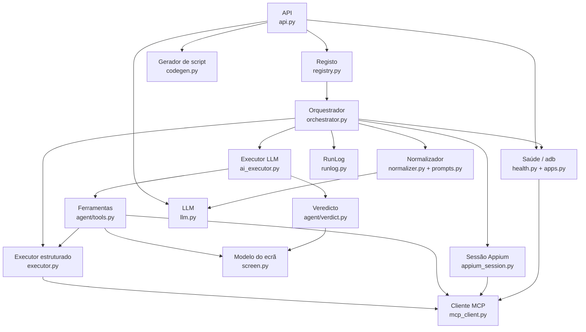
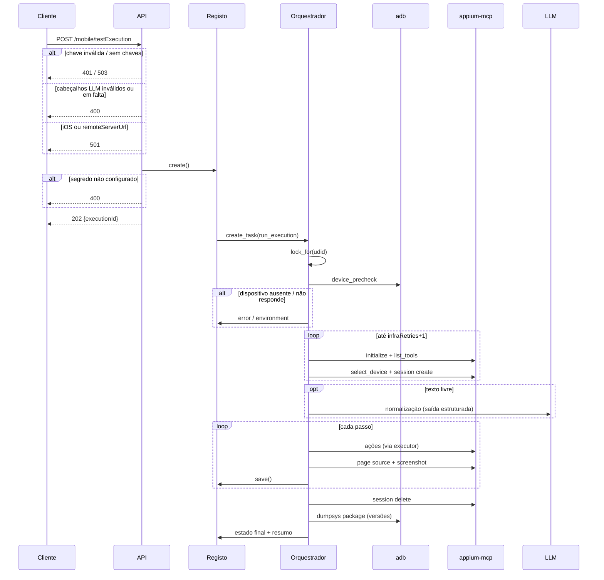
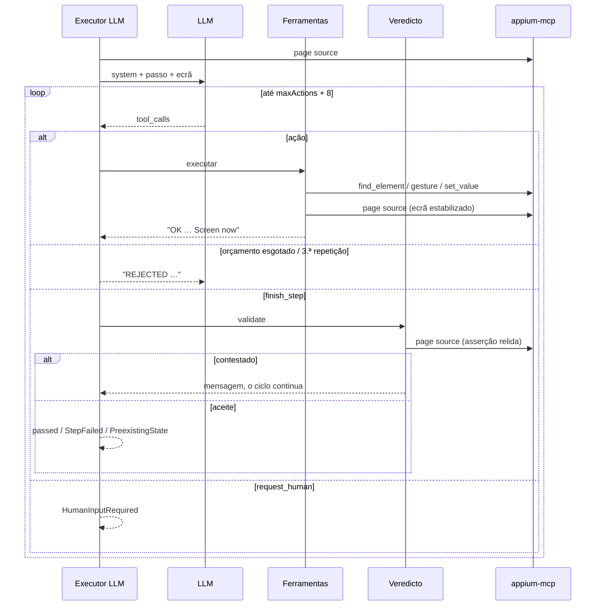
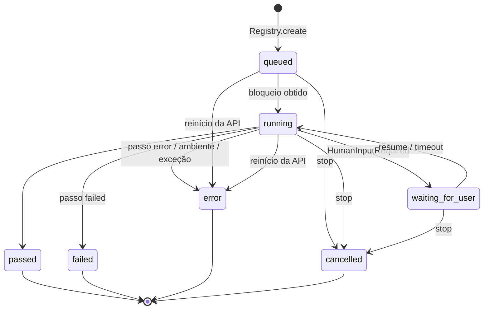

# Arquitetura do QAgent

## 1. Visão geral

O QAgent é um serviço local em Python que executa casos de teste em apps Android nativas. O caso pode chegar em três formatos:

- texto livre;
- Gherkin;
- passos estruturados (tap, type, assert…).

Um orquestrador determinístico prepara o dispositivo e a sessão Appium e percorre os passos. Nos passos em linguagem natural, um LLM (Azure OpenAI ou Gemini, escolhido por cabeçalhos HTTP em cada pedido) decide as ações. Para isso usa um conjunto de ferramentas próprias que falam com o [appium-mcp](https://github.com/appium/appium-mcp), um servidor MCP em Node.

Cada execução produz:

- um relatório JSON por passo, com screenshots e XML do ecrã;
- um log com os segredos mascarados;
- a pedido, um script Python + Appium gerado sem LLM, para repetir o teste fora do QAgent.

Os utilizadores são QA e programadores, através da interface web (React) ou de pedidos HTTP diretos. O QAgent é um protótipo: ainda não está integrado em nenhum outro sistema.

## 2. Tecnologias

| Tecnologia | Versão | Uso |
|---|---|---|
| Python | 3.11 | Backend |
| FastAPI + Uvicorn | 0.115.x / ≥ 0.30 | API |
| Pydantic / pydantic-settings | ≥ 2.11 / ≥ 2.6 | Contrato da API (`models.py`) e configuração (`config.py`) |
| LangGraph | 0.5.x | Grafo de passos |
| langchain-core | 0.3.46 | Mensagens, ferramentas, modelos |
| langchain-openai | 0.3.1 | `AzureChatOpenAI` |
| langchain-google-genai | 2.1.0 | `ChatGoogleGenerativeAI` |
| langchain-mcp-adapters | 0.1.14 | Só usado por `scripts/f1_lifecycle.py` |
| mcp (SDK Python) | ≥ 1.30, < 2 | Cliente MCP (HTTP e stdio) |
| appium-mcp | 1.99.3 | Servidor MCP local; traz o Appium 3 e o UiAutomator2 |
| React / MUI / Vite / TypeScript | 19 / 9 / 8 / 7 | Interface web |
| pytest, httpx, Appium-Python-Client | — | Testes e scripts gerados |
| uv | — | Ambiente Python |

Não há base de dados, filas, Docker, cloud nem CI.

## 3. Estrutura do repositório

```
QAgent/
├── src/qagent/                 backend
│   ├── api.py                  API (FastAPI)
│   ├── registry.py             registo de execuções (memória + disco), bloqueios por dispositivo
│   ├── orchestrator.py         orquestrador: preparação, grafo, evidências, limpeza
│   ├── normalizer.py           texto livre (LLM) / Gherkin → passos
│   ├── prompts.py              prompts versionadas (e1, e2, e3, n1, n2)
│   ├── executor.py             executor de passos estruturados (sem LLM)
│   ├── ai_executor.py          executor LLM: ciclo ReAct de um passo
│   ├── agent/                  partes do executor LLM
│   │   ├── tools.py            as 20 ferramentas expostas ao LLM
│   │   ├── verdict.py          regras do veredicto
│   │   ├── device.py           ecrã atual, refs, gestos
│   │   ├── navigation.py       apps instaladas, abrir/fechar apps
│   │   ├── recording.py        registo de ações/locators, máscara de segredos
│   │   ├── transcript.py       mensagens para o LLM, compactação de ecrãs
│   │   ├── schemas.py          argumentos das ferramentas e do veredicto
│   │   └── state.py, errors.py estado por passo; exceções
│   ├── screen.py               modelo do ecrã (XML → elementos com ref e locator)
│   ├── mcp_client.py           cliente MCP (uma ligação por execução)
│   ├── appium_session.py       sessão Appium (create/delete/screenshot/page source)
│   ├── health.py, apps.py      /health, adb, catálogo de apps
│   ├── codegen.py              gerador do script Python + Appium
│   ├── llm.py                  criação do LLM a partir dos cabeçalhos
│   ├── models.py               contrato de entrada/saída
│   ├── runlog.py               log JSON lines com máscara
│   └── config.py               configuração (QAGENT_*, .env)
├── frontend/                   interface web
├── config/capabilities.json    capabilities Appium base
├── scripts/                    arranque (.ps1) e utilitários de medição
├── tests/                      pytest (95 testes) + XML de ecrãs
├── examples/                   pedidos de exemplo; examples/blind/ para testes às cegas
├── tools/appium-mcp/           instalação local do appium-mcp
├── apps/, runs/                APK de exemplo e execuções (fora do Git)
└── pyproject.toml, uv.lock, .env.example, README.md
```

## 4. Arranque e configuração

| Processo | Comando |
|---|---|
| API | `python -m uvicorn qagent.api:app --host 127.0.0.1 --port 8100` |
| appium-mcp | `scripts/start-appium-mcp.ps1` (HTTP em 127.0.0.1:8080) |
| Interface web | `npx vite` em `frontend/` (127.0.0.1:5173) |
| Servidor Appium 4723 | `scripts/start-appium-server.ps1`, só para correr os scripts gerados |
| Testes | `python -m pytest -q` |

Ao arrancar, a API (`api.py:lifespan`):

1. cria a pasta `runs/`;
2. apaga execuções antigas, se a retenção estiver ligada;
3. recarrega as execuções do disco;
4. avisa se `QAGENT_API_KEYS` estiver vazio.

No fim, cancela as execuções em curso.

A configuração vem de variáveis `QAGENT_*`, com `.env` carregado explicitamente em `config.py`:

| Variável | Omissão |
|---|---|
| `QAGENT_RUNS_DIR` | `<raiz>/runs` |
| `QAGENT_RUNS_RETENTION_DAYS` | `0` (nunca apagar) |
| `QAGENT_CAPABILITIES_CONFIG` | `<raiz>/config/capabilities.json` |
| `QAGENT_APPIUM_MCP_VERSION` | `1.99.3` |
| `QAGENT_MCP_TRANSPORT` | `http` (alternativa: `stdio`) |
| `QAGENT_MCP_HTTP_URL` | `http://127.0.0.1:8080/sse` |
| `QAGENT_APPIUM_MCP_ENTRY`, `QAGENT_ANDROID_HOME`, `QAGENT_JAVA_HOME` | caminhos locais (só stdio) |
| `QAGENT_API_KEYS` | vazio → rotas protegidas respondem 503 |
| `QAGENT_CORS_ORIGINS` | localhost/127.0.0.1:5173, localhost:3000 |
| `QAGENT_IOS_REMOTE_SERVER_URL` | vazio |
| `QAGENT_SECRET_<NOME>` | — (lido diretamente do ambiente) |

O appium-mcp recebe as suas próprias variáveis, definidas em `start-appium-mcp.ps1` (modo HTTP) ou em `mcp_client.py:_stdio_params` (modo stdio). Entre elas:

- `APPIUM_MCP_ON_CLIENT_DISCONNECT=delete_all`;
- `CAPABILITIES_CONFIG`;
- `SCREENSHOTS_DIR` e `PAGE_SOURCES_DIR`;
- `ALLOW_REMOTE_APP_URLS=false` e `AI_VISION_ENABLED=false`.

A interface web usa `VITE_QAGENT_API_URL` e `VITE_QAGENT_API_KEY`.

## 5. API HTTP

| Método | Caminho | Auth | Resposta | Erros |
|---|---|---|---|---|
| GET | `/health` | não | `{status, checks{node, adb, appiumMcp}, cached}` | 503 se degradado |
| GET | `/mobile/devices` | sim | dispositivos adb prontos (+ entrada iOS se configurada) | 401/503 |
| POST | `/mobile/testExecution` | sim | 202 `{executionId}`; com `wait=true` e execução terminada, 200 com o resultado | 400, 501 (iOS) |
| GET | `/mobile/testExecution` | sim | lista, mais recentes primeiro | — |
| GET | `/mobile/testExecution/{id}` | sim | resultado completo | 404 |
| POST | `/mobile/testExecution/{id}/stop` | sim | `{status: stopping}` | 404, 409 |
| POST | `/mobile/testExecution/{id}/resume` | sim | `{status: resuming}` | 404, 409 |
| GET | `/mobile/testExecution/{id}/script` | sim | `test_<id>.py` | 404, 409, 500 |
| GET | `/mobile/testExecution/{id}/artifacts/{name}` | sim | ficheiro | 404 |

- **Autenticação:** cabeçalho `X-API-Key`.
- **LLM:** escolhido pelos cabeçalhos `X-Provider`, `X-LLM-Model`, `X-LLM-API-Key`, `X-LLM-Endpoint` e `X-LLM-APIVersion`.
- **Erros de validação:** respondem 400 `{"detail": [...]}`, em vez do 422 do FastAPI.
- **`/docs` e `/openapi.json`:** ficam ativos e sem autenticação, porque o `FastAPI()` é criado com as omissões.

O script gerado corre sozinho (`python test_<id>.py`) e lê:

- `APPIUM_SERVER` e `DEVICE_UDID`;
- `QAGENT_SECRET_*`;
- `TESTDATA_*`.

## 6. Integrações externas

| Integração | Como | Onde |
|---|---|---|
| appium-mcp | MCP por HTTP (`/sse`) ou stdio (processo `node` filho) | `mcp_client.py:McpConnection` |
| LLM | SDKs LangChain; `temperature=0` (exceto modelos de raciocínio), `max_retries=4` | `llm.py:build_llm` |
| adb | subprocessos (`devices -l`, `getprop`, `dumpsys package`, `cmd package …`) | `health.py`, `apps.py` |
| Servidor Appium 4723 | só os scripts gerados o usam | `codegen.py` |

Ferramentas do appium-mcp usadas:

- `select_device`, `appium_session_management`, `appium_get_page_source`, `appium_screenshot`;
- `appium_find_element`, `appium_gesture`, `appium_set_value`, `appium_get_text`;
- `appium_mobile_keyboard`, `appium_mobile_press_key`, `appium_app_lifecycle`, `appium_drag_and_drop`.

Algumas respostas do appium-mcp são texto livre, por isso o QAgent extrai os valores com expressões regulares:

| Valor | Padrão |
|---|---|
| id da sessão | `with ID:` |
| caminho do screenshot | `saved successfully to:` |
| id do elemento | `elementId '…'` |
| XML do ecrã | entre o primeiro `<` e o último `>` |

Isto prende o QAgent ao formato da versão 1.99.3. O `package.json` aceita `^1.99.3`, por isso uma atualização menor pode partir estes padrões.

## 7. Segurança

| Aspeto | Situação |
|---|---|
| Autenticação | `X-API-Key` comparada com `secrets.compare_digest`; sem chaves configuradas, 503 |
| Autorização | Não há: qualquer chave válida vê todas as execuções |
| Chave do LLM | Só viaja no cabeçalho; é mascarada nos logs e nunca aparece em `describe()` |
| Segredos do teste | `{{secret:x}}` → `QAGENT_SECRET_X`; chaves com `pass`, `secret`, `token`, `pwd` ou `pin` também são mascaradas |
| Máscara | `RunLog.mask` (valores com ≥ 3 caracteres, do mais longo para o mais curto); XML de evidência e motivos mascarados; `request.json` com `***` |
| LLM e segredos | O LLM só vê `{{testData.k}}` e, para segredos, "(secret, value hidden)" |
| Script gerado | Recusado se contiver um segredo da execução |
| Artefactos | Só nomes da lista da execução, sem separadores nem `..` |
| CORS | Origens de `QAGENT_CORS_ORIGINS`; métodos GET e POST |
| Rede | Tudo em 127.0.0.1, sem TLS; o appium-mcp não tem autenticação |
| Browser | `VITE_QAGENT_API_KEY` fica embutida no código do browser; a configuração do LLM vai para `localStorage`, mas sem a chave |

## 8. Erros, novas tentativas e logs

**Classificação das falhas** (`orchestrator.py:classify_exception` e `execute_step`):

| Situação | Estado / categoria |
|---|---|
| `StepFailed` | `failed` / `app` |
| Timeout do passo | `error` / `environment` |
| `ToolError` | `environment` ou `appium_mcp`, conforme a mensagem |
| `PreexistingState`, `HumanTimeout` | `environment` |
| Outras exceções | `llm` nos passos `ai`; nos restantes, classificadas pela mensagem |

Exceções sem pista na mensagem acabam em `environment`.

Falhas ao recolher screenshot ou XML ficam só no log (`evidence_error`) e não alteram o resultado do passo.

**Novas tentativas:** só na ligação MCP e na criação da sessão, até `infraRetries` vezes, com pausa de 3 s × tentativa. Os passos nunca são repetidos, porque as ações não são idempotentes. Os SDKs do LLM fazem até 4 tentativas.

**Log:** `runs/<id>/qagent.log` em JSON lines. Os eventos principais são:

- `execution_started`, `mcp_connected`, `appium_session_created`;
- `app_reset`, `llm_configured`, `normalized`, `step_finished`;
- `waiting_for_user`, `user_resumed`, `infra_retry`;
- `appium_session_deleted`, `execution_finished`, `execution_error`.

**Métricas:** o resultado guarda as métricas por execução e por passo:

- chamadas e tokens do LLM;
- chamadas a ferramentas;
- novas tentativas;
- duração.

Não são exportadas (não há Prometheus nem OpenTelemetry).

**`/health`** (cache de 30 s) verifica:

- que o `node` existe;
- que o `adb` está no PATH;
- a ligação ao appium-mcp, a presença das ferramentas principais e a versão.

Não verifica:

- se há algum dispositivo ligado (com zero dispositivos, `adb.ok` continua `true`);
- se o dispositivo responde ou está desbloqueado (isso só é feito no início de cada execução, em `device_precheck`);
- o acesso ao LLM;
- a ferramenta `appium_mobile_press_key`;
- a escrita em `runs/`;
- se a criação de uma sessão Appium funciona.

## 9. Componentes



| Componente | O que faz |
|---|---|
| API | Rotas, autenticação, validação, modo síncrono, geração do script |
| Registo | Cria, lista, para e retoma execuções; bloqueios por dispositivo; recarga do disco; retenção |
| Orquestrador | Prepara o dispositivo e a sessão, corre o grafo, recolhe evidências, limpa e calcula o resultado |
| Normalizador | Texto livre → passos (1 chamada LLM com saída estruturada); Gherkin → passos sem LLM |
| Executor estruturado | `tap/type/scroll_to/assert_*/back/wait` sem LLM; substitui `{{testData.x}}` |
| Executor LLM | Ciclo ReAct de um passo: orçamento de ações, recusa de repetições, compactação de ecrãs, imagens |
| Ferramentas | 20 ferramentas; converte refs em locators estáveis; deteta mudanças de app |
| Veredicto | Valida o `finish_step`: regras WHEN/THEN, asserções confirmadas num ecrã relido, contestações |
| Modelo do ecrã | XML → elementos com ref, estado, posição e melhor locator; asserções; pontos livres para tocar |
| Cliente MCP | Uma sessão MCP por execução; regista as chamadas; converte erros em `ToolError` |
| Sessão Appium | Criação, remoção, screenshot e page source |
| Saúde / adb | `/health`, dispositivos, verificação prévia, propriedades, versões das apps, launcher |
| LLM | Cabeçalhos → parâmetros → modelo LangChain |
| Gerador de script | `result.json` + `request.json` → script Python + Appium |
| RunLog | Log JSON lines com máscara |

Algumas dependências entre módulos merecem nota:

- **Ferramentas e executor estruturado:** as ferramentas reutilizam `render` e `StepFailed` de `executor.py`.
- **Orquestrador e `health.py`:** o orquestrador importa funções de adb de `health.py`, misturando o módulo do endpoint `/health` com a preparação das execuções.
- **Ciclos:** não há ciclos de importação.

## 10. Como corre uma execução

1. **Pedido.** `POST /mobile/testExecution`:
   - a API valida o corpo e os cabeçalhos do LLM;
   - exige um LLM para texto livre, Gherkin e passos `ai`;
   - recusa iOS com 501.
2. **Criação.** `Registry.create`:
   - resolve os segredos (se faltar algum, 400, antes de criar qualquer pasta);
   - gera o id, grava `request.json` (mascarado) e o `result.json` inicial;
   - lança a tarefa.
3. **Preparação.** `run_execution`:
   - espera pelo bloqueio do dispositivo e verifica-o (`device_precheck`);
   - lê as propriedades e o launcher do dispositivo e monta as capabilities;
   - liga ao appium-mcp e cria a sessão, com novas tentativas;
   - limpa as apps pedidas (`resetApps`) e reabre a app em teste.
4. **Grafo.**
   - `normalize` corre só para texto livre.
   - `execute_step` corre uma vez por passo. Em cada passo: executor, evidências, `outcome` e gravação do `result.json`.
   - Com `stopOnFailure`, os passos seguintes a uma falha ficam `skipped`.
5. **Fim.**
   - Apaga a sessão Appium e lê as versões das apps.
   - Calcula o estado final, com a prioridade `error` > `failed` > `passed`.
   - Calcula o resumo e a categoria da falha.

O cliente acompanha a execução por polling.

**Passo LLM** (`ai_executor.py:run_instruction`):

1. A primeira mensagem leva a prompt `e3`, o resumo dos passos anteriores, os placeholders e o ecrã.
2. O ciclo repete até `maxActionsPerStep + 8` vezes:
   - Se o modelo não chamar ferramentas, recebe um aviso; à segunda vez, é erro.
   - Se chamar `finish_step`, o veredicto é validado. O resultado é aceite, contestado, ou levanta `StepFailed` / `PreexistingState`.
   - Se chamar outra ferramenta, passa pelo controlo de repetições e do orçamento e é executada. Depois os ecrãs antigos são compactados.
   - Se houver uma imagem pendente, segue numa mensagem multimodal.
3. Os tokens do passo são registados no fim.

**Intervenção do QA:**

1. Um passo `manual`, ou a ferramenta `request_human`, põe a execução em `waiting_for_user`.
2. O QA atua no dispositivo e chama `/resume`.
3. O passo é repetido a partir do ecrã atual, com uma nota a dizer o que o QA fez. São permitidas até 3 intervenções por passo.

**Stop:**

1. `/stop` cancela a tarefa.
2. A limpeza apaga a sessão Appium.
3. A execução fica `cancelled`, e os passos por correr ficam `skipped`.

**Script:** `/script` só funciona com a execução terminada.

1. Gera o código a partir das ações registadas.
2. Recusa-o se contiver um segredo.
3. Valida a sintaxe com `compile()`.
4. Grava-o e devolve-o.





## 11. Estados



**Passo:** `pending` → `running` → `passed` | `failed` | `error`. Fica `skipped` em três casos:

- depois de uma falha, com `stopOnFailure`;
- num stop (o passo em curso);
- se ainda estiver `pending` no fim.

Noutras interrupções, o passo em curso fica `error`.

O `outcome` mede a força da evidência:

| Valor | Significado |
|---|---|
| `verified` | Confirmado por uma verificação da máquina |
| `executed` | Ação feita, mas não verificada |
| `inconclusive` | Só o juízo do LLM, ou o passo terminou em erro |

## 12. Concorrência e estado em memória

Há um único processo Uvicorn. Cada execução é uma `asyncio.Task` e o adb corre em subprocessos assíncronos.

| Estado | Onde | Ao reiniciar |
|---|---|---|
| Execuções (id → `Execution`) | `Registry.items` | Recarregadas de `result.json`; as não terminadas passam a `error` |
| Tarefa, evento humano, LLM, segredos | `Execution` | Perdem-se; execuções recarregadas não têm `request` nem segredos |
| Bloqueios por dispositivo | `Registry.device_locks` | Perdem-se |
| Cache de `/health` | `HealthChecker` | Perde-se |
| Último ecrã, apps instaladas e abertas | `agent/device.py`, `agent/navigation.py` | Só duram a execução |
| Estado do passo | `agent/state.py` | Recriado em cada passo |
| Sessões Appium | appium-mcp (globais no servidor) | Fora do processo |

Pontos a ter em conta:

- **Mesmo dispositivo:** execuções no mesmo `udid` correm uma de cada vez. Sem `udid`, usa-se o primeiro dispositivo pronto, escolhido antes de obter o bloqueio.
- **Dispositivos diferentes:** correm em paralelo, cada execução com a sua ligação ao mesmo appium-mcp. Este cenário não foi testado.
- **`wait=true`:** usa `asyncio.shield`, para que o timeout do pedido HTTP não cancele a execução.
- **`/stop` sobre uma execução já terminada:** ignora o retorno de `Registry.stop()` e responde `stopping` na mesma.
- **Timeouts:**

  | O quê | Limite |
  |---|---|
  | Passo | `timeoutPerStepSec`, com mínimo de 180 s nos passos `ai` |
  | Ação humana | `humanTimeoutSec` |
  | Criação da sessão | 240 s |
  | Remoção da sessão | 30 s |
  | adb | 5–15 s |
  | LLM | 90 s (Gemini), 120 s (Azure) |

- **Bloqueios por dispositivo:** o dicionário nunca é limpo e cresce com cada `udid` novo.

## 13. Dados em disco

| Dado | Ficheiro | Notas |
|---|---|---|
| Pedido | `runs/<id>/request.json` | Escrito uma vez; segredos como referência ou `***` |
| Resultado | `runs/<id>/result.json` | Reescrito a cada mudança; escrita atómica (`.tmp` → `replace`) |
| Log | `runs/<id>/qagent.log` | JSON lines |
| Screenshots | `runs/<id>/step-NN.png` | Copiados da pasta do appium-mcp; largura máx. 400 px |
| Page source | `runs/<id>/step-NN.xml` | Só em passos não passados; mascarado |
| Script | `runs/<id>/test_<id>.py` | Criado em cada `GET …/script` |
| Pasta do appium-mcp | `runs/_mcp-server/` | O QAgent nunca a limpa |
| Configuração do LLM (sem chave) | `localStorage` do browser | — |

**Retenção:** com `QAGENT_RUNS_RETENTION_DAYS > 0`, o arranque apaga as pastas de execução (nome com 12 hex) terminadas há mais de N dias. Por omissão, nada é apagado.

## 14. Testes

- **Suite:** 95 testes pytest, sem dispositivo nem LLM. Usam um appium-mcp falso (`FakeConn`) e um LLM com respostas programadas (`ScriptedChatModel`).
- **O que cobrem:**
  - API: autenticação, validação, segredos, artefactos, script;
  - orquestrador: limpeza, stop, novas tentativas, bloqueios, outcome, classificação, retenção;
  - regras do veredicto;
  - asserções, ecrãs genéricos, normalizador, intervenção humana e gerador de script.
- **Agnosticismo:** `test_prompts_app_agnostic.py` impede que nomes das apps de teste ou vocabulário de domínio cheguem às prompts, às descrições das ferramentas ou às mensagens.
- **Testes ponta a ponta:** manuais, com `scripts/run_case.py`, `scripts/f5_batch.py` e os pedidos em `examples/`.
- **O que falta:** linting, *type checking* do backend, medição de cobertura, CI, testes do frontend e testes do transporte stdio. O frontend tem `npm run typecheck`.

## 15. Limitações e pontos em aberto

**Limitações:**
- Só Android local: iOS e `remoteServerUrl` respondem 501.
- Máximo de 15 passos por normalização e 70 elementos por ecrã.
- Máximo de 3 intervenções humanas por passo.

**Por confirmar:**
1. **Ligações simultâneas:** o comportamento do appium-mcp com várias ligações em simultâneo.
2. **Transporte stdio:** se ainda funciona; não tem testes e o modo por omissão é HTTP.
3. **Outras versões do appium-mcp:** a estabilidade do formato das respostas fora da 1.99.3.
4. **Execução recarregada após reinício:** não tem a lista de segredos, por isso a verificação de segredos no `/script` deixa de ter efeito. O `request.json` já está mascarado, mas um segredo escrito em claro num `ActionRecord.value` não seria detetado.
5. **Pedido só com `appActivity`, sem `appPackage`:** é tratado como "sem app" e a activity é ignorada.

**Restos e inconsistências no código:**

| Item | Situação |
|---|---|
| `LLM_TOOL_ALLOWLIST` (`mcp_client.py`) | O nome já não corresponde ao uso: o LLM usa as ferramentas de `agent/tools.py`; a lista só serve a `/health` e a `scripts/f1_lifecycle.py` |
| `StepExecutor` (`executor.py`) | O protocolo diz que o executor LLM o implementa, mas `AiStepExecutor` expõe `run_instruction()` e não `run()` |
| `McpConnection.langchain_tools()` | Só usado por `scripts/f1_lifecycle.py`, e com ele a dependência `langchain-mcp-adapters` |
| `AppiumSession.list_text`, `has_sessions`, `foreground_packages`, `packages_in` | Só usados por `scripts/f1_lifecycle.py` |
| `SYSTEM_PROMPT`, `NORMALIZER_PROMPT` | Aliases mantidos por compatibilidade; o primeiro não tem usos, o segundo só nos testes |
| `SessionView` (`agent/device.py`) | Só usado quando não é passada uma sessão, ou seja, nos testes |
| `recordVideo`, `DeviceSpec.type`, `DeviceInfo.mode="remote"`, campos iOS | Aceites no contrato, mas nunca lidos |
| `/mobile/devices` | Anuncia um dispositivo iOS remoto se configurado, mas o `POST` recusa iOS |
| `hatchling` em `pyproject.toml` | Declarado, mas não há empacotamento |
| `scripts/f2_step.py` | Desatualizado em relação ao executor atual |

**Configuração duplicada:**
- os caminhos `C:\Android\…` em `config.py` e nos dois `.ps1`;
- as variáveis do appium-mcp no `.ps1` e em `_stdio_params`;
- os keycodes em `agent/device.py` e `codegen.py`;
- as pistas de launcher em `agent/tools.py` e `codegen.py`;
- os pacotes de sistema em `screen.py` e `appium_session.py`;
- a regex `{{secret:…}}` em `orchestrator.py` e `codegen.py`.

**README desatualizado:**
- indica `e2` como prompt por omissão, mas é `e3`;
- refere "Node 20+", que o código não verifica;
- aponta para registos de fase em `docs/` que já não existem.

## 16. Zonas mais complexas

| Zona | Porquê |
|---|---|
| Executor LLM e `agent/` | Ciclo não determinístico; orçamento, repetições, compactação e imagens; regras de veredicto com contestações; deteção de mudança de app; conversão de coordenadas da captura para o ecrã |
| Orquestrador | Bloqueios, novas tentativas, cancelamento, pausa humana, timeouts, evidências e cálculo do resultado; é onde tudo se liga |
| Gerador de script | O código gerado traz o seu próprio *runtime* (`ensure_app`, `check_target`, `drag`, permissões) e heurísticas de launcher, interrupções e locators frágeis |
| Modelo do ecrã | Base de todas as ações do LLM: interpretação do XML, unicidade dos locators, assinaturas, pontos livres |
| Registo | Estado partilhado entre memória e disco, bloqueios e retenção irreversível |
| Cliente MCP e sessão | Dois transportes e interpretação das respostas por regex |

## 17. Decisões de desenho

| Decisão | Vantagem | Custo |
|---|---|---|
| Orquestrador determinístico; o LLM só decide dentro de um passo | Veredictos e limpeza fiáveis; custo controlado | Mais código de orquestração |
| LangGraph para o grafo de passos | Encaixa no ecossistema LangChain | O grafo tem só 2 nós; o estado útil vive fora dele |
| appium-mcp como servidor HTTP de longa duração | Evita ~33 s de arranque em cada execução (stdio) | Servidor partilhado; sessões e screenshots globais |
| Modelo do ecrã próprio com refs; o LLM não escreve locators | Locators estáveis, sem locators inventados | Tokens por ecrã; manutenção da interpretação do XML |
| Regras do veredicto no código, não só no prompt | Menos falsos positivos | Contestações aumentam as chamadas ao LLM |
| LLM escolhido por pedido, sem chaves no servidor | Nada sensível guardado | O cliente envia a chave em cada pedido |
| Persistência só em ficheiros | Simples | Sem consultas; o estado em memória perde-se ao reiniciar |
| Estado limpo só com `resetApps` explícito | O QAgent nunca apaga dados por iniciativa própria | Execuções podem interferir umas com as outras |
| Novas tentativas só na preparação | Nunca repete ações não idempotentes | Falhas transitórias a meio contam como erro |
| Script gerado sem LLM | Determinístico e reprodutível | Verificações reduzidas a presença/texto |
| Prompts versionadas | Comparação A/B e reprodutibilidade | Várias versões a manter |
| Agnosticismo verificado por teste | Evita afinar o agente para apps concretas | Restringe o vocabulário das prompts |
