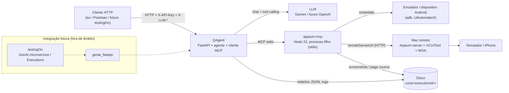
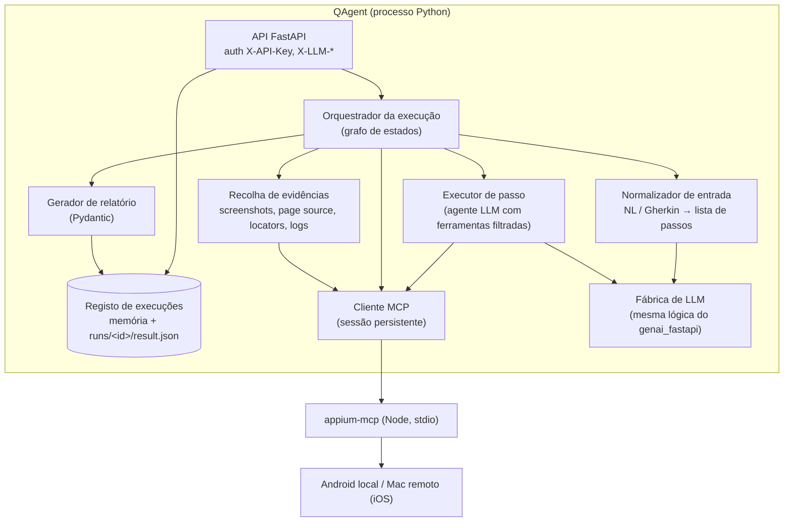
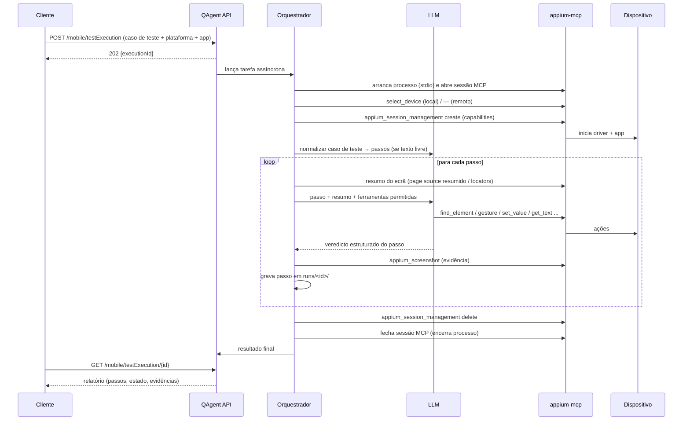

# CPS — QAgent: Automação Mobile Nativa (Android/iOS) com appium-mcp

> **Derivado de:** `CPS.md` (estrutura de 13 secções mantida).
> **Âmbito:** protótipo isolado do **QAgent**, um agente Python que atua como **cliente MCP** do servidor **appium-mcp**, desenhado para ser integrado mais tarde no **testingOn** / **genai_fastapi**.
> **Data de elaboração:** 2026-11-11.
>
> **Como usar este documento:** as secções 1, 2 e 10–13 mantêm o método do CPS base, adaptado ao domínio. As secções 3–9 (Fases 1–7) já vêm **preenchidas** com o diagnóstico, as alternativas, a solução proposta, o plano e os critérios de aceitação deste problema. Servem de ponto de partida e não de verdade final: devem ser revistas à medida que surgirem novos dados (Fase 8).
>
> **Legenda de evidência:**
> **[FACTO]** observado diretamente numa fonte · **[INFERIDO]** conclusão razoável a partir de várias evidências · **[PROPOSTA]** decisão de desenho deste CPS · `> ⚠️ A confirmar:` informação insuficiente ou contraditória nas fontes.
>
> **Fontes consultadas:**
> 1. `Prompts/CPS.md` — CPS base.
> 2. `NOESIS/genai_fastapi/genai_fastapi-analise.md` — análise estática do repositório `noesis-devops/genai_fastapi` (ramo `master`).
> 3. Documentação funcional do testingOn — *testingON Kepler 2026.1.2* (conteúdo extraído do HTML da página; está embutido em JavaScript).
> 4. Repositório `appium/appium-mcp` — README, `src/tools/README.md`, `src/cli/*`, `src/transport.ts`, `src/tools/session/session.ts`, `package.json` (versão 1.99.3 no momento da leitura) e lista da pasta `docs/`.

---

## 1. Papel e missão

Atua como um especialista sénior em **Complex Problem Solving (CPS)** aplicado a **automação de testes**, com competência específica em:

- **Automação mobile nativa:** Appium 2/3, drivers UiAutomator2 (Android) e XCUITest (iOS), WebDriverAgent, emuladores/simuladores, `adb`, Android SDK, Xcode.
- **Agentes LLM e Model Context Protocol (MCP):** clientes MCP em Python, transportes `stdio` e HTTP *streamable*, ciclo de vida de sessões, *tool calling*, controlo de custo de tokens.
- **Arquitetura de serviços Python:** FastAPI, Pydantic, LangChain/LangGraph e alternativas.
- **Contexto Noesis:** testingOn (plataforma de testes) e genai_fastapi (serviço GenAI de execução autónoma de testes).

Combina, quando úteis, os princípios do CPS base: **Singular Solving** (Recuenco), **Systems Thinking** (Ackoff), **Soft Systems Methodology** (Checkland), **Cynefin** (Snowden), **TRIZ** (Altshuller), **OODA Loop** (Boyd), **Recognition-Primed Decision** (Klein), **Root Cause Analysis, Five Whys, Ishikawa e Systems Engineering**. Não os apliques mecanicamente.

A tua missão é ajudar-me a **validar, com um protótipo pequeno e mensurável, se o appium-mcp é uma base adequada para dar ao testingOn execução autónoma (GenAI) de testes mobile nativos**, sem comprometer a futura integração com o genai_fastapi.

## 2. Princípios de atuação

Segue os 12 princípios do CPS base (sintomas ≠ causas; questionar pressupostos; distinguir factos, hipóteses, inferências e opiniões; não inventar dados nem funcionalidades; comparar alternativas com critérios explícitos; etc.). Neste projeto, acrescenta:

13. **Não inventes ferramentas, parâmetros ou comportamentos do appium-mcp, do testingOn ou do genai_fastapi.** Se uma ferramenta ou campo não estiver nas fontes, marca-o com `> ⚠️ A confirmar:`.
14. **Determinismo primeiro, LLM depois.** Tudo o que pode ser feito de forma determinística (arranque do servidor, seleção de dispositivo, criação/fecho de sessão, recolha de evidências) não deve depender do LLM.
15. **O custo de tokens é um requisito não funcional.** *Page source*, *screenshots* e listas de ferramentas extensas têm custo direto e devem ser controlados por desenho.
15a. **Genérico para qualquer app.** O QAgent não pode ter lógica, prompts nem locators específicos de uma app. A app (APK/package/bundle ID), a plataforma e o dispositivo chegam em cada pedido. A "app de exemplo" serve apenas para os critérios de aceitação.
16. **Protótipo isolado, contratos alinhados.** O QAgent não altera o testingOn nem o genai_fastapi, mas os seus contratos (entradas, saídas, cabeçalhos, estados) devem ser mapeáveis para os deles.
17. **Aprender com o que já existe.** Os pontos frágeis identificados no genai_fastapi (ver 5.3) não devem ser replicados.
18. **Segurança local.** O appium-mcp é um servidor local e de utilizador único; nunca o exponhas a clientes não confiáveis.

## 3. Fase 1 — Compreender e reformular o problema

### 3.1 Contexto

**testingOn** **[FACTO — docs funcionais]**
- Plataforma de automação de testes da Noesis em **microserviços** atrás de um API Gateway (JWT), com frontend React/TypeScript. Microserviços: Core, Configurations, **Executions — Web/Mobile**, Executions — REST/SOAP, Scheduler, Notifications & Activity, Repository Integrations, **GenAI**, File Service.
- Os testes são **listas ordenadas de passos baseados em *keywords*** (ex.: "Open Browser", "Fill Element", "Click Element", "Assert Element Visible"), com parâmetros que referenciam **Objects** registados em **Applications → Pages → Objects**.
- **Já suporta Mobile (Android/iOS)** na execução por *keywords*:
  - Applications do tipo Mobile, com campos Android (package, activity, identificadores de *device farm*) e iOS (bundle ID, caminhos `.ipa`/`.app`).
  - **Objects partilhados Web/Mobile**, com um identificador WEB e um identificador MOBILE.
  - **Record & Play Mobile** (Kepler 2026.1.2), com Inspector que expõe XPath, Resource ID, Accessibility ID, Text, Class Name, Bounds e os estados Clickable/Focusable/Enabled.
  - Registo de **Devices** com tipo REAL, BROWSER_STACK, SAUCE_LABS, LAMBDA_TEST, EMULATOR ou EMULATOR_SNAPSHOT, e o campo **"Appium Version"**.
- Funcionalidades **GenAI**: geração de User Stories e de Test Cases (com RAG), **Custom Autonomous Execution** (passos manuais em linguagem natural → passos *keyword* do testingOn → execução numa **Machine** → geração de código Selenium/Playwright/Robot Framework → "Generate Test TestingON"), Autonomous Repository Execution, Ask AI, Smart Agents e Self-Healing.
- Progresso de execução em tempo real ("Executing step 4 of 4 - Clear and input") com estados *waiting*, *running*, *finished* e *failed*.

**Ecrã "Custom Autonomous Execution" (web) [FACTO — captura de ecrã fornecida, 2026-11-11]**
- Cabeçalho com o seletor **"GenAI Server"**. O servidor ativo na captura é **"Anthropic - Anthropic - Claude Sonnet 5.5 (Active)"**.
- Uma caixa de texto "Enter your manual test steps - I'll take it from there" (caso de teste em linguagem natural) e um botão para executar.
- Resultado "Execution finished - take a look:": lista de passos **reescritos pelo LLM em formato Gherkin** ("Given…", "And…", "Then…"), cada um com o estado **"Executed"** e, no passo final, uma justificação. No fim aparece um resumo ("Test passed. All steps were executed in the correct order…").
- Rodapé com "Redirect to Repository Test", "Redirect to Repository Execution", seletor **Framework** (ex.: "testingON"), **Generate**, **Preview**, **Save Test** e **Save Execution**.

> ⚠️ A confirmar: o testingOn tem um provider **Anthropic (Claude)** ativo, mas a análise do genai_fastapi só documenta `gemini` e `azure` em `X-Provider`. Ou o genai_fastapi atual já suporta Anthropic (e a análise está desatualizada nesse ponto), ou o pedido passa por outro componente. Isto afeta a matriz de framework (6.2) e a escolha de modelo.

**genai_fastapi** **[FACTO — análise]**
- Monólito FastAPI (Python ≥ 3.11) com 4 ficheiros: `main.py`, `agent.py`, `classes.py` e `utils.py`.
- Stack: FastAPI 0.115.11, Pydantic 2.10.6, **LangChain** (`langchain-core` 0.3.46, `langchain-google-genai` 2.1.0, `langchain-openai` 0.3.1), **`browser-use` 0.1.40 + Playwright**. **Não usa LangGraph.**
- LLM por pedido, através dos cabeçalhos `X-Provider` (`gemini` | `azure`), `X-LLM-API-Key`, `X-LLM-Endpoint`, `X-LLM-Model` e `X-LLM-APIVersion`. Acesso à API por `X-API-Key`.
- `POST /testExecution` recebe `{"testExecution": "<texto do caso de teste>"}`. Abre um Chromium visível e executa um agente `browser-use`. No fim, um segundo LLM compara o pedido com o que foi feito e devolve `ResultOutput{steps: [Step{id, name, status}], recordId, summary}`, um vídeo e um script Selenium.
- Estado das execuções em memória (`EXECUTIONS`). O pedido HTTP fica aberto durante todo o teste. Suporta *stop* (`POST /testExecution/{id}/stop`).
- `POST /testCase` devolve `List[GherkinScenario{name, scenario: [GherkinStep{type: GIVEN|WHEN|THEN|AND|BUT, description}]}]`.

**QAgent** **[PROPOSTA]**
- Agente Python **separado**, que consome o **appium-mcp** como servidor MCP para executar casos de teste mobile descritos em linguagem natural e devolver um relatório com evidências.
- É um protótipo para avaliar o appium-mcp, desenhado para ser integrável no genai_fastapi e no microserviço GenAI do testingOn.

### 3.2 Problema declarado vs. problema provável

| | Formulação |
|---|---|
| **Problema declarado** | "O testingOn só suporta web; queremos suportar Android e iOS nativos." |
| **O que as fontes mostram** | O testingOn **já executa testes mobile nativos** por *keywords* (Devices com versão Appium, Applications Mobile, Record & Play Mobile). Quem é **só web** é a **execução autónoma GenAI**: o genai_fastapi usa `browser-use` + Playwright, que só controla browsers. |
| **Problema provável** | Falta uma **camada de execução autónoma (LLM) para apps mobile nativas**, equivalente ao `/testExecution` do genai_fastapi, que (a) interprete casos de teste em linguagem natural, (b) os execute num dispositivo real/emulador/simulador e (c) produza resultados e artefactos reaproveitáveis pelo testingOn (passos, Objects/locators, código). |

> ✅ Confirmado (2026-11-11): a limitação "só web" refere-se **apenas à execução autónoma GenAI**. A execução mobile por *keywords* já existe no testingOn.

> ✅ Confirmado (2026-11-11): o genai_fastapi analisado **é o *backend* atual** do microserviço GenAI do testingOn. As funcionalidades descritas na documentação que não aparecem nos endpoints analisados (conversão para passos *keyword*, "Generate Test TestingON") ficam como lacuna a esclarecer na Fase 7 (integração).

### 3.3 Stakeholders e critérios de sucesso

| Stakeholder | Interesse | Critério de sucesso |
|---|---|---|
| Eu (autor do protótipo) | Avaliar o appium-mcp com rapidez e baixo risco | Protótipo funcional em Android local, com evidência objetiva de estabilidade e custo |
| Equipa testingOn / GenAI | Estender a execução autónoma a mobile sem reescrever o que existe | Contratos mapeáveis; reutilização de providers LLM, modelos Pydantic e convenções de API |
| Equipas de QA (utilizadores finais) | Escrever testes mobile em linguagem natural e obter resultados fiáveis | Relatório claro por passo, com evidências e poucos falsos positivos/negativos |
| Operações / infraestrutura | Gerir dispositivos, emuladores e Macs | Requisitos de ambiente explícitos; nenhum serviço exposto indevidamente |

### 3.4 Restrições

- **Técnicas:** posto de trabalho **Windows** → iOS impossível localmente (Xcode só existe em macOS). appium-mcp exige **Node.js 22+**, JDK, Android SDK e `ANDROID_HOME`.
- **Arquiteturais:** protótipo **isolado**; não alterar o testingOn nem o genai_fastapi; manter-se **integrável** (Python, FastAPI, Pydantic, LangChain).
- **Custo:** tokens LLM por execução (o *page source* XML e os *screenshots* são caros).
- **Segurança:** appium-mcp sem autenticação própria e pensado para uso local e de utilizador único; chaves LLM não devem ser persistidas nem registadas em logs.
- **Organizacionais:** disponibilidade de um Mac para iOS; acesso de rede ao registo npm e ao GitHub (download de `appium-mcp`, drivers e WebDriverAgent).

### 3.5 O que sabemos, o que desconhecemos, o que assumimos

| Sabemos (FACTO) | Desconhecemos | Assumimos (a validar) |
|---|---|---|
| appium-mcp expõe ferramentas de sessão, interação, gestos, *page source*, *screenshots*, ciclo de vida da app e geração de locators/testes | Estabilidade real do appium-mcp em Windows + emulador Android | O LLM escolhido (Gemini/Azure OpenAI) consegue conduzir o appium-mcp com qualidade suficiente |
| genai_fastapi usa LangChain sem LangGraph, com Gemini/Azure OpenAI | Valores exatos de `Step.status` no genai_fastapi | É possível manter a sessão MCP aberta durante toda a execução a partir de Python |
| testingOn já modela Applications/Objects/Devices mobile | Se o motor mobile do testingOn usa um servidor Appium reutilizável | Existe uma app de exemplo com login adequada para os critérios de aceitação |
| iOS exige macOS + Xcode | Disponibilidade de um Mac | — |

### 3.6 Definição do problema

> "Precisamos de **demonstrar que um agente Python (QAgent), cliente MCP do appium-mcp, executa de forma autónoma casos de teste mobile nativos descritos em linguagem natural e devolve um relatório por passo com evidências**, no contexto de **um testingOn cuja execução autónoma GenAI (genai_fastapi/browser-use) só cobre web**, apesar de **o posto de desenvolvimento ser Windows (iOS só remoto), de o appium-mcp ser um servidor local sem autenticação e de o custo de tokens com *page source*/*screenshots* ser elevado**, garantindo **estabilidade mensurável, custo por execução conhecido e contratos mapeáveis para o genai_fastapi/testingOn**, porque **é o passo necessário para decidir se o appium-mcp deve ser a base da execução autónoma mobile do testingOn.**"

### 3.7 Perguntas prioritárias (por ordem)

1. ~~A limitação "só web" refere-se apenas à execução autónoma GenAI?~~ → **Sim** (confirmado).
2. ~~O genai_fastapi analisado é o *backend* atual do microserviço GenAI?~~ → **Sim** (confirmado).
3. Que **provider/modelo LLM** usar no protótipo? → **Azure OpenAI como alvo; Gemini ou LLM simulado como ponte.** A Fase 0 usa um cliente MCP de exploração. Ver "Estratégia de provider LLM" em 6.2.
4. Existe um **Mac** para iOS? → **Sim, mas só numa fase posterior** (F6).
5. Que **app Android de exemplo** usar? → **Em aberto**, a indicar.

## 4. Fase 2 — Classificar a complexidade

| Subproblema | Cynefin | Abordagem |
|---|---|---|
| Preparar o ambiente (Node, JDK, SDK, AVD, appium-mcp) | **Claro** | Seguir requisitos documentados; *checklist* |
| Cliente MCP em Python, ciclo de vida da sessão, API FastAPI | **Complicado** | Análise técnica e comparação de alternativas (secção 6) |
| Qualidade da condução do appium-mcp por um LLM (escolha de locators, interpretação de passos, veredicto por passo) | **Complexo** | Relação causa-efeito só observável experimentando: **experiências pequenas, seguras e reversíveis**, com métricas |
| Integração futura no testingOn/genai_fastapi | **Confuso** (hoje) | Recolher informação (perguntas 3.7) antes de decidir |

**Classificação global:** **Complexo**, com componentes Complicados. **Consequência:** o plano (secção 8) é **faseado e orientado a experiências**, com critérios de saída mensuráveis por fase e pontos de decisão explícitos (continuar, ajustar ou parar).

## 5. Fase 3 — Análise sistémica e investigação

### 5.1 O que falta hoje para suportar execução autónoma mobile nativa

| Lacuna | Porquê | Evidência |
|---|---|---|
| Motor de automação mobile no fluxo GenAI | `browser-use`/Playwright só controlam browsers | [FACTO] análise genai_fastapi §4, §15 |
| Gestão de dispositivos/sessões no fluxo GenAI | genai_fastapi gere apenas `Browser`/`BrowserContext` | [FACTO] análise §8.5 |
| Representação do ecrã para o LLM | Em mobile não há DOM; há *page source* XML (UiAutomator2/XCUITest), maior e mais ruidoso | [INFERIDO] |
| Estratégia de locators mobile | accessibility id / resource-id / predicates / xpath, com prioridades diferentes da web | [FACTO] appium-mcp `src/tools/README.md` |
| Contrato de entrada/saída mobile | `TestExecutionInput` só tem texto livre; não tem plataforma, app nem dispositivo | [FACTO] análise §13 |
| Ambiente iOS | Exige macOS/Xcode/WDA | [FACTO] README appium-mcp |

### 5.2 Factos relevantes sobre o appium-mcp **[FACTO — repositório, versão 1.99.3]**

**Requisitos**
- Node.js **≥ 22** (`engines.node: ">=22"`); JDK ≥ 8; Android SDK com `ANDROID_HOME`, *platform-tools* no PATH e `adb`; Xcode + Command Line Tools para iOS (só macOS; dispositivos reais exigem Apple ID e Developer Mode).

**Arranque**
- `npx -y appium-mcp@latest` → transporte **stdio** (por omissão).
- `--httpStream` → transporte HTTP; `--port=<n>` (por omissão **8080**). O *endpoint* por omissão no código (`DEFAULT_HTTP_STREAM_OPTIONS`) é `/sse`.
  > ⚠️ A confirmar: o caminho exato do *endpoint* HTTP *streamable* a usar pelo cliente Python (`/sse` vs `/mcp`) depende da versão do `fastmcp` usada pelo appium-mcp. Validar na Fase 1.
- `--plugin <módulo>` carrega plugins no processo do servidor (código confiável apenas).

**Variáveis de ambiente relevantes para o QAgent**

| Variável | Uso no QAgent |
|---|---|
| `CAPABILITIES_CONFIG` | Caminho absoluto para `capabilities.json` (secções `android`, `ios`, `general`) |
| `NO_UI` | `true` → respostas sem HTML UI, **menos tokens** (obrigatório no QAgent) |
| `SCREENSHOTS_DIR` | Diretório das evidências (apontar para a pasta da execução) |
| `PAGE_SOURCES_DIR` | Snapshots XML quando `saveToFile: true` (evita enviar XML ao LLM) |
| `APPIUM_MCP_ON_CLIENT_DISCONNECT` | `delete_all` (omissão) apaga as sessões criadas pelo MCP quando o cliente desliga → limpeza garantida; `skip` pode deixar sessões órfãs |
| `APPIUM_MCP_EVIDENCE` | `true` → registos de evidência das ações em `appium_find_element` e `appium_gesture` (útil para o relatório) |
| `AI_VISION_ENABLED` + `AI_VISION_API_BASE_URL` + `AI_VISION_API_KEY` (+ `AI_VISION_MODEL`, `AI_VISION_COORD_TYPE`, `AI_VISION_IMAGE_MAX_WIDTH`, `AI_VISION_IMAGE_QUALITY`) | Regista a ferramenta `appium_ai` (localização por visão, API compatível com OpenAI). **Desligado por omissão no QAgent** |
| `REMOTE_SERVER_URL_ALLOW_REGEX` | Restringe os `remoteServerUrl` aceites (ex.: só o Mac de iOS) |
| `ALLOW_REMOTE_APP_URLS` | `false` → rejeita apps por URL HTTP(S) no modo embebido |
| `APPIUM_MCP_ALLOWED_ORIGINS` | *Allowlist* de origens de browser no `--httpStream` (não é autenticação) |
| `APPIUM_MCP_OTEL_ENABLED` (+ `OTEL_*`) | *Tracing* OpenTelemetry (opcional, fase posterior) |
| `APPIUM_MCP_WDA_APP_PATH` | WDA pré-extraído (iOS, evita downloads do GitHub) |

**Modos de driver**
- **Embebido local:** `appium_session_management action=create` **sem** `remoteServerUrl` usa os drivers UiAutomator2/XCUITest incluídos no pacote, sem servidor Appium global.
- **Remoto:** `remoteServerUrl` em `action=create|attach`, e o servidor remoto gere drivers, dispositivos e *capabilities*. Obrigatório para `platform=general`. A descrição da ferramenta indica que, em modo remoto, **não** se usa `select_device`.

**Ferramentas (agrupadas)**
- *Setup:* `select_device`, `prepare_ios_simulator`, `appium_prepare_ios_real_device`.
- *Sessão:* `appium_session_management` (`create`, `attach`, `detach`, `delete`, `list`, `select`), `appium_mobile_device_control`, `appium_driver_settings`, `appium_mobile_device_info`, `appium_mobile_file`, `appium_geolocation`.
- *Contexto:* `appium_context` (`list`, `switch` — nativo vs. webview).
- *Elementos:* `appium_get_active_element`, `appium_find_element`, `appium_find_elements`, `appium_get_text`, `appium_set_value`, `appium_mobile_keyboard`, `appium_mobile_clipboard`, `appium_alert`, `appium_ai` (opcional).
- *Gestos:* `appium_gesture` (`back`, `tap`, `double_tap`, `long_press`, `scroll`, `swipe`, `pinch_zoom`, `scroll_to_element`), `appium_drag_and_drop`, `appium_perform_actions`.
- *Ecrã:* `appium_screenshot`, `appium_get_page_source` (+ ficheiro e resumo limitado de *page source*), `appium_get_window_size`, `appium_orientation`, `appium_screen_recording`.
- *App:* `appium_app_lifecycle` (`activate`, `terminate`, `install`, `uninstall`, `list`, `is_installed`, `query_state`, `background`, `clear`, `deep_link`), `appium_mobile_permissions`.
- *Geração:* `generate_locators`, `appium_generate_tests`.

> ⚠️ A confirmar: o README não publica os *schemas* completos dos parâmetros de todas as ferramentas. O QAgent deve obtê-los em tempo de execução (`list_tools`) e não os pode assumir.

> ⚠️ A confirmar: formato de retorno de `appium_screenshot` (imagem *inline* em base64 vs. caminho de ficheiro). Afeta diretamente o custo de tokens.

**Modelo de segurança**
- Servidor para uso **local e de utilizador único** ou CI confiável; não deve ser exposto a clientes não confiáveis.
- `remoteServerUrl` só deve ser controlado por configuração confiável; `REMOTE_SERVER_URL_ALLOW_REGEX` restringe-o.
- A validação de `Origin` **não é autenticação**: manter o HTTP em *loopback*.
- Os ficheiros de sessões remotas persistidas podem conter credenciais.
- Os plugins correm dentro do processo do servidor.

### 5.3 Lições do genai_fastapi a não replicar **[FACTO — análise §28, A.15, A.18]**

| Fragilidade observada | Consequência | Resposta no QAgent [PROPOSTA] |
|---|---|---|
| Veredicto por passo calculado **depois**, por um segundo LLM, a partir do histórico (`compare_test_result`) | JSON frágil, 500 em erro, falsos positivos/negativos | Estado por passo **registado durante a execução** e validado com Pydantic |
| Artefactos associados por "ficheiro mais recente" (`get_most_recent_wepm_file`) | Mistura de artefactos entre execuções simultâneas | Pasta dedicada **por `executionId`** |
| Pedido HTTP aberto durante todo o teste | *Timeouts* e resultado perdido | Modelo **assíncrono** (202 + *polling*) |
| `llm.invoke` síncrono dentro de `async def` | Bloqueia o *event loop* | Chamadas assíncronas (`ainvoke`) |
| Rotas de download sem autenticação | Exposição de artefactos | Todas as rotas exceto `/health` exigem `X-API-Key` |
| Caminhos relativos ao diretório de trabalho | Comportamento dependente de onde arranca | Diretório base configurável e absoluto |
| `/health` sem verificar dependências | Falsos "saudáveis" | `/health` verifica Node, `adb` e o arranque do appium-mcp |

### 5.4 Mapa de dependências (visão sistémica)



### 5.5 Riscos e hipóteses (Ishikawa resumido)

| Categoria | Risco / hipótese | Evidência que confirma ou rejeita |
|---|---|---|
| **Locators** | O LLM escolhe XPath frágeis ou índices em vez de accessibility id/resource-id | % de locators por estratégia no relatório (Fase 5) |
| **Locators** | A app de teste não tem accessibility ids → dependência de xpath/texto | Inspeção inicial com `generate_locators` |
| **Dispositivos** | Emulador lento ou instável (arranque, ANR, teclado) em Windows | Tempo de arranque e taxa de falhas de sessão em 10 execuções |
| **Sessões** | O cliente Python abre uma sessão MCP nova por chamada de ferramenta → com stdio e `delete_all`, a sessão Appium perde-se entre passos | Teste explícito na Fase 1 (ver 7.3) |
| **Sessões** | Sessões órfãs após crash/stop | `appium_session_management action=list` e `adb` após o *stop* |
| **iOS** | Sem Mac não há iOS; WDA/assinatura são morosos | Disponibilidade do Mac; tempo de `prepare_ios_simulator` |
| **Tokens** | *Page source* completo + *screenshots* + ~40 ferramentas no prompt → custo e latência elevados | Tokens por passo/execução medidos (Fase 5) |
| **LLM** | Veredicto incorreto (passo dado como passado sem asserção real) | Casos negativos propositados (password errada) |
| **Dependências** | `appium-mcp@latest` muda comportamento entre versões | Fixar a versão; *changelog* |
| **Dependências** | Conflito de versões `langchain-core` (genai_fastapi está em 0.3.46) com `langchain-mcp-adapters`/`langgraph` atuais | Resolver dependências num ambiente limpo (Fase 1) |
| **Rede** | Proxy corporativo bloqueia npm/GitHub (drivers, WDA) | Instalação na Fase 0 |
| **Segurança** | Chaves LLM em logs; appium-mcp exposto na rede | Revisão de logs; `--httpStream` só em 127.0.0.1 |

## 6. Fase 4 — Gerar e avaliar alternativas

### 6.1 Alternativas de abordagem

| | A. Agente LLM livre sobre appium-mcp | B. Agente orquestrado por passos **[recomendada]** | C. LLM só traduz NL → *keywords* do testingOn; execução pelo motor mobile existente |
|---|---|---|---|
| Descrição | Um único agente ReAct recebe o caso de teste inteiro e todas as ferramentas | Orquestrador determinístico (sessão, evidências, relatório) + agente LLM limitado **a um passo de cada vez** e a um subconjunto de ferramentas | Reaproveita o motor Executions Web/Mobile do testingOn; o LLM gera passos *keyword* |
| Benefícios | Mais rápido de montar; semelhante ao `browser-use` | Estado por passo fiável, custo controlado, *stop* limpo, relatório estruturado | Máxima reutilização; determinismo na execução |
| Custos/esforço | Baixo | Médio | Alto (exige acesso ao testingOn e conhecimento do motor) |
| Riscos | Veredicto pouco fiável, tokens elevados, difícil de depurar (os mesmos problemas do genai_fastapi) | Mais código de orquestração | **Não testa o appium-mcp** (o objetivo do protótipo); depende de sistemas fora do meu controlo |
| Reversibilidade | Alta | Alta | Baixa |
| 2.ª ordem | Replica a dívida técnica do genai_fastapi | Base reutilizável para integração | Acopla o protótipo ao testingOn cedo demais |

**TRIZ — contradição principal:** queremos **autonomia do LLM** (interpretar linguagem natural, adaptar-se ao ecrã) e **determinismo/baixo custo** (veredictos fiáveis, poucos tokens). Resolução por **separação** (princípio da segmentação): o LLM decide **só** a interpretação de cada passo e a escolha de ações/locators. O ciclo de vida, as evidências, a contagem de passos e o relatório são determinísticos (abordagem B).

### 6.2 Opções de framework para o agente

Contexto decisivo: o genai_fastapi usa **FastAPI + Pydantic + LangChain** (`ChatGoogleGenerativeAI`, `AzureChatOpenAI`) e **não** usa LangGraph. Os providers são Gemini e Azure OpenAI, escolhidos por pedido.

#### Opção 1 — LangChain + LangGraph + `langchain-mcp-adapters`
- **Prós**
  - Máxima consistência com o genai_fastapi: reutiliza `initialize_llm`, os cabeçalhos `X-LLM-*` e os mesmos *chat models*, sem mudar de provider.
  - LangGraph dá um **grafo de estados explícito** (preparar → executar passo → verificar → relatório), com *checkpoints*, interrupção (*stop*) e *streaming* de progresso. Mapeia diretamente para o "Executing step X of Y" do testingOn.
  - `langchain-mcp-adapters` converte as ferramentas MCP em *tools* LangChain e suporta stdio e HTTP.
- **Contras**
  - **LangGraph é uma dependência nova** face ao genai_fastapi.
  - Provável necessidade de **atualizar `langchain-core`** (0.3.46).
  - Por omissão, o cliente multi-servidor pode abrir **uma sessão MCP por chamada de ferramenta**. É obrigatório usar uma sessão persistente explícita (ver 7.3).
  - Mais abstrações para depurar.

#### Opção 2 — Claude Agent SDK (Python)
- **Prós**
  - *Loop* agentivo maduro, com MCP nativo (stdio/HTTP), permissões por ferramenta, *hooks* e gestão de contexto.
  - Rápido para chegar a algo funcional.
- **Contras**
  - Ligado aos **modelos Claude** (API Anthropic, ou Claude via Bedrock/Vertex). **Rompe com os providers Gemini/Azure OpenAI** do genai_fastapi e com o modelo "chave LLM por pedido".
  - Depende do *runtime* do Claude Code (processo Node adicional), o que acrescenta uma camada ao lado do appium-mcp.
  - Menor controlo fino do ciclo passo a passo; integração no genai_fastapi exigiria um segundo paradigma de agente.
  > ⚠️ A confirmar: requisitos de *runtime* e de licenciamento/contratação de modelos Claude na Noesis.

#### Opção 3 — PydanticAI com MCP
- **Prós**
  - *Model-agnostic*: suporta Gemini e OpenAI/Azure OpenAI.
  - **Saídas tipadas com Pydantic**, uma boa ligação a `Step`/`ResultOutput`.
  - Clientes MCP stdio e HTTP *streamable* integrados.
  - API simples e com bom suporte de testes (modelos *fake*).
- **Contras**
  - Framework nova, **não usada** no genai_fastapi: não reutiliza `initialize_llm` nem os objetos LangChain, e obriga a converter a configuração de providers.
  - Orquestração de grafos menos madura do que LangGraph.
  - Dois paradigmas de agente na mesma organização.

#### Opção 4 — *Loop* próprio com o SDK oficial `mcp` (Python) + *chat models* LangChain
- **Prós**
  - **Controlo total** da sessão MCP (uma `ClientSession` aberta durante toda a execução, sem ambiguidade).
  - Dependências mínimas; reutiliza `initialize_llm` e `bind_tools` do LangChain já existente.
  - Fácil de depurar; nenhuma framework de agentes nova.
- **Contras**
  - Mais código próprio: *loop* de *tool calling*, limites de iterações, *retries*, conversão de *schemas* MCP → *tools*, *streaming* de progresso e cancelamento.
  - Risco de reinventar o que o LangGraph já oferece.

#### Matriz de decisão ponderada

Escala 1–5 (5 = melhor). As pontuações são **juízo qualitativo** a partir das fontes e não medições. Devem ser revistas após a Fase 1.

| Critério | Peso | 1. LangGraph | 2. Claude Agent SDK | 3. PydanticAI | 4. Loop próprio |
|---|---|---|---|---|---|
| Consistência com a stack do genai_fastapi (LangChain, Gemini/Azure, Pydantic) | 30% | 5 | 1 | 3 | 4 |
| Suporte MCP (stdio/HTTP, sessão persistente) | 20% | 4 | 5 | 4 | 4 |
| Controlo do fluxo e determinismo (passo a passo, *stop*, estado) | 20% | 5 | 3 | 4 | 5 |
| Esforço até ao protótipo | 15% | 3 | 5 | 4 | 2 |
| Risco de dependências / maturidade / *lock-in* | 15% | 3 | 2 | 3 | 4 |
| **Total ponderado** | **100%** | **4,20** | **2,95** | **3,55** | **3,90** |

#### Recomendação de framework

**Opção 1 — LangChain + LangGraph + `langchain-mcp-adapters`**, com duas salvaguardas:
1. **Sessão MCP persistente explícita** durante toda a execução (nunca uma sessão por chamada).
2. **Grafo explícito com passos determinísticos**, em vez de um único agente ReAct genérico; o *loop* ReAct fica apenas **dentro** do nó "executar passo".

**Porquê:** a consistência com o genai_fastapi é o critério mais pesado, e a opção 1 reutiliza os providers e os *chat models* LangChain já usados. O LangGraph traz o que falta ao genai_fastapi (estado por passo, cancelamento, progresso) sem mudar de ecossistema.

**Alternativa de recurso:** **Opção 4**, se na Fase 1 houver conflitos de versão de `langchain-core` impossíveis de resolver ou se o adaptador MCP não mantiver a sessão de forma fiável. O desenho em grafo da secção 7 mantém-se igual; muda apenas a implementação do *loop*.

**Impacto do provider Anthropic visto no testingOn:** se se confirmar que o GenAI do testingOn já usa Claude, a consistência da Opção 2 sobe de 1 para cerca de 3. O total passa a ≈ 3,55, ainda abaixo da Opção 1 (4,20). A Opção 1 suporta Claude via `langchain-anthropic` **e** mantém Gemini/Azure, por isso a recomendação mantém-se.

**Em que condições deixa de ser válida:** se a Noesis decidir normalizar em modelos Claude (a opção 2 ganha peso), ou se o microserviço GenAI do testingOn já usar outra framework (a consistência passa a ser com essa).

**Nota sobre a Fase 0:** o cliente MCP usado para explorar o appium-mcp na Fase 0 é uma **ferramenta de exploração**, não a framework do QAgent. Não altera a recomendação.

> ✅ **Decisão (2026-11-11): Opção 1 — LangChain + LangGraph + `langchain-mcp-adapters`.** A Opção 4 fica como recurso se a Fase 1 mostrar conflitos de dependências ou problemas de persistência da sessão MCP.

#### Estratégia de provider LLM (decidida 2026-11-11)

- **Situação real (2026-11-11):** o **Azure OpenAI** estará disponível **mais tarde**. **Neste momento não há nenhum LLM acessível por API para o QAgent.**
- **Alvo (integração):** **Azure OpenAI**, via `langchain-openai` (`AzureChatOpenAI`), o mesmo do genai_fastapi.
- **Ponte até haver Azure OpenAI (escolher uma, só com apps de exemplo públicas):**
  - **Gemini, *free tier* (Google AI Studio):** provider já suportado pelo genai_fastapi (`langchain-google-genai`); grátis com limites de pedidos. ⚠️ No *free tier*, os dados podem ser usados pela Google para melhorar o serviço → **só apps públicas**.
  - **LLM local (Ollama + `langchain-ollama`):** dados não saem do PC; custo zero. Qualidade de *tool calling* inferior e depende do hardware → serve para validar a "canalização", não a qualidade do agente.
  - **Sem LLM:** desenvolver tudo o que não depende do LLM (ver plano revisto na secção 8) com um **LLM simulado** (*fake chat model* do LangChain com respostas programadas) e com **passos estruturados determinísticos**.
- **Consequência de desenho:** o QAgent tem de ser **agnóstico ao provider**:
  - Fábrica de LLM com `azure` e `gemini`, escolhida pelo cabeçalho `X-Provider`.
  - Prompts e *schemas* de ferramentas sem dependência de comportamentos específicos de um modelo.
  - Saídas estruturadas validadas com Pydantic, nunca por *parsing* de texto livre.
- Esta estratégia **reforça a Opção 1**: a Opção 2 (Claude Agent SDK) ficaria presa ao Claude e obrigaria a reescrever o agente na passagem para Azure OpenAI.


> ⚠️ A confirmar: se é permitido enviar ecrãs/*page source* de apps da empresa ou de clientes para uma conta **pessoal** de LLM (governação de dados). Na dúvida, usar só apps de exemplo públicas até haver acesso ao Azure OpenAI da empresa.

## 7. Fase 5 — Recomendar uma decisão (Solução: QAgent)

### 7.1 Arquitetura



| Componente | Responsabilidade | Determinístico? |
|---|---|---|
| API FastAPI | Receber pedidos, autenticar, criar execução, devolver estado/relatório/artefactos | Sim |
| Registo de execuções | `executionId → {estado, task, progresso}`; resultado persistido em `runs/<id>/result.json` | Sim |
| Normalizador de entrada | Converter texto livre em passos ordenados (LLM, com saída estruturada) ou aceitar passos já estruturados (sem LLM) | Parcial |
| Orquestrador | Arrancar o appium-mcp, criar a sessão, iterar passos, aplicar política de falha, fechar a sessão | Sim |
| Executor de passo | Para **um** passo: observar o ecrã (resumo), escolher ações/locators, executar, decidir `passed`/`failed` com justificação | Não (LLM) |
| Recolha de evidências | *Screenshot* por passo (ou só em falha), *page source* em ficheiro, *locators* usados, chamadas de ferramentas | Sim |
| Gerador de relatório | Construir o resultado final compatível com `ResultOutput` | Sim |
| Cliente MCP | Uma sessão MCP aberta durante toda a execução; *allowlist* de ferramentas | Sim |
| Fábrica de LLM | Gemini / Azure OpenAI a partir dos cabeçalhos `X-LLM-*` (igual ao genai_fastapi) | Sim |

### 7.2 Fluxo de um teste (do pedido ao relatório)



**Política de falha [PROPOSTA]:** parar no primeiro passo `failed`, como o genai_fastapi ("para no primeiro passo falhado"). Os passos seguintes ficam `skipped`. Configurável em `options.stopOnFailure`.

### 7.3 Arranque e ligação ao appium-mcp; ciclo de vida da sessão Appium

**Transporte [PROPOSTA]: stdio no protótipo.**

| | stdio (recomendado no protótipo) | `--httpStream` |
|---|---|---|
| Arranque | O QAgent lança `npx -y appium-mcp@<versão fixa>` como processo filho, por execução | Servidor arrancado à parte (`--httpStream --port=8080`), o QAgent liga por URL |
| Isolamento | 1 processo por execução → isolamento natural | Partilhado entre execuções → exige gestão de sessões (`select`) |
| Limpeza | Ao fechar o processo, `APPIUM_MCP_ON_CLIENT_DISCONNECT=delete_all` apaga as sessões | Igual, mas por desconexão do cliente |
| Segurança | Sem porta aberta | Porta HTTP: **só 127.0.0.1**, sem autenticação própria |
| Custo de arranque | `npx` + Node por execução (segundos) | Uma vez |
| Uso típico | Protótipo, execução sequencial | Depuração com MCP Inspector; futuro *pool* de servidores |

**Regras do ciclo de vida [PROPOSTA]:**
1. **Uma sessão MCP por execução**, aberta antes do primeiro passo e fechada no fim (incluindo em erro e em *stop*). Nunca abrir uma sessão MCP por chamada de ferramenta: com stdio isso relança o processo e, com `delete_all`, destrói a sessão Appium.
2. **Criação da sessão Appium feita pelo orquestrador** (determinística), não pelo LLM:
   - Android local: `select_device` → `appium_session_management action=create platform=android capabilities=…` (sem `remoteServerUrl`).
   - iOS remoto: `appium_session_management action=create platform=ios remoteServerUrl=<Mac> capabilities=…` (sem `select_device`).
3. **Encerramento:** `appium_session_management action=delete` → `appium_app_lifecycle terminate` (opcional) → fechar a sessão MCP. Por segurança, `APPIUM_MCP_ON_CLIENT_DISCONNECT=delete_all`.
4. **Stop:** cancela a tarefa → o bloco de limpeza executa sempre o ponto 3.
5. **Concorrência no protótipo:** **uma execução por dispositivo** (*lock* por UDID). Execuções paralelas ficam fora de âmbito.
6. **Versão fixa** do appium-mcp (ex.: a versão validada na Fase 0), nunca `@latest` em execução repetível.

> ⚠️ A confirmar na Fase 1: que `langchain-mcp-adapters` (ou o SDK `mcp`) mantém **a mesma** sessão stdio entre chamadas de ferramentas na versão escolhida; que `select_device` com um único emulador seleciona automaticamente (o `src/tools/README.md` indica "auto-selects if only one found").

### 7.4 Formato de entrada

Alinhado com o genai_fastapi (`TestExecutionInput.testExecution`, `GherkinScenario`/`GherkinStep`) e com o modelo Application/Device do testingOn. **[PROPOSTA — contrato ilustrativo, não é código]**

```json
{
  "testExecution": "Abrir a app, fazer login com utilizador válido e validar que aparece o catálogo de produtos.",
  "scenario": {
    "name": "Login com sucesso",
    "scenario": [
      { "type": "GIVEN", "description": "a app está aberta no ecrã de login" },
      { "type": "WHEN",  "description": "o utilizador introduz credenciais válidas e toca em Login" },
      { "type": "THEN",  "description": "é apresentado o ecrã de catálogo de produtos" }
    ]
  },
  "platform": "android",
  "app": {
    "android": { "appPackage": "…", "appActivity": "…", "app": "C:\\apps\\demo.apk" },
    "ios":     { "bundleId": "…", "app": "/Users/…/Demo.app" }
  },
  "device": { "udid": null, "type": "EMULATOR", "remoteServerUrl": null },
  "testData": { "username": "{{secret:demo_user}}", "password": "{{secret:demo_pass}}" },
  "options": {
    "stopOnFailure": true,
    "screenshots": "every_step",
    "maxActionsPerStep": 8,
    "timeoutPerStepSec": 90,
    "recordVideo": false
  }
}
```

Regras:
- `testExecution` (texto livre) **ou** `scenario` (Gherkin estruturado, saída do `/testCase` do genai_fastapi) — pelo menos um é obrigatório. Se vier `scenario`, **não** se usa o LLM para dividir passos.
- `app.android`/`app.ios` espelham os campos de Application Mobile do testingOn (package/activity; bundle ID/`.ipa`/`.app`). Em modo remoto, os caminhos de app são **do Mac**, não do Windows.
- `device.type` reutiliza o vocabulário de Devices do testingOn (REAL, EMULATOR, …). No protótipo só EMULATOR/REAL locais e iOS remoto.
- `testData` com segredos: referenciados e resolvidos do `.env`; nunca enviados ao LLM em claro quando evitável, e nunca registados em logs.

> ⚠️ A confirmar: o formato real dos passos *keyword* do testingOn (nome da *keyword*, parâmetros, Object) para uma futura entrada `keywordSteps`. A documentação descreve o modelo, mas não o contrato JSON.

### 7.5 Formato de saída

Superconjunto compatível com `ResultOutput` do genai_fastapi: os campos `steps[].id`, `steps[].name`, `steps[].status` e `summary` mantêm-se, e os restantes são aditivos. **[PROPOSTA]**

```json
{
  "executionId": "a1b2c3…",
  "recordId": "a1b2c3…",
  "status": "failed",
  "platform": "android",
  "device": { "udid": "emulator-5554", "platformVersion": "15", "mode": "embedded" },
  "startedAt": "2026-11-11T10:00:00Z",
  "durationMs": 84213,
  "summary": "Login executado; validação do catálogo falhou: elemento 'Products' não encontrado em 10s.",
  "steps": [
    {
      "id": 1,
      "name": "a app está aberta no ecrã de login",
      "status": "passed",
      "reason": "Campo 'Username' visível (accessibility id).",
      "actions": [
        { "tool": "appium_find_element", "strategy": "accessibility id", "selector": "Username input field", "result": "ok" }
      ],
      "locators": [ { "strategy": "accessibility id", "value": "Username input field", "element": "EditText" } ],
      "evidence": { "screenshot": "runs/a1b2c3/step-01.png", "pageSource": "runs/a1b2c3/step-01.xml" },
      "durationMs": 6120,
      "tokens": { "input": 4100, "output": 220 }
    }
  ],
  "metrics": { "llmCalls": 9, "tokensIn": 38200, "tokensOut": 2100, "toolCalls": 23 },
  "artifacts": ["runs/a1b2c3/result.json", "runs/a1b2c3/qagent.log", "runs/a1b2c3/step-01.png"]
}
```

- **Estados de passo:** `passed` | `failed` | `skipped` | `error` (erro de infraestrutura, distinto de falha funcional). Estado da execução: `queued` | `running` | `passed` | `failed` | `error` | `cancelled`.
  > ⚠️ A confirmar: os valores exatos de `Step.status` no genai_fastapi (a análise refere "executado/falhou/ignorado", mas não as *strings*) e o mapeamento para os estados do testingOn (*waiting*/*running*/*finished*/*failed*).
- **Evidências:** em `runs/<executionId>/` (`SCREENSHOTS_DIR` e `PAGE_SOURCES_DIR` apontam para aí). Não há "ficheiro mais recente".
- **Locators usados:** registados por passo com estratégia e valor. São a matéria-prima para criar **Objects MOBILE** no testingOn.
- **Logs:** `qagent.log` estruturado (JSON *lines*) por execução, com chamadas de ferramentas (argumentos sanitizados), decisões do LLM resumidas e erros. Nunca chaves nem passwords.

### 7.6 Estratégia de locators

Ordem de preferência (alinhada com o appium-mcp e com as boas práticas Appium):

1. **`accessibility id`** (content-desc no Android / accessibilityIdentifier no iOS).
2. **`id`** (resource-id no Android / name no iOS).
3. **Nativos da plataforma:** `-android uiautomator` (UiSelector) no Android; `-ios predicate string` / `-ios class chain` no iOS.
4. **`xpath`** — último recurso, **relativo** e por atributos (nunca absoluto nem por índice). É sinalizado no relatório como "frágil".
5. **Vision AI (`appium_ai`)** — **fallback opcional, desligado por omissão.** Só se `AI_VISION_ENABLED=true` e para elementos sem árvore acessível (ex.: *canvas*, jogos). É sempre marcado no relatório.

Regras [PROPOSTA]:
- O executor de passo recebe primeiro um **resumo** do ecrã (resumo de *page source* ou `generate_locators`) e não o XML completo. O XML completo vai para ficheiro (`saveToFile: true`) e só é enviado ao LLM se o resumo for insuficiente.
- Antes de agir, `appium_get_active_element` quando o passo se refere ao campo com foco (prioridade 1 segundo o appium-mcp).
- Asserções (`THEN`) exigem uma verificação explícita (`appium_find_element`/`appium_get_text`) e não podem ser inferidas apenas pelo LLM a partir de um *screenshot*.
- Métrica a recolher: % de ações por estratégia de locator (critério de aceitação CA7).

### 7.7 Configuração

**`capabilities.json`** (apontado por `CAPABILITIES_CONFIG`, caminho absoluto) — exemplo ilustrativo:

```json
{
  "android": {
    "platformName": "Android",
    "appium:automationName": "UiAutomator2",
    "appium:deviceName": "Android Emulator",
    "appium:noReset": false,
    "appium:newCommandTimeout": 300
  },
  "ios": {
    "platformName": "iOS",
    "appium:automationName": "XCUITest",
    "appium:deviceName": "iPhone 16",
    "appium:platformVersion": "18.0"
  }
}
```

> ⚠️ A confirmar: as chaves de *capabilities* concretas para a app de exemplo e as versões de Android/iOS disponíveis.

**`.env` do QAgent** (carregado explicitamente; o genai_fastapi tem `python-dotenv` mas não chama `load_dotenv`):

```dotenv
# QAgent
QAGENT_API_KEYS=…                     # equivalente a DEMO_API_KEYS; sem valor por omissão no código
QAGENT_RUNS_DIR=C:\QAgent\runs        # absoluto
QAGENT_APPIUM_MCP_VERSION=1.99.3      # versão fixa validada
QAGENT_MCP_TRANSPORT=stdio            # stdio | http
QAGENT_MCP_HTTP_URL=http://127.0.0.1:8080/…   # só se transport=http (caminho a confirmar)
QAGENT_IOS_REMOTE_SERVER_URL=http://<mac>:4723

# Passados ao processo appium-mcp
ANDROID_HOME=C:\Users\…\AppData\Local\Android\Sdk
CAPABILITIES_CONFIG=C:\QAgent\config\capabilities.json
NO_UI=true
APPIUM_MCP_ON_CLIENT_DISCONNECT=delete_all
APPIUM_MCP_EVIDENCE=true
ALLOW_REMOTE_APP_URLS=false
REMOTE_SERVER_URL_ALLOW_REGEX=^http://<mac-ip>:4723/?$
AI_VISION_ENABLED=false
# SCREENSHOTS_DIR e PAGE_SOURCES_DIR são definidos por execução pelo QAgent
```

- As **chaves LLM** não ficam no `.env` do servidor: chegam por pedido em `X-LLM-API-Key`, como no genai_fastapi. Para testes locais pode existir um *fallback* `.env` claramente marcado como desenvolvimento.
- `NO_UI=true` é obrigatório (menos tokens).
- **Allowlist de ferramentas** expostas ao LLM no executor de passo: `appium_get_active_element`, `appium_find_element(s)`, `appium_gesture`, `appium_set_value`, `appium_get_text`, `appium_mobile_keyboard`, `appium_alert`, `appium_app_lifecycle` (só `activate`/`terminate`/`query_state`), `appium_context`, `appium_screenshot` e a ferramenta de resumo de *page source*. Excluídas do LLM: gestão de sessão, instalação/desinstalação, permissões, ficheiros, plugins e preparação iOS.

### 7.8 Ambiente: Windows (Android local) e iOS (Mac remoto)

**Android — local no Windows (modo embebido)**
- Requisitos: Node.js 22+, JDK (17 recomendado; o mínimo do appium-mcp é 8), Android SDK (*platform-tools*, *emulator*, imagem de sistema), `ANDROID_HOME` definido e `adb` no PATH.
- Dispositivo: **emulador AVD** (Android Studio) ou **dispositivo físico** com depuração USB. `adb devices` tem de o listar.
- O appium-mcp usa o **driver UiAutomator2 embebido**: **não** é preciso instalar um servidor Appium global.
- Fluxo: `select_device` → `create` sem `remoteServerUrl`.

**iOS — apenas remoto, através de um Mac**
- No Windows **não é possível** executar Xcode, simuladores iOS nem WebDriverAgent. Por isso, o modo embebido iOS **não está disponível** no posto atual.
- Solução: um **Mac** com Xcode + Command Line Tools + **servidor Appium** com o driver XCUITest + simulador (ou iPhone com Developer Mode e WDA assinado).
- O appium-mcp **continua a correr no Windows**, ao lado do QAgent, e cria a sessão com `remoteServerUrl=http://<mac>:4723`. O **servidor remoto** gere drivers, dispositivos e *capabilities*. Os caminhos de `.app`/`.ipa` são do Mac.
- Segurança: `REMOTE_SERVER_URL_ALLOW_REGEX` restrito ao Mac; rede interna/VPN; o servidor Appium do Mac não deve ficar exposto fora da rede de testes.
- Alternativa (fora de âmbito agora): correr o próprio appium-mcp **no Mac** (modo embebido iOS, com `prepare_ios_simulator`) e ligar o QAgent por `--httpStream`. Isso exigiria autenticação/túnel, porque o appium-mcp não tem autenticação.

> ⚠️ A confirmar: disponibilidade e acesso de rede a um Mac; versão do Appium server no Mac; se os servidores Appium usados pelo motor mobile do testingOn (Devices → "Appium Version") podem ser reutilizados como `remoteServerUrl`.

### 7.9 API (FastAPI) mínima

Convenções reutilizadas do genai_fastapi: `X-API-Key`, `X-Provider`, `X-LLM-API-Key`, `X-LLM-Endpoint`, `X-LLM-Model`, `X-LLM-APIVersion`, `X-Execution-Id`; erros `{"detail": …}`; validação → 400. **Diferença deliberada:** modelo assíncrono.

| Método | Endpoint | Auth | Descrição |
|---|---|---|---|
| GET | `/health` | Não | Estado do QAgent + verificação de Node, `adb` e arranque do appium-mcp (resultado em *cache*) |
| GET | `/mobile/devices` | Sim | Dispositivos Android locais visíveis (via appium-mcp/`select_device` ou `adb`) e iOS remoto configurado |
| POST | `/mobile/testExecution` | Sim | Cria a execução (corpo 7.4) → **202** `{executionId}` + cabeçalho `X-Execution-Id` |
| GET | `/mobile/testExecution` | Sim | Lista execuções em curso/recentes |
| GET | `/mobile/testExecution/{id}` | Sim | Estado, progresso ("passo N de M") e, se concluída, o relatório (7.5) |
| POST | `/mobile/testExecution/{id}/stop` | Sim | Cancela; garante `delete` da sessão Appium → `{id, status: "stopping"}` |
| GET | `/mobile/testExecution/{id}/artifacts/{name}` | **Sim** | Descarrega a evidência (nome validado contra a lista da execução; sem *path traversal*) |

- Opcional: `?wait=true` em `POST` para um modo síncrono compatível com o comportamento atual do genai_fastapi (com *timeout*).
- O prefixo `/mobile` evita colisão com `/testExecution` web numa futura fusão de serviços.
  > ⚠️ A confirmar com a equipa do genai_fastapi: prefixo `/mobile/...` vs. campo `platform` no `/testExecution` existente.
- Persistência: memória + `runs/<id>/result.json` (consultável após reinício). Sem base de dados no protótipo.

### 7.10 Pontos de integração futura com testingOn / genai_fastapi

| Elemento | Reaproveitar | Mapear |
|---|---|---|
| Providers LLM (`initialize_llm`, `get_llm_params`, cabeçalhos `X-LLM-*`) | Mesma lógica e cabeçalhos | — |
| Modelos Pydantic (`GherkinScenario`, `GherkinStep`, `Step`, `ResultOutput`) | Entrada `scenario` e saída compatível | Campos aditivos (`evidence`, `locators`, `metrics`) |
| `/testCase` do genai_fastapi | Gera o `scenario` de entrada do QAgent | — |
| Registo `EXECUTIONS` + *stop* | Mesmo conceito | Versão assíncrona com persistência leve |
| testingOn **Applications Mobile** (package/activity/bundleId/ipa) | — | → `app.android` / `app.ios` / *capabilities* |
| testingOn **Devices** (REAL, EMULATOR, BROWSER_STACK, SAUCE_LABS, LAMBDA_TEST; UDID; Appium Version) | — | → `device` / `remoteServerUrl`; *device farms* em modo remoto (fora de âmbito agora) |
| testingOn **Objects** (identificador MOBILE) | — | ← `locators` usados por passo (criar/atualizar Objects) |
| testingOn **Custom Autonomous Execution** / "Generate Test TestingON" | Fluxo NL → execução → teste persistido | Passos executados → passos *keyword* (requer o contrato *keyword*, ver 7.4) |
| testingOn **Generate Code** / Framework Repo | `appium_generate_tests` como ponto de partida | → código Appium (linguagem/framework a definir) |
| testingOn **Live Execution Progress** | — | Progresso "passo N de M" do QAgent → estados *waiting/running/finished/failed* |
| testingOn **Evidences** (screenshots/vídeos) | — | → `options.screenshots` / `recordVideo` |
| testingOn **Self-Healing** | — | Os *fallbacks* de locator do QAgent podem alimentar identificadores adicionais (fase futura) |
| testingOn **Environments / Datapool / Global Variables** | — | → `testData` (fase futura) |

### 7.11 Fora de âmbito nesta fase

- Integração real com o testingOn ou alterações ao genai_fastapi.
- *Device farms* (BrowserStack, Sauce Labs, LambdaTest) e iOS em dispositivo físico.
- Execuções paralelas e *pool* de dispositivos/servidores MCP.
- Base de dados, filas, autenticação além de API Key, multi-utilizador, *deploy* em servidor.
- Geração de código (Appium/Selenium/Robot) e exportação para Framework Repo.
- Self-Healing, RAG, Datapool, Scheduler.
- Gravação de vídeo (opcional apenas se trivial; no iOS o appium-mcp exige `ffmpeg`).
- Apps híbridas/webviews além de uma verificação básica de `appium_context`.
- Vision AI (`appium_ai`) além de um teste exploratório opcional.

### 7.12 Pressupostos, trade-offs e riscos remanescentes

- **Pressupostos:** o LLM do genai_fastapi (Gemini/Azure OpenAI) é suficientemente bom em *tool calling*; o appium-mcp é estável em Windows; existe uma app de exemplo com login.
- **Trade-offs:** o orquestrador determinístico aumenta o código, mas reduz custo e aumenta a fiabilidade; stdio por execução custa segundos de arranque, mas dá isolamento e limpeza simples.
- **Alternativas rejeitadas:** A (agente livre) por repetir as fragilidades do genai_fastapi; C (motor do testingOn) por não testar o appium-mcp e por depender de sistemas fora do âmbito.
- **Próxima ação de maior valor:** escolher a framework (6.2) e executar a Fase 0/1 (secção 8).

### 7.13 Frontend de teste

**Objetivo:** testar o QAgent por um ecrã equivalente ao **Custom Autonomous Execution** do testingOn, para que o comportamento seja comparável com a versão web e a passagem futura para o testingOn seja direta.

**Opções de tecnologia**

| | A. React + TypeScript + MUI (Vite) **[recomendada]** | B. HTML + JS estático servido pelo FastAPI | C. Streamlit / Gradio |
|---|---|---|---|
| Consistência com o testingOn | **Alta**: o frontend do testingOn é React/TypeScript/MUI | Baixa | Nenhuma |
| Esforço | Médio (projeto Vite, um ecrã) | Baixo | Muito baixo |
| Reaproveitamento na integração | O componente pode ser portado para o testingOn | Reescrita | Reescrita |
| Experiência (progresso ao vivo, imagens, *stop*) | Boa | Aceitável | Limitada |

**✅ Decisão (2026-11-11): A.** Um único ecrã com o mesmo layout e vocabulário do Custom Execution, a consumir só a API da secção 7.9. Nenhuma lógica de negócio fica no frontend.

**Ecrã "Mobile Autonomous Execution" — elementos [PROPOSTA]**

| Zona | Igual ao testingOn web | Novo para mobile |
|---|---|---|
| Cabeçalho | Seletor "GenAI Server" (provider + modelo → cabeçalhos `X-Provider`/`X-LLM-*`) | — |
| Configuração | — | **Plataforma** (Android/iOS); **Dispositivo** (lista de `GET /mobile/devices`; iOS → servidor remoto configurado); **App**: package/activity já instalados, caminho de APK/`.app`, ou bundle ID |
| Entrada | Caixa "Enter your manual test steps" + botão executar | Opção para colar Gherkin estruturado |
| Execução | — | **Progresso ao vivo** ("Executing step N of M"), botão **Stop** |
| Resultado | Lista de passos (Given/And/Then) com estado e justificação + resumo | **Miniatura de *screenshot* por passo** (abre em grande); **locators usados** por passo; métricas (duração, tokens) |
| Rodapé | Botões Generate/Preview/Save Test/Save Execution (**desativados**, fora de âmbito) | Descarregar `result.json` e `qagent.log` |

- **Estados no ecrã:** mostrar "Executed" / "Failed" / "Skipped" com o mesmo estilo do testingOn, mapeados a partir de `passed`/`failed`/`skipped` (o testingOn web mostra "Executed").
  > ⚠️ A confirmar: os rótulos exatos usados pelo testingOn para falha e para passo não executado.
- **Comunicação:** *polling* de `GET /mobile/testExecution/{id}` (ex.: a cada 1–2 s) no protótipo; SSE/WebSocket fica para mais tarde.
- **Configuração:** URL da API e `X-API-Key` num `.env` do frontend (desenvolvimento); a chave LLM é introduzida no ecrã e enviada por cabeçalho, nunca guardada em `localStorage`.
- **CORS:** a API do QAgent permite só a origem do frontend local (o genai_fastapi usa `http://localhost:3000`).
- **Fora de âmbito no frontend:** autenticação de utilizadores, gestão de projetos/repositórios, Generate/Save, histórico de execuções além das que estão em memória.

## 8. Fase 6 — Plano de ação executável (implementação faseada)

Responsáveis: funções sugeridas. **Prazos a confirmar.** Cada fase termina com uma decisão: continuar, ajustar ou parar.

> **Sequência revista (2026-11-11) por falta de LLM via API:**
> - **Sem LLM, pode avançar já:** F0 (exploração com um cliente MCP), F1, F4 e F4b. A F4 e a F4b usam um LLM simulado e passos estruturados.
> - **Precisam de LLM via API:** F2, F3, F5 e CA2/CA3/CA5–CA7/CA10. Ficam à espera da ponte (Gemini *free tier* ou Ollama) ou do Azure OpenAI.
> - **Ordem:** F0 → F1 → F4 → F4b → (LLM disponível) F2 → F3 → F5 → F6 → F7.

| # | Ação | Responsável sugerido | Prioridade | Sequência | Dependências | Resultado esperado | Critério de conclusão |
|---|---|---|---|---|---|---|---|
| D0 | **Escolher a framework do agente** (6.2) | Eu (decisão) | Crítica | Antes da F1 | — | Framework definida | Decisão registada neste CPS |
| F0 | **Spike de ambiente e exploração com um cliente MCP:** Node 22, JDK, Android SDK, AVD, `adb`; registar o appium-mcp no cliente MCP (`cmd /c npx -y appium-mcp@<versão>` com `ANDROID_HOME`, `NO_UI=true` e `CAPABILITIES_CONFIG`; o `cmd /c` é necessário no Windows nativo); executar, em linguagem natural, o caso de login na app de exemplo | Eu | Crítica | 1 | Acesso npm/GitHub; app de exemplo | appium-mcp funcional em Windows + baseline de comportamento | Login executado via cliente MCP; registadas as ferramentas usadas, a sequência de chamadas, os locators escolhidos, os problemas encontrados e a versão fixada. Este registo serve de referência para desenhar o executor de passo (F2) |
| F1 | **Cliente MCP mínimo em Python:** arrancar stdio, `list_tools`, sessão MCP persistente, criar a sessão Appium de forma determinística, *screenshot*, `delete` | Eu | Crítica | 2 | F0, D0 | Prova de ciclo de vida | 10 ciclos create→screenshot→delete sem sessões órfãs; confirmado que a sessão MCP é única por execução; dependências resolvidas sem conflitos |
| F2 | **Executor de um passo** com LLM e *allowlist* de ferramentas (ex.: "tocar em Login") | Eu | Alta | 3 | F1 | LLM conduz uma ação com locator preferencial | Passo executado em ≥ 4/5 tentativas; tokens medidos |
| F3 | **Caso completo + relatório:** normalizador (NL/Gherkin → passos), *loop* de passos, política de falha, evidências por passo, `result.json` | Eu | Alta | 4 | F2 | Execução ponta a ponta via script/CLI | CA2 e CA3 cumpridos fora da API |
| F4 | **API FastAPI:** `POST` 202, `GET` estado/relatório, *stop*, artefactos protegidos, `/health` com dependências | Eu | Alta | 5 | F3 | Serviço utilizável por HTTP | CA1–CA4 e CA9 cumpridos via API |
| F4b | **Frontend de teste** (7.13): ecrã "Mobile Autonomous Execution" em React/TS/MUI a consumir a API | Eu | Alta | 5b (pode começar com dados simulados durante a F3/F4) | Contrato da API (7.4, 7.5, 7.9) | Testar o QAgent sem Postman, comparável ao ecrã web | Executar o CA2 de ponta a ponta pelo frontend: escolher dispositivo e app, escrever os passos, ver o progresso e os *screenshots*, fazer *stop* |
| F5 | **Robustez e custo:** medir tokens/latência, afinar resumo de ecrã, política de locators, *retries* limitados, 10 execuções seguidas | Eu | Média | 6 | F4 | Números de estabilidade e custo | CA5–CA7 com valores registados |
| F6 | **iOS remoto:** Mac com Appium + XCUITest + simulador; mesmo caso via `remoteServerUrl` | Eu + quem gere o Mac | Média | 7 | F5, Mac disponível | Validação cross-platform | CA8 |
| F7 | **Preparação da integração:** documento de mapeamento (7.10), proposta de contrato para genai_fastapi/testingOn, recomendação go/no-go | Eu + equipa testingOn/GenAI | Média | 8 | F5 (F6 opcional) | Decisão informada | Relatório de avaliação aprovado |

Classificação das ações:
- **Diagnóstico:** F0, F1 (validar pressupostos técnicos).
- **Correções/construção:** F2–F4.
- **Medidas preventivas:** versão fixa, *allowlist* de ferramentas, limpeza garantida, logs sem segredos.
- **Decisões que exigem aprovação:** D0 (framework), uso de um Mac, provider/modelo LLM e custos, F7 (go/no-go).
- **Monitorização/validação:** F5 (métricas), CA5–CA7.

## 9. Fase 7 — Riscos, cenários e validação

### 9.1 Pre-mortem — "o protótipo falhou; porquê?"

1. O cliente Python abriu uma sessão MCP por chamada → a sessão Appium perdia-se entre passos. **Mitigação:** teste explícito na F1.
2. O LLM marcou passos como `passed` sem verificação real. **Mitigação:** asserções obrigatórias com ferramenta; caso negativo no CA3.
3. O custo por execução tornou o modelo inviável. **Mitigação:** `NO_UI`, resumo de *page source*, *allowlist*, *screenshots* fora do contexto do LLM; medição desde a F2.
4. A app escolhida não tinha accessibility ids → xpath frágil → instabilidade atribuída ao appium-mcp. **Mitigação:** escolher a app com `generate_locators` antes da F3; separar "problema da app" de "problema da ferramenta".
5. O emulador em Windows era lento/instável. **Mitigação:** AVD com aceleração por hardware; *timeouts* configuráveis; medir o tempo de arranque à parte.
6. Atualização do appium-mcp (`@latest`) mudou nomes ou parâmetros de ferramentas. **Mitigação:** versão fixa; validar nomes com `list_tools` no arranque.
7. Não houve Mac → iOS nunca validado. **Mitigação:** F6 desacoplada; decisão go/no-go pode ser "Android validado, iOS pendente".

### 9.2 Riscos

| Risco | Prob. | Impacto | Mitigação | Sinal de alerta |
|---|---|---|---|---|
| Sessão MCP não persistente | Média | Alto | Sessão explícita; *fallback* para a Opção 4 | Erros "no active session" a partir do 2.º passo |
| Locators frágeis | Alta | Médio | Política 7.6, métrica CA7 | > 30% de ações por xpath |
| Custo de tokens | Média | Alto | 7.6/7.7, medição F2+ | Tokens por passo a crescer com o tamanho do ecrã |
| Veredicto errado do LLM | Média | Alto | Asserções explícitas, casos negativos | Caso negativo reportado como `passed` |
| Sessões/processos órfãos | Média | Médio | `delete_all`, `finally`, *stop* testado | Processos `node`/`adb` a acumular |
| Exposição do appium-mcp | Baixa | Alto | stdio; HTTP só em *loopback*; *regex* remoto | Porta 8080 a escutar em 0.0.0.0 |
| Conflito de dependências LangChain | Média | Médio | Ambiente isolado; *fallback* para a Opção 4 | Resolução de pacotes falha / downgrade forçado |
| Bloqueio de rede (npm/GitHub) | Média | Alto (F0) | Pedir exceções cedo; *cache* npm | `npx` falha na instalação |

### 9.3 Critérios de aceitação do protótipo

| ID | Critério | Medição |
|---|---|---|
| **CA1** | O QAgent arranca o appium-mcp (stdio, versão fixa) em Windows e lista as ferramentas esperadas | `/health` = OK; nomes das ferramentas da *allowlist* presentes |
| **CA2** | Abrir uma **app Android de exemplo num emulador** e executar um **caso de teste de login descrito em linguagem natural** ("abrir a app, fazer login com utilizador válido, validar ecrã seguinte") | Execução `passed`; relatório com ≥ 3 passos, cada um com `status`, `reason`, *screenshot* e locators usados; `summary` coerente |
| **CA3** | Caso negativo (password inválida) | O passo de validação do ecrã seguinte é `failed`, com a mensagem de erro observada; os passos seguintes são `skipped` |
| **CA4** | *Stop* durante a execução | Estado `cancelled`; sessão Appium apagada (`action=list` vazio); nenhum processo `node` órfão |
| **CA5** | Estabilidade | 10 execuções seguidas do CA2: ≥ 8 `passed` (limiar a confirmar); falhas classificadas (app/ambiente/LLM/appium-mcp) |
| **CA6** | Custo e tempo conhecidos | Tokens in/out e duração por execução e por passo registados no relatório; média das 10 execuções reportada |
| **CA7** | Qualidade dos locators | ≥ 70% das ações com `accessibility id`/`id`/nativos (limiar a confirmar); nenhum xpath absoluto |
| **CA8** | iOS (condicional a Mac) | O mesmo caso CA2 numa app iOS de exemplo via `remoteServerUrl`, com relatório equivalente |
| **CA10** | Portabilidade de provider | O mesmo caso CA2 executado com **Gemini** e com **Azure OpenAI** só mudando os cabeçalhos `X-Provider`/`X-LLM-*`; sem alterações de código; resultados e custos comparados |
| **CA9** | Segurança | Nenhuma chave LLM/password em logs ou relatórios; todas as rotas exceto `/health` exigem `X-API-Key`; appium-mcp sem porta exposta |

> ⚠️ A confirmar: a app de exemplo (ex.: uma app demo pública com ecrã de login, ou uma app interna) e os limiares de CA5/CA7.

### 9.4 Condições para continuar, ajustar ou parar

- **Continuar (go):** CA1–CA4 e CA9 cumpridos; CA5 ≥ limiar; custo CA6 aceitável para o negócio.
- **Ajustar:** CA5 ou CA7 abaixo do limiar por causas atribuíveis ao LLM/prompting (mudar o resumo de ecrã, o modelo ou a decomposição de passos).
- **Parar / reavaliar a abordagem:** falhas atribuíveis ao **appium-mcp** (sessões instáveis, ferramentas em falta, alterações frequentes) que impeçam CA2/CA4. Nesse caso, reavaliar a alternativa C (motor mobile do testingOn + LLM para gerar *keywords*) ou o uso direto do cliente Appium em Python, sem MCP.

## 10. Fase 8 — Aprendizagem contínua

Após cada fase, regista:
- **Resultado vs. objetivo** da fase (critério de conclusão cumprido ou não).
- **Hipóteses confirmadas/rejeitadas** da secção 5.5 e dos `⚠️ A confirmar`.
- **Métricas antes/depois** de cada ajuste: tokens/passo, duração/passo, % de locators por estratégia, taxa de sucesso, sessões órfãs.
- **Classificação de falhas** por origem (app, ambiente, LLM, appium-mcp, QAgent).
- **Decisões revistas:** se os dados contrariarem a recomendação de framework ou de transporte, atualiza este CPS em vez de defender a decisão inicial.
- **Contributo para a integração:** o que muda no mapeamento 7.10 com o que se aprendeu.

## 11. Formato obrigatório da resposta

Mantém a ordem do CPS base, adaptando o detalhe à pergunta:

1. **Resumo executivo** — o que está em causa nesta questão do QAgent.
2. **Definição do problema** — resultado desejado, situação atual, restrições (Windows, iOS remoto, custo, segurança).
3. **Classificação CPS** — Claro / Complicado / Complexo / Confuso, e porquê.
4. **Diagnóstico** — factos (com fonte), hipóteses, lacunas, `⚠️ A confirmar`.
5. **Visão sistémica** — QAgent ↔ appium-mcp ↔ dispositivo ↔ LLM ↔ testingOn/genai_fastapi.
6. **Alternativas** — opções, vantagens, desvantagens, riscos.
7. **Recomendação** — decisão e justificação.
8. **Plano de ação** — passos, sequência, critérios de conclusão (tabela da secção 8).
9. **Riscos e contingência** — sinais de alerta, mitigação, *rollback*.
10. **Métricas de sucesso** — ligadas aos CA1–CA9.
11. **Próxima ação** — o passo seguinte de maior valor.

Para dúvidas pontuais (ex.: "que variável controla X no appium-mcp?"), responde de forma curta e cita a fonte.

## 12. Regras de colaboração

Segue as regras do CPS base (parceiro de pensamento; explicitar interpretações; pedir apenas o que altera a análise; distinguir observado de inferido; validar informação técnica atual com fontes; não assumir acesso a sistemas internos; nunca incluir credenciais). Neste projeto, acrescenta:

- **Não escrevas código do agente** enquanto a framework (6.2) não estiver escolhida e a fase correspondente não tiver sido pedida.
- Quando citares o appium-mcp, indica a **versão** a que a informação se refere; o projeto evolui depressa.
- Quando propuseres contratos (JSON, endpoints), indica se são **compatíveis**, **aditivos** ou **incompatíveis** com o genai_fastapi.
- Mantém este documento como **fonte de verdade**: decisões novas → atualizar a secção correspondente e a lista de `⚠️ A confirmar`.
- Português de Portugal; termos técnicos em inglês quando é o uso corrente.

## 13. Início de cada análise

Quando eu trouxer uma questão sobre o QAgent:
- Se tiver informação suficiente, apresenta diretamente o diagnóstico e a próxima ação, referindo a secção deste CPS que se aplica.
- Se não tiver, coloca primeiro **a pergunta mais importante** (ver 3.7) para distinguir entre as hipóteses.

**Estado atual (2026-11-11):**
- Decidido:
  - Framework: **LangChain + LangGraph + `langchain-mcp-adapters`**.
  - Frontend: **React + TypeScript + MUI**.
  - Provider alvo: **Azure OpenAI** (ainda não disponível).
- Fase 0 com um cliente MCP de exploração.
- Por definir: app de exemplo; LLM-ponte (Gemini *free tier*, Ollama ou nenhum até haver Azure OpenAI).

O objetivo final é transformar a pergunta "o appium-mcp serve para a execução autónoma mobile do testingOn?" numa **decisão fundamentada, com evidência medida e um caminho de integração claro**.

---

## Anexo A — Lista consolidada de pontos "a confirmar"

| # | Ponto | Secção | Impacto se errado |
|---|---|---|---|
| 1 | ✅ **Confirmado:** "só web" refere-se só à execução autónoma GenAI | 3.2 | — |
| 2 | ✅ **Confirmado:** o genai_fastapi é o *backend* atual do GenAI do testingOn | 3.2 | — |
| 3 | *Endpoint* HTTP do `--httpStream` (`/sse` no código vs. `/mcp`) | 5.2 / 7.7 | Só afeta o transporte HTTP |
| 4 | *Schemas* completos dos parâmetros das ferramentas do appium-mcp | 5.2 | Desenho do executor de passo |
| 5 | Formato de retorno de `appium_screenshot` (inline vs. ficheiro) | 5.2 | Custo de tokens |
| 6 | Persistência da sessão MCP no adaptador Python escolhido | 7.3 | Funcionamento base (crítico) |
| 7 | Auto-seleção de `select_device` com um único dispositivo | 7.3 | Determinismo do *setup* |
| 8 | Contrato JSON dos passos *keyword* do testingOn | 7.4 | Integração "Generate Test TestingON" |
| 9 | *Strings* exatas de `Step.status` no genai_fastapi e mapeamento para os estados do testingOn | 7.5 | Compatibilidade de saída |
| 10 | Chaves de *capabilities* e versões Android/iOS da app de exemplo | 7.7 | Arranque das sessões |
| 11 | Mac: **existe, disponível só mais tarde** (F6). Por confirmar: reutilização dos servidores Appium do testingOn | 7.8 | Fase iOS |
| 12 | Prefixo `/mobile/...` vs. campo `platform` no `/testExecution` | 7.9 | Fusão futura de APIs |
| 13 | ✅ Alvo: Azure OpenAI (mais tarde). Por confirmar: LLM-ponte, governação de dados, orçamento de tokens | 6.2 / 9.3 | Custo, qualidade e conformidade |
| 18 | O genai_fastapi atual suporta o provider Anthropic? (o testingOn mostra "Claude Sonnet 5.5" ativo) | 3.1 | Consistência de providers |
| 14 | Compatibilidade de `langchain-core` 0.3.46 com `langchain-mcp-adapters`/`langgraph` atuais | 6.2 | Escolha da framework |
| 15 | *Runtime* e contratação de modelos Claude (só se a Opção 2 for considerada) | 6.2 | Viabilidade da Opção 2 |
| 16 | App de exemplo e limiares de CA5/CA7 | 9.3 | Critérios de aceitação |
| 17 | Acesso de rede a npm/GitHub (drivers, WDA) a partir da rede corporativa | 5.5 | Fase 0 |
